# volumetric IoU: definition, algorithm, and guarantees

The `volumetric-iou` package compares volumetric bodies specified by ground-truth
and prediction meshes. This document explains what the metrics mean, the input
requirements, the rules for constructing bodies, and the conditions under which
the package returns a result or a failure. Accuracy guarantees, limitations,
and diagnostics are described separately.

This document describes version 0.24.0. Installation and the
API are described in the [README](../README.md); measurements on real data—agreement
with the arbiter, case frequencies, and runtime—are in [REPORT.md](REPORT.md).

For a first reading, start with sections 1–3, then read the guarantees and
limitations in sections 7–8. Sections 4–6 describe the algorithm in detail.
To find a particular case, use the [case catalog](#section-16); to interpret
a result, see [fields and diagnostics](#section-9) and [failures](#section-10).
The complete [glossary](#section-14) and [thresholds](#section-15) are in the
reference part; concepts needed at the start are explained as they arise.

**Contents**

**Part I. The metric and input requirements**

1. [What the metric measures](#section-1)
2. [Input and coordinate-frame requirements](#section-2)
3. [Computation overview](#section-3)

**Part II. Algorithm**

4. [Preparing a side](#section-4)
5. [Constructing a side's body](#section-5)
6. [Intersecting bodies and computing the metrics](#section-6), including [false zeros in manifold3d](#false-zero)

**Part III. Guarantees and limitations**

7. [Guarantees and errors](#section-7)
8. [Limitations](#section-8)

**Part IV. Reference**

9. [Result: fields, methods, warnings, and diagnostics](#section-9)
10. [Failures](#section-10)
11. [Reusing a body or a prepared side](#section-11)
12. [Dataset aggregation](#section-12)
13. [Independent verification: the arbiter](#section-13)
14. [Glossary](#section-14)
15. [Thresholds](#section-15)
16. [Case catalog](#section-16)

Time limits and thread control are described in the [API guide](API.md).
The rules below state the evaluation contract and explain their geometric
rationale where the interpretation is not immediate.

**Reading the figures.** Illustrations are in [img/](img/) and are generated by
`tools/doc_figures.py`. Gaps and offsets are exaggerated for clarity. Patches
are constructed by the package's own functions; fans use the same vertex
selection rule. In cross-section diagrams, a face is drawn as a line segment,
an edge as its endpoint, and an arrow specifies the traversal direction.
Material lies to the left of the arrow.

---

# Part I. The metric and input requirements

<a id="section-1"></a>

## 1. What the metric measures

The `volumetric-iou` package compares volumetric bodies specified by triangular
ground-truth and prediction meshes. IoU is the fraction of their union's
volume occupied by their intersection. The better the bodies agree, the
closer the value is to one.

Three measures are used for ground truth G (GT) and prediction P:

    IoU = V(G ∩ P) / V(G ∪ P) = I / (V_G + V_P − I)
    iog = I / V_G
    iop = I / V_P

Here V_G and V_P are the body volumes, and I = V(G ∩ P) is their intersection
volume. `iog` is the fraction of ground truth covered by the prediction
(volumetric recall); `iop` is the fraction of the prediction inside ground
truth (precision).

### Basic concepts

A **mesh** specifies a surface using triangles. A **side** is one of the two
inputs: ground truth or prediction. A side can contain one part or an assembly
of several parts. To measure volume, the package constructs a **body** from
the surface: the set of points occupied by material.

In the usual case, a body's boundary consists of closed **shells**: an outer
surface and, where present, the surfaces of internal **cavities**. A cavity
is empty unless cavity filling is enabled. The precise meanings of these
terms at different algorithm stages are collected in the glossary
(section [14](#section-14)).

### How a surface defines a body

The main rule uses the **generalized winding number** w(p): the signed number
of times an oriented surface encloses point p. The winding number is considered
after orienting shells according to [4.6](#section-4-6). For each body,
material is defined by w(p) ≥ 1; the side's body is the union of these materials.
The raw-input path also reconstructs which bodies and assemblies own the
cavities ([4.9](#section-4-9)): thresholding the **total** winding number of
the original STL generally defines a different set.

| point location | w | interpretation |
|---|---|---|
| inside a single body | 1 | material |
| outside the body or inside a cavity | 0 | empty space |
| in the overlap of two bodies on one side | 2 | material, counted once |

Thus, a side's body is the **union** of its bodies. Overlapping assembly parts
do not contribute volume twice: part volumes cannot be added without accounting
for their intersection.

### Metric value or failure

The package returns either metric values that pass the prescribed checks or
a failure with a status, cause, and source of the problem (`blame`, section
[10](#section-10)). Engine selection and checks are described in section
[6](#section-6). Accuracy guarantees depend on the computation path: a strict
error bound for all three volumes is available with `exact_booleans`; the
manifold path has no such bound (section [7](#section-7)).

The package does not replace failure with zero or a bare `None`, and does not
round IoU to one just because it is close to one. Only a small excess in the
intersection volume may be corrected: if I exceeds min(V_G, V_P) by a factor
no greater than 1 + 1e-6, it is set to min(V_G, V_P). The original value is
retained in `volume_inter_raw` (section [6](#section-6)).

Input preparation also permits two approximations with proven error bounds
and diagnostic records:

- A hole patch is accepted if the proven volume error is no greater than
  1e-3 of the volume of the parts it closes ([4.3](#section-4-3)).
- Cells of a two-sided representation that may be cavities may be filled if
  their total volume is no greater than 1e-6 of the body volume ([4.8](#section-4-8)).

Section [7](#section-7) summarizes the guarantees and the effects of input transformations.

### Self-intersections and ambiguous surfaces

The same winding number can arise for different reasons. Overlap between
different assembly parts is allowed, but double coverage within a single body
is handled according to the selected mode:

| configuration | w | result |
|---|---|---|
| a shell passes through itself and encloses a region twice | 2 | the region is counted once; in `"fail"` mode (the default for pred), `self_intersecting` according to [4.7](#section-4-7); on raw input, the bodies of all admissible readings are checked ([4.9](#section-4-9)) |
| a shell passes through itself and forms an inverted pocket | ≤ −1 | `inverted_volume`; cavity filling provides an exception for a pocket inside a part's cavity ([5.5](#section-5-5)) |

Two special body-construction methods cannot be reduced to applying the main
rule directly to prepared shells:

- **Closed two-sided representation.** Every face is recorded in both
  directions, so w = 0 everywhere. The package interprets this representation
  as a volumetric body's boundary and constructs it from spatial cells
  ([4.8](#section-4-8)).
- **Construction from raw input.** If splitting leaves open fragments with
  edges incident to three or more faces, or cleaning disrupts the surface
  structure where bodies touch face-to-face, the package enumerates admissible
  connections of oriented faces and cavity owners. This check also applies
  to inputs formally accepted by the ordinary path if the original record
  has an ambiguous connection or cavity ownership. Material must be identical
  under every reading; a combination of valid and invalid readings is also
  ambiguous. This method applies in both modes ([4.9](#section-4-9)).

### Why an inverted pocket causes failure

If w ≥ 0 everywhere, {w ≥ 1} and {w ≠ 0} define the same body. A region with
w ≤ −1 breaks this uniqueness: the surface does not determine which volume
was intended.

For example, the same oriented surface with w = 1_H − 1_F can describe two
different modeling errors. In the first case, the intended shape is H ∪ F,
but the added element F is inverted. In the second, H ∖ F is intended, but the
cut extends beyond the body's wall. The rules w ≥ 1, w ≠ 0, |w| ≥ 1, and
area-based labeling fail in at least one of these cases. Both occur in real
data: blades for which w ≥ 1 is correct, and channels for which w ≠ 0 is correct.

A pocket of **any volume** therefore causes `inverted_volume`: the package
does not return a value with an indeterminate geometric meaning. There is
no minimum threshold. This also applies to a pocket at rounding-error scale
created by the package's own patch, for example a fold in a hole patch
([4.3](#section-4-3)). This rule allows rare false rejections.

On the raw-input path these checks apply to each reading after assigning cavity
owners. If a valid reading coexists with a reading containing a pocket, the
result is `degenerate_volume`: the record permits different validity judgments.
When filling is enabled, a closed pocket inside a cavity may be eliminated
before this comparison; a pocket open to the exterior remains a defect.

The exception concerns `fill_cavities`: a pocket inside a part's cavity that
will be filled does not cause failure. After filling, both possible readings
of the surface produce the same body. The exact conditions are described in
[5.5](#section-5-5).

---

<a id="section-2"></a>

## 2. Input and coordinate-frame requirements

### Accepted inputs

Each of the two inputs may be represented as:

- A mesh-file path (read using `trimesh.load(..., force="mesh", process=False)`;
  trimesh's automatic processing is disabled and the package cleans the mesh).
- A `trimesh.Trimesh` (copied; the input is not modified).
- A `trimesh.Scene` (combined into one mesh, including node transformations).
- A pair `(V, F)` of vertices and triangles.
- A `Body` or a path to `*.body.ply` (section [11](#section-11)).
- A prepared side, `PreparedSide` (section [11](#section-11)).

Argument order is `(gt, pred)`. Although the IoU formula is symmetric, argument
roles differ: they determine the meaning of iog/iop, the source of a failure,
and each side's default processing mode (section [4.7](#section-4-7)).

### Shared coordinate frame and normalization

Ground truth and prediction must be in a shared coordinate system, here called
the **frame**. Preparing that frame is the caller's responsibility. The metric
itself does not move or align inputs: automatic alignment would hide position
or scale errors that IoU should reflect.

The following requirements and checks apply:

- **GT lies in [−0.5, 0.5]³**, with a tolerance of 1e-6 for normalization
  rounding. Otherwise, `not_normalized` is returned (without blame: the call
  contract is violated, rather than a side being defective).
- **pred is in the same frame** as GT. Extending more than 0.1 beyond the cube
  produces a warning, not a failure. If the constructed bodies do not intersect,
  IoU is 0; limitations for very large coordinates are described in section
  [8](#section-8).
- Two additional GT warnings concern the bounding-box center being displaced
  from the origin by more than 1e-3 along any axis (the largest absolute center
  coordinate), and the longest bounding-box side being less than 1 − 1e-3
  (GT does not fill the cube). Both indicate normalization different from
  `normalize_pair`.

Normalization to the unit cube gives absolute tolerances a comparable meaning
and reduces numerical problems:

- Floating-point Boolean operations lose accuracy at large coordinates:
  with an offset of ~1e7, manifold silently returned an empty intersection
  of two clearly overlapping cubes.
- Cleaning tolerances are absolute (vertex merging on a 1e-8 grid, degenerate
  face height ≤ 1e-8, section [4.2](#section-4-2)): in the unit cube, this is
  1e-8 of the part size; in the millimeters of an original STL, it means
  something entirely different.

### Preparing the frame with `normalize_pair`

`normalize_pair(gt, pred, pred_frame=...)` normalizes GT by its own bounding
box: it moves the center to the origin and scales the longest side to 1.
The prediction transformation must be specified explicitly: `pred_frame`
has no default.

| `pred_frame` | transformation of pred | use |
|---|---|---|
| `"gt"` | the same transformation as GT | pred and GT share coordinates; prediction scale and position errors are preserved and penalized |
| `"bbox"` | by its own bounding box, like GT | prediction scale and position do not matter; scale and position errors are **erased** |
| `"div200"` | division by 200 around the origin | evaluation pipeline frame: pred `/200 + 0.5` against GT in `[0, 1]³`, shifted by −0.5 |

A GT `Body`, or GT prepared from a body, is already in its frame and is returned
unchanged; pred is transformed using that body's frame. GT prepared from a
raw mesh does not retain the original mesh's frame, so `ValueError` is raised.
A prepared side is also not accepted as pred: `AttributeError` is raised
because that object is not a mesh. Body storage and reuse rules are described
in section [11](#section-11).

---

<a id="section-3"></a>

## 3. Computation overview

Computation has five main stages:

1. **Input checks.** Load meshes, check coordinates, and verify frame requirements.
2. **Surface preparation.** Clean each side, close permitted holes, and determine
   shell structure (section [4](#section-4)).
3. **Body construction.** Construct each side's volumetric body, union its parts,
   and fill cavities if requested (section [5](#section-5)).
4. **Intersection.** Compute the intersection volume of the two constructed
   bodies (section [6](#section-6)).
5. **Validation and result.** Check volume consistency and return IoU, iog,
   and iop, or a failure with an explanation.

Preparation and construction are performed independently for each side. The
first failure stops computation. If both inputs have problems, the returned
failure is determined by check order:

load GT → load pred → frame → construct GT → construct pred → fill GT cavities
→ fill pred cavities.

This sequence defines precedence: for example, a pred loading error is detected
before a GT construction error.

The detailed diagram below retains all branches and statuses. On a first
reading, you may proceed directly to side preparation.

<details>
<summary>Complete computation diagram: branches and failure causes</summary>

```
gt, pred
 │
 ├─ load, inexpensive checks ............ load_failed / empty_mesh / invalid_coords
 ├─ frame contract (GT in cube) ......... not_normalized; pred and GT warnings
 │
 ├─ for each side — preparation (section 4):
 │    unfold shells recorded twice (if duplicate faces exist):
 │       closed two-sided components — from cells .............. degenerate_volume (possible cavity)
 │       cell arrangement failure ............................... boolean_failed
 │       open copy (not closed by patch) ....................... open_surface
 │    clean: merge vertices, degenerate and duplicate faces .... empty_mesh
 │    fill holes: patch with proven error ≤ 1e-3 ............... open_surface
 │    split into shells; open pieces (edges with 3+ faces) —
 │       from raw input in both modes .......................... open_surface / not_manifold /
 │                                                               inverted_volume / boolean_failed /
 │                                                               degenerate_volume (ambiguity),
 │                                                               self_intersecting ("fail": body
 │                                                               winds ≥ 2; for a wall
 │                                                               with filling — component pair)
 │    discard empty zero-volume shells ....................... degenerate_volume
 │    orient by nesting groups ............................... self_intersecting (cavity outside bodies)
 │    detect face intersections within each body:
 │       pair found → split body's T-junctions exactly, check pairs again
 │          ("fail": only if first pair may be a T-junction pair)
 │       pair remains or detector fails ("exact") → body to CGAL
 │       pair remains ("fail") → body to CGAL
 │       detector error in "fail" mode ......................... boolean_failed
 │    fallback after open_surface/not_manifold:
 │       patch raw-input holes; patch not accepted or edge
 │          balance not restored ............................... original cleaning failure
 │       exact arrangement, all body readings and cavity owners
 │          CGAL error or resource limit ....................... boolean_failed
 │       different materials or valid + invalid ............... degenerate_volume
 │       no valid readings: pocket / body passing through itself ... inverted_volume / self_intersecting
 │       consistently empty body .............................. original cleaning failure
 │
 ├─ for each side — body construction (section 5):
 │    bodies without pairs → manifold (float64) ............... not_manifold
 │    bodies with pairs + bounding-box neighbors (exact_booleans — all bodies) → exact body in CGAL:
 │       pocket w ≤ −1 (with filling — outside body cavity, 5.5) ... inverted_volume
 │       w ≥ 2 within a single body, "fail" mode ............... self_intersecting
 │       point check failed .................................. boolean_failed / not_manifold
 │    union side's bodies .................................... degenerate_volume
 │    fill cavities (optional) ............................... boolean_failed
 │
 └─ pair (section 6):
      disjoint bounding boxes → I = 0 (method "bounds")
      manifold intersection, checks; empty → exact zero proof
         or recompute in CGAL; error → recompute in CGAL ...... boolean_failed
         (recompute if at least one side is in "exact"; otherwise fail directly)
      I ≤ min(V); iou, iog, iop in [0, 1] ..................... boolean_failed
      → IouResult
```

</details>

---

# Part II. Algorithm

<a id="section-4"></a>

## 4. Preparing a side, step by step

Preparation converts a raw triangular mesh into a collection of closed,
oriented shells grouped into bodies. For each body the package determines
whether it can use the fast manifold engine or requires exact construction
in CGAL.

Each step begins with its purpose and main rule, followed by possible outcomes,
reasoning, and diagnostics. Implementation details are in collapsible blocks;
proofs are in section [7](#section-7). Short steps need only a table of
conditions and results.

Below, d is the diagonal of the side's bounding box; in the unit cube d ≤ √3.

<a id="section-4-1"></a>

### 4.1. Loading and preliminary checks

**Purpose.** Before scale-dependent operations, check that the input specifies
a nonempty mesh with finite coordinates.

| condition | result |
|---|---|
| input cannot be read as a mesh: file missing, unsupported format, or `Scene` cannot be converted to a mesh | `load_failed`, blame: side |
| no faces or no vertices | `empty_mesh`, blame: side |
| NaN or ±inf in coordinates | `invalid_coords`, blame: side |

<a id="section-4-2"></a>

### 4.2. Cleaning

**Purpose.** In STL, every triangle stores its own three vertices and triangle
connectivity is unspecified. Until records of the same vertex are merged,
every edge belongs to only one face. Such a mesh is therefore considered open
even if it geometrically describes a closed surface.

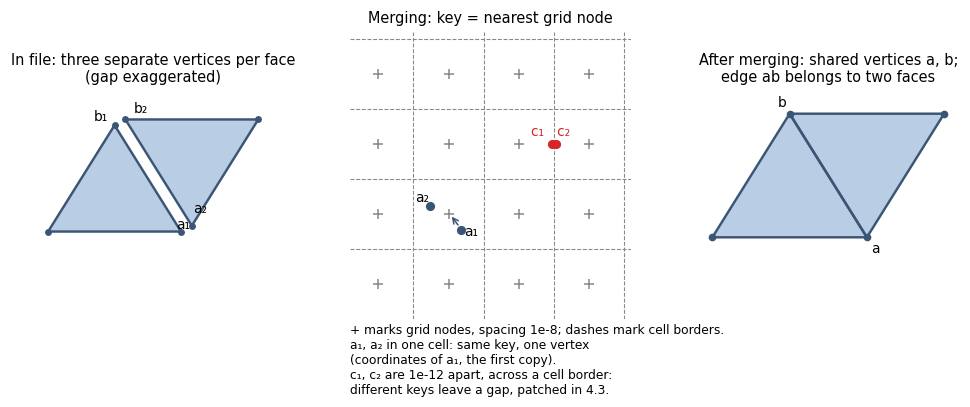

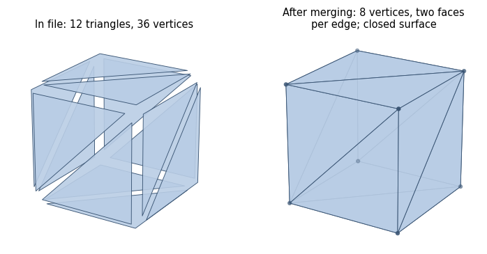

**Rule.** Cleaning consists of four operations (with the same result as
trimesh's `merge_vertices`, `nondegenerate_faces`, `unique_faces`, and
`remove_unreferenced_vertices`):

1. **Vertex merging.** A vertex's key is its nearest grid node at spacing 1e-8.
   Vertices with the same key merge into one, retaining **the exact coordinates
   of the first vertex**. Only the key used to find matches is rounded;
   coordinates are preserved, and subsequent computation uses double precision.
   Merged vertices lie in one grid cell, so each moves by at most the cell
   diagonal, δ = √3·1e-8 ≈ 1.7e-8.
2. **Degenerate faces.** Remove a face if its height above edge v0v1 or edge
   v0v2 is no greater than 1e-8 (needle, sliver, or face with merged vertices;
   an edge shorter than 1e-8 gives height 0).
3. **Duplicate faces.** Of faces with the same vertex set, retain the first,
   **regardless of traversal direction**.
4. Remove **unreferenced vertices**.

**Conditions and results.**

| situation | result |
|---|---|
| vertices in one grid cell (up to δ ≈ 1.7e-8 apart) | one vertex |
| two vertices 1e-12 apart but on opposite sides of a midpoint between grid nodes | not merged: a gap remains and is closed by crack patching ([4.3](#section-4-3)) |
| degenerate face | removed; its hole is an ordinary crack for [4.3](#section-4-3) |
| coincident faces with unequal copy counts in each direction or with opposite directions | retain one copy; volume is **not preserved**. Special cases and subsequent handling are described below |
| no faces remain | `empty_mesh` ("all faces degenerate"), blame: side |

Removing duplicates requires separate handling in these cases:

- A two-sided STL has winding number 0, whereas one retained copy would define
  a body. This representation follows rule [4.8](#section-4-8).
- Oppositely oriented faces coincide on two bodies' contact surface. The body
  is reconstructed from raw input ([4.9](#section-4-9)).
- For a face 2↑1↓ (two copies in one direction and one in the other), ↓ may
  be the first retained copy. The retained copy's orientation is handled in
  [4.5](#section-4-5) and [4.6](#section-4-6).

**Reasoning.**

- **Why grid keys rather than exact double equality.** An STL records a vertex
  as many times as it has adjacent faces. Copies need not agree bit-for-bit:
  an exporter may compute coordinates for different faces with differences
  in the last digits, or write different numbers of digits in ASCII STL.
  Exact equality would not merge such copies, leaving a ~1e-12 gap along
  every seam. The grid can merge them but does not guarantee it in all cases:
  copies across a cell boundary, c₁ and c₂ in the figure, do not merge.
  The remaining gaps are closed by hole patching ([4.3](#section-4-3)) with
  a proven error bound. The 1e-8 spacing and rule match trimesh's
  `merge_vertices`. Exact vertex equality is used where the original record
  matters without modification: on raw input ([4.9](#section-4-9)).
- Merging moves each vertex by at most δ. If adjacent faces already meet at
  bit-for-bit equal vertices (the input is closed as a sum of triangles),
  the body changes by at most the volume of the surface's δ-neighborhood,
  ≈ 3.5e-8 × area. If merging itself stitches the surface together, there is
  no numerical bound. Removing a degenerate face F from a surface closed
  before removal changes the body by at most (π/4)·I(F); an open surface has
  no such estimate. See section [7](#section-7), "Merging and degenerate faces,"
  for the derivation.
- Cleaning retains one copy of duplicate faces. Cases where this changes
  volume are handled by the separate steps listed above.

<details>
<summary>Implementation</summary>

- **Rounding to a grid node.** Choose the nearest node; ties use round-to-even.
- **The merge key** is the rounded float64 value, rather than its int64
  conversion: in numpy, converting a coordinate larger than ≈ 9.2e10 in
  magnitude (2⁶³·1e-8) produces the same value, which would merge all such
  vertices into one (a distant pred would fail instead of giving IoU 0).
  Within int64 range the merging matches trimesh; beyond it, trimesh merges
  such vertices while the metric does not.
- **Vertex order in the degeneracy check.** Height above the third edge v1v2
  is not checked, so the threshold depends on vertex order: for a sliver
  whose v0 lies above the midpoint of the long edge v1v2, both checked heights
  are twice the true height. A face with true height between ½·1e-8 and 1e-8
  survives, but is removed under another vertex order (trimesh behaves the
  same way; the face area is at most ½·1e-8 × length of edge v1v2).

</details>

**Diagnostics.** The side diagnostics record `degenerate_removed` and
`duplicate_removed`. No warning is issued.

<a id="section-4-3"></a>

### 4.3. Hole patching

**Purpose.** After merging, a surface may still have boundary edges—edges
belonging to only one face. They form **loops**, the rims of holes. This step
distinguishes small recording defects from surfaces for which a closed volume
cannot be reconstructed with justification.

For example, if the edges have separated by 1e-7, a hole can be closed with
a small volume change and a proven error estimate. For a box without a lid,
the volume depends substantially on the chosen closing surface. In the first
case the package adds a patch if the error condition holds; in the second,
it returns a failure.

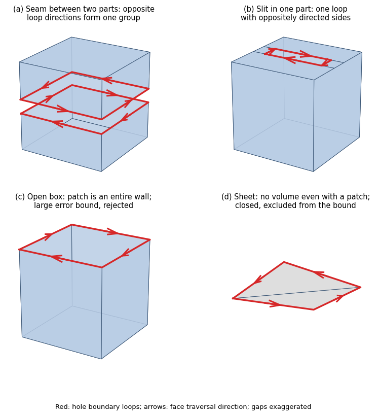

In the figure: (a) a part made of two halves with a separated seam—each half
has its own loop, and the two loops' boundaries run close together in opposite
directions; (b) a slit within one part—one long, narrow loop; (c) a box without
a lid—one rim loop requiring an entire wall to close it; (d) a stray sheet—an
open surface that encloses no volume even with a patch.

**Rule.**

1. **Loop groups.** Loops whose boundaries run close together in opposite
   directions are grouped and closed with a shared patch. Thus, the two seam
   halves in (a) are closed by a strip across the gap rather than by separate
   lids. Close means no farther than 1e-2·d; loops i and j form one group if
   at least 20% of the boundary sample points of at least one loop are this
   close to an oppositely directed edge of the other. Groups are transitively
   closed (A with B and B with C form one group). A loop without such a
   neighbor forms a group of one.
2. **Candidates.** For each group, patches of **all** applicable types are
   constructed. Choose the patch with the smallest proven volume error bound
   (π/4)·I(Z), where Z is the patch and I(Z) is defined under "Reasoning" below.
   If several types apply, compare all their candidates:

   | candidate (`patch` in diagnostics) | construction | construction conditions |
   |---|---|---|
   | fan (`fan`) | triangles from one loop vertex to all edges | one loop—always |
   | minimum-area triangulation (`triangulation`) | triangles on loop vertices minimizing total area | one loop with 4–400 points |
   | fans of all loops (`fans`) | a separate fan for each loop in the group | two or more loops—always |
   | band (`band`) | a strip of triangles between two loops across the gap | exactly two loops, n·m ≤ 4·10⁶ |
   | triangulation with bridges (`bridged triangulation`) | combine several loops into one closed walk, traversing every joining segment in both directions, and triangulate that walk | two or more loops, Σ(loop points + 2) ≤ 400 |

   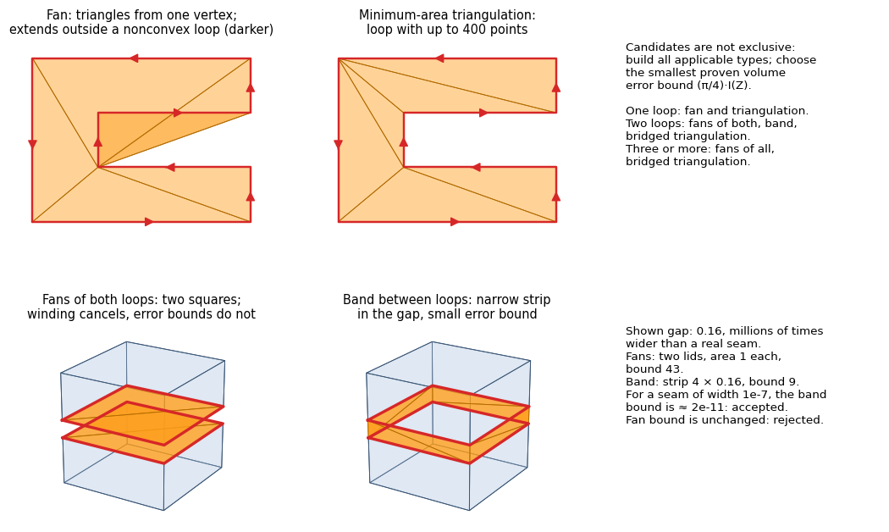

   **How a bridge works.** The next figure shows a patch with an outer boundary
   and an inner cutout. First, connect the nearest vertices of two loops with
   a segment. While walking the outer loop, follow the segment to the inner
   loop, traverse it, and return along the same segment. Then continue the
   outer walk. The result is one closed walk that can be triangulated. The
   bridge is traversed in both directions, so it is absent from the completed
   patch's boundary: only the original loops remain. The bridge itself is a
   line segment and adds neither area nor volume.

   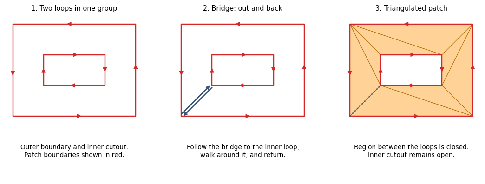

   Here the triangles close the region between the loops while preserving
   the inner cutout. For groups with more loops, bridges are added one at a
   time. This is another candidate: its error bound is compared with those
   of the other applicable patches.

3. **Acceptance.** A patch is **accepted** if both conditions hold:
   - **Small bound:** for each group and for all groups together, the bound
     is no greater than **1e-3 of the volume of the parts being closed**—the
     components with holes together with their patches (unsigned volume:
     take the absolute value for each connected part separately, then sum).
     Sheets (item 4) are excluded from this condition.
   - **Closed chain:** after patching, every edge of the parts being closed
     has equally many faces traversing it in either direction. Otherwise,
     the surface has a defect beyond holes that patching cannot repair
     (figure below). The package then constructs a body from raw input
     ([4.9](#section-4-9)).

   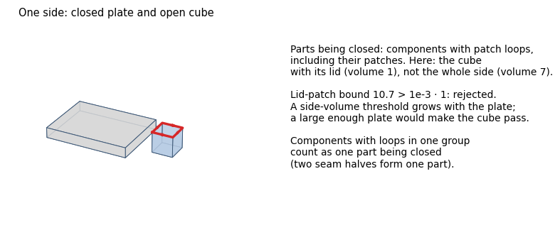

   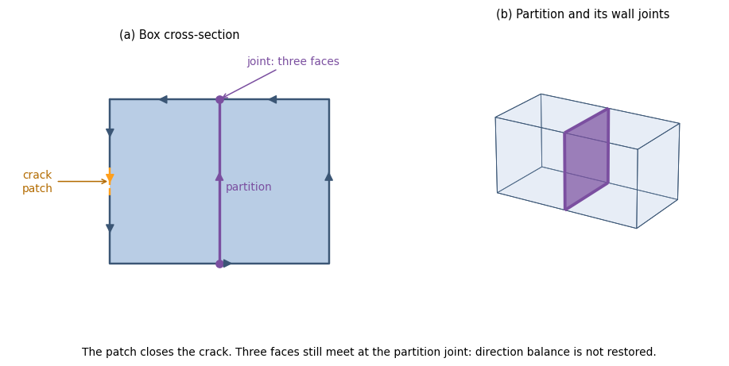

   In cross-section (a), the orange patch joins the crack boundaries. The
   purple partition is a separate defect: where it joins the walls, three
   faces meet, as shown in (b). Their directions cannot cancel: two traverse
   the edge in one direction and one in the other. Closing the crack is
   therefore insufficient. The closed-chain condition fails, the patch is
   not accepted, and [4.9](#section-4-9) follows.

4. **Sheet.** A group whose parts enclose a volume no greater than 1e-9·d³
   even after patching (figure (d) above) is closed but excluded from the
   error bound. The resulting zero-volume shell is removed in [4.5](#section-4-5).
5. **Global acceptance condition.** If any group's patch is not accepted,
   **no loop** on that side is closed.

There is no hole-area threshold. Cracks and large holes follow the same rule:
the decision uses a proven error bound.

**Conditions and results.**

Main outcomes:

| situation | result |
|---|---|
| no holes | no action |
| holes exist and the patch is accepted (crack, seam, slit, sheet) | all loops closed; two warnings: the added face count and area fraction, and the proven bound |
| large bound (box without a lid, cup) | nothing closed; `open_surface` ("… holes left open: the patch's proven volume error is …"), blame: side. Another attempt patches raw-input holes; if the patch is admissible and leaves balanced edges, construct a body ([4.9](#section-4-9), fallback) |
| branching hole boundaries: more than two boundary edges meet at a vertex, so loops cannot be extracted | nothing closed; `open_surface`, blame: side; fallback as in the previous row |
| nonclosed chain (partition figure above) | patches rejected; proceed to raw input ([4.9](#section-4-9), "nonclosed chain"). Possible results: body construction, `open_surface` ("… not closed by the patch …"), or another [4.9](#section-4-9) outcome |

Rare outcomes:

| situation | result |
|---|---|
| a loop lies on one straight line (T-junction: vertex on a neighboring edge, remnant of a removed sliver) | zero-area fan, bound 0, unchanged body; the detector ([4.7](#section-4-7)) sees contact, resolved by exact T-junction splitting—a value in both modes |
| a nonplanar patch passes through neighboring faces | this patch has a large bound and is rejected; if nevertheless accepted, the detector ([4.7](#section-4-7)) finds the intersection like any other |
| a patch fold encloses a small region in reverse (w = −1) | the patch creates an inverted pocket: `inverted_volume` (section [1](#section-1), no threshold); with cavity filling, a pocket inside a part's cavity does not cause failure ([5.5](#section-5-5)) |

**Fallback after failure.** If the patch's error bound is large or hole
boundaries branch, the package also checks raw input ([4.9](#section-4-9))—the
surface without grid merging or duplicate-face removal. First, it attempts
to patch its holes using the same error-bound rule. If the patch is accepted
and all edges are balanced, it checks the oriented assembly's readings and
constructs their common material ([4.9](#section-4-9)). If the patch is not
accepted or balance is not restored, the original failure is retained.

This helps when cleaning itself damaged the boundary. For example, grid
merging can combine nearby vertices of two separate holes, making their
boundary branch. In raw input the vertices differ, so two loops can be
extracted and closed with admissible patches. If the raw input is already
balanced, no patches are needed: this handles face-to-face body contact where
cleaning removed one of the opposite copies. A nonclosed patch chain uses
a different transition to raw input, including an attempt to patch its holes,
as described in [4.9](#section-4-9).

**Reasoning.**

- **What a patch guarantees.** The body of an open surface S is defined even
  with holes: {round(w_S) ≥ 1}—the winding number is fractional only near holes.
  A patch Z changes it by at most (π/4)·I(Z), where
  I(Z) = ∫_Z ∫_Z dA dA′ / |y − y′| depends only on the patch's shape.
  This is small for a narrow strip and large for a wide lid. The estimate
  holds for any constructed Z, so a poor patch produces a large bound and
  failure, rather than an incorrect value. The bound is unchanged when shells
  and their patches are flipped in [4.6](#section-4-6). The derivation is in
  section [7](#section-7), "Patch bound."
- **Groups.** Closing each seam half with its own fan yields two lids spanning
  the part's entire cross-section. Their winding contributions are opposite
  and cancel. However, the error bounds add, so even a narrow seam would fail.
  A band in the gap between the same loops is a narrow strip with a small
  bound (candidate figure: 43 versus 9 for a gap of 0.16; at a gap of 1e-7,
  the band's bound is ≈ 2e-11). Loops with oppositely directed nearby boundaries
  are therefore closed together.
- **Volume of the parts being closed, not of the side.** A side-volume threshold
  would grow when neighboring parts are added: a cube without a lid next to
  a large plate might pass.
- **Absolute value for each part separately.** Taking the absolute value of
  the total would cancel oppositely oriented parts: two open boxes, one
  inverted, would be mistaken for a flat sheet under item 4. Their patch
  would be accepted without considering its error bound. Volume sign is not
  used here because orientation is determined in [4.6](#section-4-6).
- **`trimesh.fill_holes` is not used:** it silently closes any 3–4-edge hole
  of arbitrary size, including a missing box face.

<details>
<summary>Implementation</summary>

- **Loop grouping.** Boundary samples: 5 points per edge (t = 1/6, …, 5/6).
  For each point, take oppositely directed edges among the 32 nearest boundary
  samples (direction cosine < −0.5, excluding its own edge), then the nearest
  of those edges. Credit it to its loop if its distance is no greater than
  1e-2·d. Loops i and j form one group if either meets the 20% threshold;
  groups are closed using union-find.
- **A fan** uses the vertex yielding the smallest area. If areas differ by
  no more than 10⁻⁹, choose the lexicographically smallest point. The same
  point is chosen for loops longer than 2000 points. The patch is therefore
  independent of vertex numbering.
- **Candidate complexity:** minimum-area triangulation is O(n³); a band is
  O(n·m). A bridge joins the closest vertices of the next loop and the polygon
  already assembled; the walk traverses it in both directions.
- **I(Z)** is bounded above over patch triangles: distant pairs use the
  distance between bounding spheres; nearby pairs use the maximum triangle
  potential.

</details>

**Diagnostics.** Warnings are `"<side>: N triangles added to close cracks, covering
X% of its surface; the IoU includes that invented geometry"` and `"<side>: N holes
patched: proven volume error at most B, R of the parts they close"`.
Diagnostics include `boundary_edges_before_fill`, `loop_faces_added`,
`patched_area_frac`, and `holes`:

- `groups`—per group: `loops`, `patch` (candidate type), `faces`, `bound`,
  `parts_volume`, `closed`, `sheet`;
- `loops`, `faces`, `sheets`, `area`, `area_frac`, `bound`, `parts_volume`,
  `ratio`, `worst_ratio`, `closed`, `accepted`.

On failure, `open_edges` is recorded.

<a id="section-4-4"></a>

### 4.4. Splitting into shells

**Purpose.** The surface, closed after patching, is split into shells—connected
components of faces through shared edges. For each shell, determine its signed
divergence-theorem volume and winding consistency: two faces must traverse
their shared edge in opposite directions. This information is used to determine
orientation in [4.6](#section-4-6).

Edges incident to more than two faces need special treatment. They arise,
for example, when bodies touch along an edge or a face.

```
 ┌───────┐
 │   A   │
 └───────●───────┐     Four segments meet at ●; each connects
         │   B   │     to its neighbor across a material wedge:
         └───────┘     A to A, B to B—two shells, both closed
```

(In 2D a face is a segment, and an edge is its endpoint.)

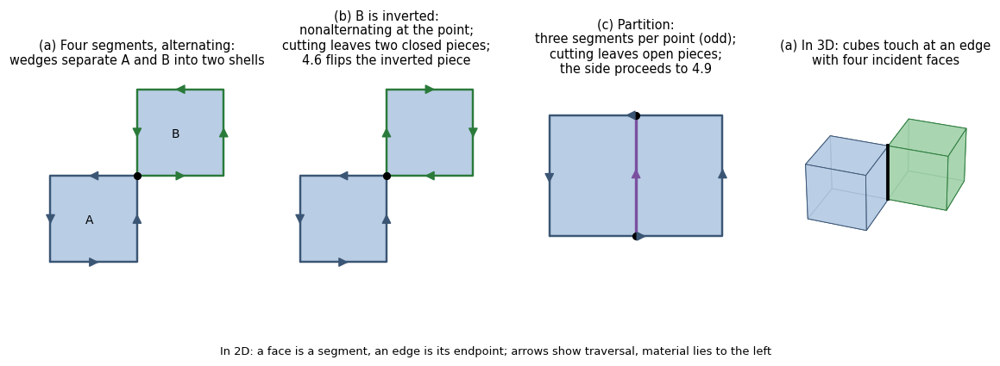

**Rule.**

1. **Two-face edges** are the ordinary case; shells are unambiguous.
2. **Edges with 4, 6, … faces.** Order faces around the edge by angle, then
   connect each face to its neighbor across a material wedge: a face with
   material "after" it connects to the nearest face with material "before"
   it. Each shell gets exactly two faces at that edge and remains closed
   without new faces. Two coplanar faces lying on top of one another
   (face-to-face contact) do not form a wedge, and two bodies remain separate.
3. **A surface that cannot be split this way.** Three cases: an edge has an
   odd face count (figure (c)); the count is even but directions do not
   alternate (figure (b): one body is inverted); or one shell reaches the
   edge twice (is pinched). Cut along all edges with 3+ faces (trimesh's `split()`
   without repair), then check whether the pieces are closed:
   - **All pieces are closed** (possible only when every edge has an even
     face count, as in (b)): the pieces are the shells; the inverted piece
     is flipped in [4.6](#section-4-6).
   - **At least one piece is open:** splitting fails and the package constructs
     the entire side from raw input ([4.9](#section-4-9)). An **odd** incident
     face count always leaves an open piece: every piece receives some faces
     of that edge, and an odd count cannot be divided into pairs; some piece
     has an odd count and is therefore not closed.

**Conditions and results.**

| situation | result |
|---|---|
| every edge has two faces | shells are connected face components |
| an edge has 4, 6, … faces, with alternating directions (a) | shells separated by wedges: A and B are two closed shells |
| nonalternating directions or a pinched shell; all pieces closed after cutting (b) | pieces are the shells, unchanged |
| at least one open piece after cutting—including every odd incident face count (c) | construction from raw input ([4.9](#section-4-9)); transition conditions and possible outcomes below |
| [4.3](#section-4-3) has a nonclosed chain: patches close holes but an edge still has 3 faces or faces traversing it in the same direction | same transition to raw input ([4.9](#section-4-9)) |

The transition to raw input occurs in both modes. The exception is a side
whose unfolding step [4.8](#section-4-8) failed ([4.8](#section-4-8), "Failure
precedence"). Subsequent results follow [4.9](#section-4-9):

- If raw input defines a body, construct it. For example, this handles
  face-to-face body contact where cleaning retained only one of two opposite
  face copies.
- If the raw-input hole patch is rejected, return `open_surface`.
- For partition (c), return `not_manifold` without cavity filling; with filling,
  construct a body from cells.

Inputs with odd incident face counts are therefore not accepted unchanged:
they always have an open piece, and a body is constructed only from raw input
if that input defines one.

**Reasoning.** Wedge splitting changes only how faces are assigned to shells.
The surface winding number and its body are preserved. Open pieces are not
closed: trimesh's `fill_holes` would close them without a threshold or error
estimate, while partition (c) has no hole at all—its pieces are open because
its edges have three faces.

<details>
<summary>Implementation</summary>

- Face order around an edge uses exact CGAL predicates.

</details>

**Diagnostics.** On failure, `nonmanifold_edges` and `split_open` are recorded.
Diagnostics for construction from raw input are listed in [4.9](#section-4-9).
`diagnose_mesh` splits the surface using trimesh repairs: `fill_holes` closes
open pieces. It therefore does not record `split_open`.

<a id="section-4-5"></a>

### 4.5. Removing zero-volume shells

**Purpose.** A zero-volume shell—for example a flat scrap, a two-sided sheet,
or export residue—does not contribute volume but can disrupt Boolean operations.
Such shells are removed. However, a small signed volume does not itself prove
emptiness: it is the integral of w, where a positive contribution +V can cancel
a negative contribution −V.

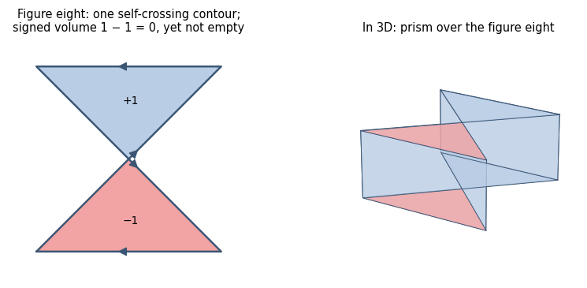

**Ordinary-path rule.** A shell with |V| ≤ 1e-9·d³ is removed **if it is proven
empty**. Signed volume is taken after making shell winding consistent (as in
[4.6](#section-4-6)). Exact emptiness checks run in sequence, starting with
the least expensive conditions:

1. If all vertices share one coordinate, they lie in a plane parallel to a
   coordinate plane and the shell is empty.
2. If the detector ([4.7](#section-4-7)) finds no pairs, the shell's surface is
   proven embedded, with no intersections or contacts. Its winding number w
   has one sign, so |V| is the shell's entire volume. Since it does not exceed
   the threshold, the shell is considered empty. A detector exception proceeds
   to item 3.
3. Otherwise, CGAL constructs an exact arrangement for this shell alone. It
   is considered empty if both the volume of {w ≥ 1} and the pocket volume
   {w ≤ −1} do not exceed the threshold.

**Conditions and results.**

| situation | result |
|---|---|
| \|V\| > 1e-9·d³ | retain shell |
| \|V\| ≤ 1e-9·d³, emptiness proven (items 1–3) | discard; warning `"<side>: N zero-volume shells dropped"` |
| \|V\| ≤ 1e-9·d³, but {w ≥ 1} or the pocket exceeds the threshold (figure eight) | retain (`zero_volume_kept`), continue like any other shell |
| CGAL rejects the shell | emptiness unproven—retain (`zero_volume_kept`) |
| nonorientable shell (winding cannot be made consistent) | not discarded here—emptiness unproven; a subsequent step fails (below) |
| everything discarded | `degenerate_volume` ("flat or self-cancelling surface"), blame: side |

**A nonorientable shell fails at a subsequent step.** Step [4.5](#section-4-5)
only determines whether a shell can be removed without losing volume, and
removes only those proven empty. Signed volume is undefined for a nonorientable
shell (for example, a Klein bottle): faces cannot be flipped to traverse every
edge in opposite directions. Emptiness is therefore unproven, and the shell
remains. There is only one subsequent path: a closed nonorientable surface
in 3D always passes through itself. The detector ([4.7](#section-4-7)) finds
a face pair, so the body is sent to CGAL. Before invoking CGAL, the edge-balance
check ([5.3](#section-5-3), item 1) finds an edge traversed by both faces in
the same direction. The result is `not_manifold`, blame: side
([5.3](#section-5-3)). With the detector disabled
(`check_self_intersection=False`), the body goes to manifold3d and is rejected:
`not_manifold` ([5.2](#section-5-2)). If `exact_booleans` is also enabled, it
goes to CGAL and receives `not_manifold` in the edge-balance check. Such a
side yields no metric value in any mode.

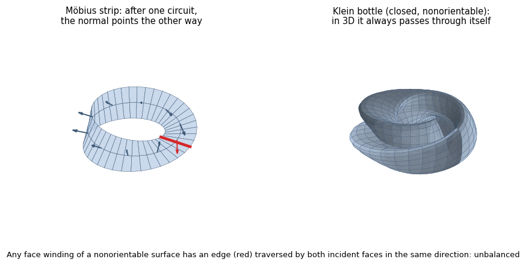

**What happens to a retained figure eight.** Its signed volume is ≈ 0, so that
sign cannot establish whether it points outward or inward. In [4.6](#section-4-6):

- In a group using original orientation ([4.6](#section-4-6), item 2), the
  shell is not flipped and does not become a cavity. It remains a body with
  the traversal direction recorded in the file; the exception is when the
  whole group flips, in which case it flips too.
- In a parity group ([4.6](#section-4-6), item 3), all shells are oriented
  outward using volume sign. For the figure eight, that sign determines
  orientation just as arbitrarily as for the group's other shells.

Then, with the detector enabled, the shell is processed in CGAL (the contour
self-intersects, so a pair will be found): the w = +1 lobe enters the body,
while the w = −1 lobe is an inverted pocket, causing `inverted_volume`
([5.3](#section-5-3); with cavity filling, except for a pocket inside a part's
cavity, [5.5](#section-5-5)). If the −1 lobe lies inside another body on the
same side, the total w there is 0 or greater, hiding the pocket from the total.
Pockets are therefore also sought using each body's own w ([5.1](#section-5-1)).

**Reasoning.**

- Signed volume is computed **after** making winding consistent: a cube with
  flipped faces could otherwise give 0 and be wrongly discarded.
- Discarding shell s changes the body by at most 2·1e-9·d³ (≤ 1.04e-8 in the
  unit cube) per shell, up to volume-computation error. The derivation and
  quantities not bounded are in section [7](#section-7), "Removing zero-volume
  shells."

<details>
<summary>Implementation</summary>

- The detector in item 2 searches for one pair without T-junction splitting.
  This check also runs with `check_self_intersection=False`.

</details>

This removal applies to construction from cleaned shells. If the final body
is constructed from raw input ([4.9](#section-4-9)), original faces participate
again in the readings: small shells are not removed there.

**Ordinary-path diagnostics.** `shells_dropped` is always recorded;
`zero_volume_kept` only when relevant shells exist. When the ordinary-path
result is replaced by the raw audit result, the earlier counter is moved to
`raw_solid.cleaned_shells_dropped`: it describes preliminary cleaning, not
removal from the final material, and no removal warning is emitted.

<a id="section-4-6"></a>

### 4.6. Orientation: bodies and cavities

**Purpose.** Determine which shells specify material and which subtract cavities
from it. An outward-facing shell defines a body. An inward-facing shell inside
it defines a cavity. Another outward-facing shell inside that cavity defines
a separate body there.

Two properties must be distinguished. **Consistent winding** means neighboring
triangles traverse their shared edge in opposite directions. The shell as a
whole may still face outward or inward. If individual faces are reversed
relative to their neighbors, winding is inconsistent, and original face
directions cannot assign body and cavity roles.

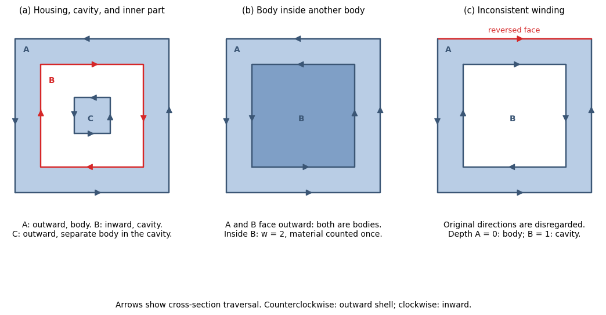

In figure (a), A and C face outward: A defines the housing, C a separate part
inside its cavity. B faces inward and subtracts a cavity from A. In (b), both
shells face outward. Nested B also defines a body: w = 2 inside it, and material
is counted once. In (c), one face of A is reversed relative to its neighbors.
This group's original directions cannot be trusted: roles follow nesting depth.

**Which shells are considered together.** When containment checks are needed,
the package determines which shells lie inside others. Tested pairs with
established containment are linked into **nesting groups**. Links extend
through intermediate shells: in (a), C is inside B and B inside A, so all
three are considered together. A separate neighboring housing forms another
group; an unlinked shell forms a group of one. Containment matters here,
not shared mesh edges.

If the entire side has consistent winding, two outward-facing shells need
not be linked: both already define bodies, as in (b). In that case, only
pairs with at least one inward-facing shell are tested.

Pairs with unresolved containment are also linked into a group. For example,
contact or a thickness too small to place probe points can prevent a check.
The table below describes how such pairs affect roles. Containment checks
are detailed under "Implementation."

Groups ensure that one part's winding error does not alter the reading of
others: the role-assignment method is chosen independently for each group.

**Rule.**

1. **Fast case.** Every shell has consistent winding and all volumes have the
   same sign: do not check containment; all shells are bodies (a negative
   sign means the whole mesh is inside out and is flipped).
2. **Entire group consistent—roles from shell directions.** First check whether
   the whole group is inside out: sum the volumes of its outer shells, those
   not contained in any other. If the sum is negative, flip every shell in
   the group. Then:
   - An outward-facing shell with positive volume is a **body**.
   - An inward-facing shell with volume ≤ 0 inside a body is that body's
     **cavity**. If several bodies contain it, choose the smallest by volume
     as owner.
   - An inward-facing shell inside no body is an **inverted separate body**:
     flip it outward.
   The exception for a shell with canceling positive and negative portions
   is described in [4.5](#section-4-5): its nearly zero total volume does not
   itself make it a cavity. How outer shells are chosen with unresolved
   containment is clarified under "Implementation."
3. **Group contains an inconsistent shell—roles from depth.** Disregard original
   face directions throughout the group. Make shell winding consistent and
   initially orient each shell outward. For each shell, compute its **depth**—the
   number of other shells proven to contain it:
   - Depth 0, 2, 4, …: a **body**, retaining outward orientation.
   - Depth 1, 3, 5, …: a **cavity**, flipped inward.
   Its owner is the smallest containing shell by volume one level above.
   A pair with unresolved containment does not contribute to depth.

**The step's result** is a set of **bodies**. Each consists of an outer shell
and its owned cavity shells.

**Situations and results.**

| situation | result |
|---|---|
| all shells have consistent winding and positive volume | all shells are bodies; containment not checked |
| same, with all volumes negative | entire mesh inside out: flipped; warning `"mesh was inside out; flipped"` |
| consistent winding, mixed signs (a), (b) | direction-based roles (item 2): inward inside a body is a cavity; outward is a body; inward inside no outward shell is an inverted body and is flipped. Warnings: all groups flipped—`"mesh was inside out; flipped"`; a separate body or some groups flipped—`"N inside-out bodies flipped"` (both can occur) |
| a group contains a shell with inconsistent winding (c) | roles by nesting depth (item 3); warning `"inconsistent winding; cavities decided by nesting parity"` |
| containment unresolved: shells touch, point-test results disagree, or probes could not be placed inside the shell | shells join one group. With original orientation, an inward shell is that body's cavity. With depth-based roles, this pair does not contribute to depth. Warning `"N touching shells, containment ambiguous"` |
| in a depth-based group, a shell becomes a cavity (odd depth) with no enclosing body: containment answers contradict each other | `self_intersecting` ("cavity shells have no enclosing body"), blame: side, in either mode |

If shells with unresolved containment actually intersect, subsequent processing
depends on role assignment. With original orientation, the cavity joins its
owner body and the detector finds the intersection inside that body
([4.7](#section-4-7)). With nesting depth, the unresolved pair is ignored. If
both shells are assigned body roles, the detector does not search between
them: their overlap is handled by union ([5.4](#section-5-4)).

**Reasoning.**

- **Not always parity.** Insert (b) lies inside one shell (depth 1) and would
  become a cavity under parity, removing the insert from the housing volume.
  Only direction distinguishes it from cavity (a): a cavity faces inward,
  an insert outward. Parity correctly reads the body inside cavity (a): it
  lies within both housing and cavity, at depth 2. Depth is therefore used
  for roles only where original orientation is unreliable (c).
- **Per group, not per side.** An inconsistent shell of one part does not
  impose parity on another part's insert. A neighboring part does not change
  a group's interpretation: both an entirely inverted hollow box and an
  insert inside its own part behave identically regardless of another part's
  presence and orientation.

<details>
<summary>Implementation: testing containment</summary>

- Probes are selected by offsetting vertices into the shell along vertex
  normals. Ray-intersection parity is undefined on the surface itself, so
  vertex tests would give arbitrary results for touching shells. Use 8 vertices
  and try offsets 1e-3, 1e-4, and 1e-5 of shell size (bounding-box diagonal)
  in order. Choose the first offset putting at least max(2, ⌊n/2⌋) of n points
  inside the shell itself. Here n ≤ 8: take the first eight vertices at a
  stride of max(1, ⌊vertex count / 8⌋).
- Test each point using ray-intersection parity in an "irregular" non-axis-parallel
  direction (axis-aligned rays often hit CAD edges), with tolerance 1e-9
  on barycentric coordinates and, relative to shell size, distance along the
  ray. If membership is unresolved, retry another direction, using at most
  three directions total. If none gives a result, consider the point outside.
- Test a pair only if one shell's bounding box lies within the other's
  (with margin 1e-12) and, when all side shells have consistent winding,
  at least one faces inward: two outward-facing shells are then not linked.
- If a triangle's projection along the ray is degenerate
  (|area| ≤ 1e-9·scale²), point membership is unresolved and the next direction
  is tried.
- The group's **outer shells** (item 2) are shells contained in no others.
  Contact also counts as containment here. If there are no such shells,
  choose those whose containment relationships are all based solely on
  contact. If none exist either, choose one shell with maximum |V|.
- In a consistent group, `ambiguous_containment` counts only pairs of an
  inward-facing shell and an owner body with unresolved containment; in a
  parity group it counts every pair with unresolved containment.

</details>

**Diagnostics.** `solids`, `cavities`: counts of bodies and cavities extracted
from the surface. A cavity enclosed by several overlapping bodies without
its own shell is excluded from these counters but included in `cavities_solid`
([5.4](#section-5-4)). `orientation: "parity"` and `parity_groups` indicate
parity use and the number of groups read by parity; also `flipped_shells`,
`flipped_inverted_mesh`, `ambiguous_containment`.

<a id="section-4-7"></a>

### 4.7. Self-intersection detector

**Purpose.** manifold3d requires an embedded surface without self-intersections
to operate correctly. If a shell passes through itself, it creates double
coverage (w = 2) or an inverted pocket (w = −1). Watertightness and winding
consistency checks, and splitting into shells, do not detect this defect.
The divergence-theorem volume formula and manifold Boolean operations count
these regions with weight w. Union does not help because there is only one
body. The detector determines which bodies can use manifold and which require
exact construction in CGAL.

**Rule.**

1. **What is checked.** Face pairs follow these rules:
   - No shared vertices: triangles intersect (including contact).
   - One shared vertex: one face's opposite edge hits the other face.
   - Shared edge: faces are coplanar and overlap (folded onto each other).
   - Coincident faces (three shared vertices by index or coordinates) are
     skipped.
   - Degenerate faces (three exactly collinear vertices, zero area) are never
     checked.

   Checks use **exact CGAL predicates, without tolerance**. The detector does
   not distinguish contact (face boundaries touching or coplanar faces
   overlapping) from a surface passing through itself. Either result means
   that surface embeddedness is unproven.
2. **Scope.** Each body—outer shell and its cavities—is checked separately.
   Pairs between different bodies represent their overlap, handled by union
   (section [5](#section-5)).
3. **T-junctions before the decision.** A T-junction is a shell vertex lying
   strictly inside an edge of the same shell:

   ```
                 ●
                /|\
               / | \
              / 1|2 \
             /   |   \
            ●────◆────●      Above: triangles 1 and 2;
             \       /      below: triangle 3 with an unsplit upper edge.
              \  3  /       ◆ belongs to faces 1 and 2 but not face 3:
               \   /        the detector sees contact.
                \ /
                 ●
   ```

   This happens when tessellation splits an edge on only one side, or cleaning
   removes a sliver ([4.2](#section-4-2)) and a collinear fan closes its hole
   ([4.3](#section-4-3)). Splitting T-junctions lets such a body use manifold
   without more expensive CGAL construction; the body geometry is unchanged.
   If the detector finds pairs, the package splits an edge at pair-forming
   vertices lying exactly on it. Faces are then retriangulated **without new
   vertices or coordinates**, collinear faces are removed, and the detector
   is called again. In `"fail"` mode, splitting runs only when the first found
   pair can be a T-junction. If splitting worsens a shell's edge condition,
   retain the original shell (details under "Implementation").
4. **Choosing the next action.** The result depends on the side's
   `on_self_intersection` mode. The default is `("exact", "fail")`:
   GT uses `"exact"`, pred uses `"fail"`.

**Situations and results.**

| detector result | `"exact"` (default for GT) | `"fail"` (default for pred) |
|---|---|---|
| no pairs within the body (including after T-junction splitting) | body → manifold | body → manifold |
| a pair within the body | exact body construction in CGAL ([5.3](#section-5-3)) | exact body construction in CGAL and checking each body's winding number in the same arrangement; outcomes below |
| CGAL exception while running the detector | send body to CGAL as if a pair were found; warning `"self-intersection check failed (…); resolved by CGAL"` | `boolean_failed`, blame: engine—no unchecked result is returned, and detector failure does not prove a body defect |

In `"fail"` mode, a detected pair has three possible outcomes:

- A region with w ≥ 2 within one body means it passes through itself:
  `self_intersecting`, blame: side.
- An inverted pocket produces `inverted_volume`. Cavity filling provides
  an exception for a pocket inside a part's cavity ([5.5](#section-5-5)).
- If there is only contact, computation continues and returns a metric value.

A body that both passes through itself and contains a pocket in `"fail"` mode
receives `inverted_volume`: pockets are checked first for shell bodies
([5.3](#section-5-3)). On raw input, agreement among all readings is considered
first: valid and invalid together give `degenerate_volume`; if no valid
readings exist, pockets take precedence ([4.9](#section-4-9)). A region with
w ≥ 2 or a pocket causes failure **at any volume**, without a threshold.

**Disabling the detector.** With `check_self_intersection=False`, all bodies
go to manifold unchecked. Exceptions are the arrangement body in
[4.8](#section-4-8) and `exact_booleans` mode: these still use CGAL.
A self-intersecting body may be counted with weight w or cause an engine
failure. The section [7](#section-7) guarantee for the manifold path no longer
applies; the flag is intended only for diagnostics.

**Reasoning.**

- **Per-side modes.** GT is a dataset reference; its self-intersection is an
  export defect, repaired by constructing the exact body {w ≥ 1}. A prediction
  is model output that should construct a valid body; a surface passing
  through itself is not a body boundary and is a model error. Contact within
  a body (surface pressed against itself, cavity pressed against a wall, or
  line or point contact) defines volume unambiguously and gives a value in
  both modes; `"fail"` rejects only when one body encloses a region two or
  more times. Overlap of two different bodies (also w = 2) is an assembly,
  not a body passing through itself; union removes it.
- **No threshold.** Even a thin region at rounding scale caused by inaccurate
  tessellation of a valid B-rep fails. The caller remains responsible for
  validating prediction tessellation (B-rep → mesh): the metric does not
  reconstruct original intent from a mesh.
- **Pairs only within a body.** For a side with 30 overlapping copies of one
  body, there are 12.8 million between-body pairs, and union already removes
  their overlap.
- **T-junction splitting preserves the metric.** The surface as a sum of
  oriented triangles is unchanged: face pieces cover exactly that face with
  its orientation, and a collinear face has no area. The winding number at
  every point off the surface is therefore unchanged, as are body, volume,
  and verdict in any mode (self-passage still produces pairs and failure
  in `"fail"`), with no warning.

<details>
<summary>Implementation</summary>

- **Candidates** are face bounding-box intersections (CGAL
  `box_self_intersection_d`); degenerate faces receive no bounding box.
- **T-junction splitting, step by step:**
  1. Candidate vertices of one face in each pair are tested against the other
     face's edges; a T-junction producing no pair does not affect the detector
     result. Add every exactly collinear face from all shells of that body
     (not only paired faces): its middle vertex lies on its long edge.
     A vertex on an edge of another shell of the same body is not split
     (shells are not merged; contact remains).
  2. Test vertex-on-edge membership **exactly**: float64 coordinates are
     rational numbers, so cross products and segment parameters are computed
     with rational arithmetic (`fractions.Fraction`). Floating-point comparison
     with any tolerance is insufficient: a point one rounding unit off the
     line is not a T-junction. A float filter only selects candidates:
     |e × w| ≤ 1e-9·|e|·|w| and segment parameter in (−1e-9, 1 + 1e-9)
     (e is the edge, w goes from its start to the vertex; cross-product rounding
     is of order 1e-15·|e|·|w|, so the filter loses no exact matches).
  3. Split each such edge at the vertices found in steps 1–2 (not every vertex
     on it); retriangulate incident faces using their vertices and edge points.
     An exactly collinear face (a fan face on a collinear crack) is discarded,
     and its middle vertex is placed on its neighbor's long edge. A face
     that cannot be retriangulated remains intact and is caught by step 4.
  4. Restore a shell if splitting increased its number of unbalanced edges
     or edges incident to other than two faces. This happens when a vertex
     on an edge is already connected to an endpoint by a two-face edge
     (two sheets touch along that segment): splitting would create a four-face
     edge that must not be sent to manifold. The body with its pairs goes
     to CGAL, just as without splitting.
  5. Recompute the body's pairs on the split shells. If none remain, send
     the body to manifold. If genuine contact or an adjacent intersection
     leaves pairs, construct the body in CGAL from the split surface.

  If any step after the detector's first call fails—the full call, splitting,
  or pair recomputation—restore the body's original shells. Decide using
  the original pairs, so the status matches the status without splitting
  (`t_junction_error`).
- **`"fail"` and the first pair.** In `"fail"`, the detector first searches
  for one pair; all pairs (splitting candidates) are sought only if that
  pair may be a T-junction pair (one face's vertex lies exactly on the other's
  edge; a collinear face cannot appear in a pair because it has no bounding
  box). Otherwise the body goes to CGAL as without splitting. A body without
  pairs needs no extra computation. With multiple detector threads, pair
  discovery order depends on timing. Engine choice is independent of that
  order: a body with only T-junction pairs yields such a pair under any choice,
  and one with other pairs goes to CGAL with or without splitting. However,
  splitting counters (`t_junctions_split`, `collinear_faces_removed`) and the
  triangulation of CGAL input do depend on it; float64-rounded output may
  differ in its last bits.

</details>

**Diagnostics.**

- `self_intersection_checked` (`True`: checked; `False`: not run; `None`:
  exception), `crossing_pairs_internal` (pairs after T-junction splitting),
  `unchecked_bodies`, `detector_error`.
- In `"fail"`, one pair per body suffices and the detector stops at the first:
  the side's `crossing_pairs_internal` and `resolved.crossing_pairs` report
  the number of bodies with pairs, not the pair count. In `"exact"`, they
  report the complete pair count after T-junction splitting; `diagnose_mesh`
  counts pairs without splitting, so its `crossing_pairs_internal` can be larger.
- `t_junctions_split` (vertex placements on edges) and `collinear_faces_removed`
  (discarded collinear faces); `t_junction_splits_undone` (shells restored by
  splitting step 4) and `t_junction_error` (failure after the first detector
  call: body shells retain their original form and that body's counters are
  not recorded). The latter two keys exist only for the corresponding events.
  Splitting keys are absent with `check_self_intersection=False`, for a side
  constructed from raw input ([4.9](#section-4-9)), for failure before the
  detector, and for bodies (`*.body.ply`) from older versions—use `.get`.
- In `"fail"`: `self_overlap_bodies`, `self_overlap_volume` (in `resolved`
  and in failure: number of bodies winding two or more times and that region's
  volume).

**Special inputs.** The next two steps apply only under specific conditions.
Unfolding shells recorded twice ([4.8](#section-4-8)) runs if cleaning found
duplicate faces. If unfolding closes a copy or removes a sheet, the side
passes through [4.2](#section-4-2)–[4.7](#section-4-7) again. Construction from
the raw surface ([4.9](#section-4-9)) follows a cleaning or splitting failure.

<a id="section-4-8"></a>
### 4.8. Unwrapping shells written twice

**Purpose.** In a two-sided STL, each face is written twice, in two opposite
directions. This format is used when exporting a surface for viewing. The
contributions of the two copies to the winding number cancel: w = 0 everywhere,
so the rule in section [1](#section-1) does not identify a volumetric body.
Nevertheless, a single copy of the surface may bound a body. This step
recovers it according to the interpretation rules for two-sided records.

```
    one-sided record             two-sided record
   ┌───←───┐                     ┌───⇄───┐
   │       │                     │       │
   ↓  w=1  ↑                     ⇅  w=0  ⇅
   │       │                     │       │
   └───→───┘                     └───⇄───┘
```

An assembly can also be recorded two-sided. A face along which two bodies
touch with identical triangulation is then written four times: one pair of
opposite copies from each body:

```
 ┌───────┬───────┐     outer faces — k = 1: one copy in each direction
 │   A   ║   B   │     ║ — contact face, k = 2: one pair from A and one from B
 └───────┴───────┘
```

Here and below, k is the number of records of a face in each of the two directions.

**When this applies.** This step runs if cleanup ([4.2](#section-4-2)) found
duplicate faces. A shell written twice cannot exist without them, so this
preliminary check only reduces computation and does not change the rule.
Duplicate faces may also occur without a two-sided shell, for example where
bodies recorded one-sided touch. In that case, this step does not change the
surface.

**What counts as a shell written twice.** An edge-connected component of faces
in which:

- each set of coincident faces (the same set of vertices) is written k times
  in one direction and k times in the other: k = 1 for an ordinary body face,
  k = 2 for a contact face between two bodies of a two-sided assembly;
- no edge belongs to a face outside such sets (degenerate faces from
  [4.2](#section-4-2) are disregarded).

Opposite pairs sharing an edge with another face do not qualify: this is
contact between bodies recorded one-sided (handled by [4.9](#section-4-9)).

**Rule.**

1. **One copy.** Closure of the component is checked using one copy: one face
   is taken from each set with odd k, and none from sets with even k (a contact
   face between two bodies lies inside their union). For the A|B assembly
   above, the copy is the outer contour of A ∪ B, without ║.
2. **Holes in the copy** are closed using the side's hole-patching rule
   ([4.3](#section-4-3)), with the same guarantee: a patch is accepted if its
   proven bound (π/4)·I(Z) is at most 1e-3 of the volume of the parts of the
   copy being closed. There is no area threshold. If it is not accepted, no
   other methods of closing the copy are used.
3. **Interpreting a closed copy.** The package treats it as the boundary of a
   volumetric body, rather than a closed surface of zero thickness. The mesh
   itself cannot distinguish these alternatives, so this interpretation is a
   convention: a closed surface of zero thickness has no volume on its own.
   All closed components of the side written twice jointly cut space into
   cells, and the body consists of **all bounded cells**. Its boundary replaces
   these components, and the whole side is prepared again: this joins it with
   the side's other bodies, which are recorded one-sided.
4. **A cell that may be a cavity.** A two-sided record does not say what is
   inside an inner contour: empty space (the hollow square in the figure
   below) or material (a square inside a square) — their records are identical.
   For each bounded cell, sufficient condition (a) or (b) from “Rationale” is
   checked. If it holds, the cell is filled under every interpretation of the
   record. Otherwise, this is a cell that may be a cavity, and:
   - with cavity filling (`fill_cavities`), the cell is included in the body:
     filling a cavity and retaining material produce the same result;
   - without filling, the cell is included in the body if the total volume of
     such cells is at most 1e-6 of the side body's volume (the volume error is
     at most this fraction); otherwise, the result is `degenerate_volume`.
5. **An open copy that rule 2 did not close.** Only one question is addressed
   here: is this a zero-thickness sheet or a body with a hole? To answer it,
   the copy is closed with a **trial** patch: fans over all holes, without an
   error estimate:
   - if the trial patch closes the copy and the enclosed volume is at most
     1e-9·d³, this is a two-sided sheet: no interpretation assigns it volume,
     and both copies are discarded;
   - otherwise (it encloses volume or does not close), the result is
     `open_surface` (unless repeated preparation has its own failure; see
     “Failure precedence” below).

   No error estimate is needed here: the trial patch is **never included in
   the final body**. If the copy is classified as a sheet, the patch is
   discarded with it; otherwise, a failure is returned. The trial patch serves
   only to distinguish a sheet from a surface that encloses volume.

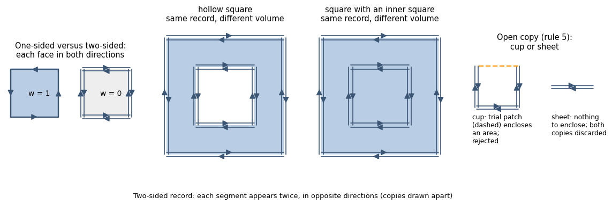

**Cases and outcomes.**

| case | outcome |
|---|---|
| the copy is closed, and filling of every bounded cell is proven | the body consists of all bounded cells |
| some cells may be cavities, with cavity filling | the body consists of all bounded cells; warning |
| the same without filling, their volume ≤ 1e-6 of the side body's volume | the body consists of all bounded cells; warning (relative volume error ≤ 1e-6) |
| the same without filling, their volume > 1e-6 of the side body's volume | `degenerate_volume` failure (“… may be a cavity or a body inside a body …”), blamed on the side |
| an exception occurs during cell decomposition | `boolean_failed` failure, blamed on the engine |
| the copy is open; patching all holes closes it and encloses volume ≤ 1e-9·d³ (d is the side's bounding-box diagonal, threshold from [4.5](#section-4-5)) | two-sided sheet: both copies are discarded and the side is prepared again |
| the copy is open and is not a sheet: trial closure of all holes encloses volume above the threshold, or a branching boundary prevents closure | `open_surface` failure (“shell(s) written twice stay open: their holes are not closed by a patch of proven volume error within 1e-3 of the parts”), blamed on the side. The decision is made from the copy, even if the hole-patching rule for the whole side ([4.3](#section-4-3)) would allow closing the hole |

**Failure precedence.** Failure of cell decomposition always produces
`boolean_failed`, regardless of the result of repeated preparation. In other
cases, the result of repeated preparation is considered first. If it fails,
that failure is retained. If the body is built successfully, open copies are
checked first, then cells that may be cavities; each of these checks may
return its own failure.

Construction from raw input ([4.9](#section-4-9)) is not used if cell
decomposition failed, an open copy remains, or possible cavities above the
volume tolerance were found without filling. This restriction applies in
every mode, regardless of which failure status was retained. The reason is
that the winding number of a two-sided component is 0: construction from raw
input would lose it.

**Rationale.** For each face, a two-sided record retains only k: both
directions occur equally, so orientation conveys no information about the
interior. This is insufficient to distinguish a cavity from a body inside a
body (the second and third squares in the figure above). Both use the same
segments, with k = 1 on both contours: the records are identical but the
volumes differ. A one-sided record distinguishes them by the orientation of
the inner contour (section [1](#section-1)).

This leads to the rule (proofs are in section [7](#section-7), “Two-sided
records: what they determine”):

- **The filled body is always determined.** An empty bounded cell is always
  a cavity: a face between two empty cells would not be recorded. Therefore,
  the body with filled cavities consists of all bounded cells, with any
  duplicates, contacts, and overlaps. With `fill_cavities`, this holds for any
  collection of bodies recorded this way.
- **Without filling, a cell's occupancy must be proven.** A cell is filled
  for every collection of bodies if (a) the sum of k along a path from the
  exterior to it is odd, or (b) it has a face with k greater than the
  k-distance from the exterior to the neighbor across that face. In the A|B
  assembly, every cell has an outer face with k = 1 > 0, satisfying (b). In
  the inner square above, neither (a) nor (b) holds: this is exactly a cell
  that may be a cavity. The condition is sufficient: it may cause an
  unnecessary failure, but not an incorrect number.
- **The 1e-6 tolerance.** The two-sided record of two overlapping bodies A
  and B is identical to the record of A △ B: the overlap sliver is read as a
  cell that may be a cavity. Failing in this case would exclude the whole part
  from evaluation because of volume ambiguity at the rounding scale.
- **An open copy is a failure rather than a sheet.** A zero-thickness sheet
  and a body with a hole are indistinguishable in the record. The latter
  occurred in the datasets: discarding the “sheet” left only a small separate
  shell from the part.
- A component inside a body recorded one-sided becomes a body inside a body
  after repeated preparation, rather than a cavity (the boundary of its cells
  points outward): their union has the same volume as the outer body alone.

<details>
<summary>Implementation</summary>

- **Coincident vertices.** Vertices are merged on a 1e-8 grid, as in cleanup
  ([4.2](#section-4-2)). A reverse record with noise in the 12th digit is
  therefore recognized as a copy. Exact-coordinate lookup would miss such a
  copy; after cleanup only one record might remain, silently treating a hollow
  part as solid. The exception is the same as for cleanup: if noise moves a
  coordinate across the midpoint between grid nodes, the vertices are not
  merged.
- **Support.** If the copy is empty (k is even everywhere: a body written
  twice) or does not close, and the component has sets with even k, closure is
  checked using one face from each set.
- **Patching the copy.** The copy's winding is first made consistent. It
  contains one face from each set regardless of the original direction,
  whereas hole loops and the patch chain are defined by face directions.
  Choosing either consistent orientation does not affect the result: the
  patch is oriented opposite to the loops, and the parts' volumes are taken
  unsigned. Patching a flat sheet (a part with no volume, [4.3](#section-4-3),
  item 4) does not count as closing the copy; the sheet is handled by rule 5.
  Copy patches have their own warnings (section [9](#section-9)). The copy is
  already closed during repeated preparation, so the side's overall patch
  counter does not include these patches.
- **Patch parity in decomposition.** Cell decomposition accounts for record
  parity, so a patch's parity must match that of the surrounding faces. If
  every set in the component is recorded an even number of times in each
  direction, the patch is included twice in each direction; otherwise, once
  in each direction. A single record of the patch for a body written twice
  would be inconsistent with the surrounding faces, and the cell's occupancy
  would be treated as undetermined.
- **Cutting.** Triangles cut space with edge wedges in angular order, as in
  [4.4](#section-4-4); the body boundary is the boundary of the exterior cell.
  If another cleanup would change the cell surface (rounded cut vertices
  produce slivers, duplicates, or boundary edges), it is passed as a separate
  body directly to CGAL, without repeated cleanup and without the detector
  from [4.7](#section-4-7) ([5.3](#section-5-3)).
- **Inconsistent parity.** If the cut record is not entirely two-sided or
  the cell parities are inconsistent with it, filling is not proven for any
  cell: all bounded cells are cells that may be cavities.

</details>

**Diagnostics.** Fields in `diagnostics[side]["doubled_shells"]`:

- `closed`, `open`, `sheets`: counts of closed, open, and discarded flat
  copies; `contact_faces`: faces with even k across all detected components
  (contact faces in assemblies; for a body written twice, all its faces);
- `loop_faces_added`: faces in copy patches; `patched_area_frac`: their area
  as a fraction of the copies' area before patching; `holes`: a list with one
  entry per patched copy, using the same keys as the side's `holes`
  ([4.3](#section-4-3): `groups`, `loops`, `faces`, `bound`, `parts_volume`,
  `worst_ratio`, …);
- `cells`: number of bounded cells; `ambiguous_cells`, `ambiguous_volume`:
  cells that may be cavities and their volume; `ambiguous_accepted`: accepted
  as part of the body under the 1e-6 tolerance;
- `cut_vertices: True`: the cell surface was built in CGAL without repeated
  cleanup; `cells_error`: cutting failed.

`faces_raw` and `vertices_raw` describe the input before unwrapping; other
diagnostic fields refer to the unwrapped side. Warnings:

- about copy patches: “… triangles added to close cracks in shells written
  twice, covering X% of their surface …” and “… N holes patched in shells written
  twice: proven volume error at most B, R of the parts they close” (B is the
  sum of the copies' bounds, R is the largest ratio);
- about cells accepted into the body: “… cells enclosed by shells written
  twice may be cavities; taken as solid …”, under the tolerance or filling.

<a id="section-4-9"></a>

### 4.9. Body from raw input

**Purpose.** Determine material from the original oriented record, retaining
duplicate faces that cleanup removes. At edges with four or more faces, a
single mesh may allow several ways of assembling shells. An inner shell may
belong to one body or to an assembly of bodies. The package checks all
interpretations specified below and returns a number only if they agree on
both validity and material.

An example is two bodies touching along a face with identical triangulation.
The contact surface is recorded twice in the file: once from each body, in
opposite directions. Together these copies define a correct body. Cleanup
([4.2](#section-4-2)) retains one copy. Contact edges then have an odd number
of faces, and construction from shells fails with `not_manifold` or
`open_surface`. Returning to the original faces preserves the body.

```
 raw input: two squares             after cleanup
 touching along a side
 ┌───────┬───────┐                   ┌───────┬───────┐
 │       ↑↓      │  two opposite     │       ↑       │  one copy: three
 │   A   ↑↓  B   │  copies on the    │   A   ↑   B   │  segments at each end
 │       ↑↓      │  shared side,     │       ↑       │  of the shared side;
 └───────┴───────┘  w = 1 in A and B └───────┴───────┘  shells cannot be resolved
```

(In the two-dimensional diagram, a face is shown as a segment and an edge
as its endpoint.) The two opposite copies of the shared face add no material:
their winding-number contributions cancel. However, this cancellation is
insufficient for more complex assemblies. For example, a cavity of one body
must not remove material from a neighboring body, whereas a cavity of the
whole assembly must be subtracted after its parts are united. Applying
{w ≥ 1} to the global sum of the original STL without resolving cavity owners
is therefore invalid.

**What “raw input” means here.** The original side after unwrapping
[4.8](#section-4-8), if performed. Vertices are merged only when their
coordinates are exactly equal, without grid merging; faces with coincident
vertices are removed, while duplicate faces are retained. The ordinary
path's removal of small shells ([4.5](#section-4-5)) does not carry over to raw
input: every interpretation retains all its faces, including those of a shell
discarded by preliminary cleanup. If there are no boundary edges, the input
itself is used unchanged.

**When the package uses raw input.** There are three reasons for this
transition. They are the same for `"exact"` and `"fail"`, but differ in whether
the package first attempts to close holes:

| reason for the transition | attempt to patch holes in raw input | what happens with unbalanced edges |
|---|---|---|
| splitting left open pieces ([4.4](#section-4-4)) | closed under rule [4.3](#section-4-3) | wall: rule 3 below |
| hole patching [4.3](#section-4-3) did not close the chain (`open_surface` failure) | closed under rule [4.3](#section-4-3) | wall: rule 3 below |
| other `open_surface` / `not_manifold` failures after preparation (**fallback path**) | closed under rule [4.3](#section-4-3), then balance is checked | the original failure is retained, including with cavity filling |

In the first two cases, the result is final: the fallback path is not applied
afterward. If unwrapping [4.8](#section-4-8) fails, construction from raw input
is unavailable in all three cases ([4.8](#section-4-8), “Failure precedence”).

The analysis is also used to **check the ordinary path**: a balanced original
surface with edges incident to multiple faces, or requiring assignment of
cavity owners, is checked even after successful cleanup. Cleanup accepting
one interpretation does not eliminate ambiguity in the original record. The
ordinary repair of an entirely inverted shell is retained; this does not mean
that any negative interpretation of a raw assembly may be arbitrarily flipped.

**How the body is built.**

1. **Close holes.** All three rows of the table apply patching rule
   [4.3](#section-4-3), including its error bound. A crack counts as a hole,
   not a wall. If a patch is rejected, the first two transitions return
   `open_surface`, while the fallback path retains the original failure. In
   particular, a hole in the same component as a wall is not closed: the wall
   retains edges with an odd number of faces, so the patch does not close the
   chain.
2. **Check edge balance and analyze the balanced surface.** An edge is
   balanced if as many incident faces traverse it in one direction as in the
   other. An ordinary pair of faces remains connected; at an edge with four,
   six, or more faces, all pairings of opposite traversals are enumerated.
   Every face retains its direction and multiplicity. The union of all faces
   connected by at least one shared edge is not assumed to be the only
   possible body.

   An **interpretation** consists of the selected connections and owners of
   negative shells. For every resulting shell, its per-cell winding number
   is computed in one exact CGAL decomposition. Then:
   - a shell with a positive region defines a body; its own negative region
     remains a pocket of that body;
   - for a shell without a positive region, each connected volumetric negative
     region is assigned its own owner;
   - if a region is entirely covered by one positive body, a minimal containing
     owner is selected: a body whose support {w ≥ 1} does not contain a strictly
     smaller suitable support. All incomparable minimal alternatives are
     checked;
   - if there is no single owner, inclusion-minimal sets of positive bodies
     whose union covers the whole region are enumerated. This is an assembly
     cavity rather than an independent cut from each member.

   Assembly owners sharing members, with neither set contained in the other,
   are merged. Merging repeats until stable. Nested sets retain their
   hierarchy: child bodies' material is united first, then the assembly's own
   cavities are subtracted. A child body's already-subtracted cavity is not
   subtracted from its neighbors.

   Every interpretation is checked for pockets and, in `"fail"` with
   self-intersection checking enabled, for regions with w ≥ 2 **inside a single
   body**. `"exact"` allows such self-overlap and counts it once. Overlap of
   independent bodies is allowed in both modes.

   With `fill_cavities=True`, the effect of filling is considered in every
   interpretation: a pocket entirely inside a closed cavity is allowed,
   whereas a pocket open to the exterior remains invalid. Filling does not
   permit a body to pass through itself in `"fail"`. The **filled material**
   of each interpretation is compared, rather than the result of filling one
   previously selected alternative.

   Only nonempty material identical across all interpretations is accepted,
   and **all interpretations must be valid**. A valid alternative alongside
   an invalid one is the same kind of ambiguity as two different materials:
   `degenerate_volume`. If no valid interpretations exist, the established
   defect determines the failure (`inverted_volume` or `self_intersecting`).
   There is no volume tolerance for ambiguity, including after filling.
3. **If edges remain unbalanced, apply the wall rule for the first two
   transitions.** In this case, the fallback path retains the original
   failure, even with cavity filling enabled. An example is a one-sided
   partition inside a closed surface. The winding number near it is
   fractional; the rule {w ≥ 1} is not used here. Without cavity filling, the
   original failure is retained. With filling, the package treats **all
   bounded cells** of the decomposition as material: all regions cut off from
   the exterior by the surface.

   The decomposition includes the raw-input patches accepted in item 1,
   each in both directions. If raw input has no holes, no patches are added.
   If a patch was not accepted, execution already failed in item 1. In
   `"fail"` with the detector enabled, a different check is performed before
   construction: any detector pair ([4.7](#section-4-7)) **inside one component
   of the cleaned surface** causes failure.

**Cases and outcomes: balanced edges (rule 2).**

| case | outcome |
|---|---|
| CGAL error or enumeration/memory limit exceeded | `boolean_failed`, blamed on the engine; no previously found alternative is selected |
| both valid and invalid interpretations exist | `degenerate_volume`, blamed on the side |
| valid interpretations define different material | `degenerate_volume`, blamed on the side |
| no valid interpretations exist and an inverted pocket is established | `inverted_volume`, blamed on the side; with filling, a pocket in a closed cavity is removed first |
| no valid interpretations exist and a body passing through itself is established in `"fail"` | `self_intersecting`, blamed on the side |
| interpretations yield one empty or too-small body (≤ 1e-9·d³) | the failure with which the side entered this step |
| all interpretations are valid and define one material | body accepted; `raw_solid.assembly` describes the interpretation check |

If no valid interpretations exist and both defects are found, the pocket
takes precedence. The presence of at least one valid alternative makes the
mixed case ambiguous, rather than a pocket or self-overlap failure.

**Cases and outcomes: wall (rule 3).**

| case | outcome |
|---|---|
| without cavity filling | the failure with which the side entered this step (`not_manifold` for open pieces, `open_surface` for an unclosed patch chain) |
| in `"fail"`: a detector pair inside one component | `self_intersecting` failure, blamed on the side |
| in `"fail"`: an exception occurs while running the detector | `boolean_failed` failure, blamed on the engine |
| an exception occurs during cell decomposition | `boolean_failed` failure, blamed on the engine |
| a triangle on the exterior cell boundary points inward (material outside) | `inverted_volume` failure, blamed on the side |
| constructing the body from the exterior cell boundary raises a CGAL exception or yields an empty body | the preceding table determines the outcome; here material is defined by the boundary of the selected cells, not by the original wall's fractional w |
| all checks pass | body accepted; warning `"<side>: edges of 3+ faces with an unbalanced raw surface (a wall inside a body or the boundary of a void); every enclosed cell taken as solid (fill_cavities), built by CGAL"` |

**Rationale.**

- **Raw rather than cleaned input.** Cleanup retains one copy of an opposite
  pair ([4.2](#section-4-2)): this repairs two-sided STL and cracks, but breaks
  face contact between bodies. In this case, the original surface preserves
  the required information: its winding number is integer without further
  changes. On the balanced path, the pair detector ([4.7](#section-4-7)) does
  not select an interpretation: CGAL cuts intersections exactly, and validity
  is determined from body fields in every interpretation.
- **Bodies rather than a global sum or a connected component.** Opposite
  contact faces can connect several independent bodies into one mesh
  component. The reverse problem is a cavity in a separate component whose
  pocket is hidden by a neighbor's material in the global sum. Enumerating
  connections and owners checks both situations. A failing interpretation
  cannot be discarded in favor of a convenient valid one: the input does not
  specify that choice.
- **An assembly cavity is subtracted after union.** If a negative region is
  entirely contained in one minimal body, it belongs to that body. If only a
  union of several bodies contains it, the cut belongs to that union. A shared
  cavity is subtracted once; individual parts' cavities do not remove material
  from an independent neighbor.
- **Wall.** A partition inside a body and the boundary of empty space have
  identical records:

  ```
   ┌───────────────┐        ┌───────────────┐
   │▓▓▓▓▓▓▓│▓▓▓▓▓▓▓│        │▓▓▓▓▓▓▓│       │
   │▓▓▓▓▓▓▓│▓▓▓▓▓▓▓│        │▓▓▓▓▓▓▓│ empty │
   └───────────────┘        └───────────────┘
   partition in a body      boundary of empty space
  ```

  Without filling, one cannot choose between these interpretations, so the
  package returns a failure. With filling, both interpretations yield one
  body: all bounded cells. Since the winding number is inapplicable here to
  detect a body passing through itself, the pair detector is used. A pair
  between different components means overlap of parts. A cavity extending
  beyond its body is detected by an inward-oriented triangle on the exterior
  cell boundary.
- **The fallback path requires balance after patching.** Hole patching may
  restore raw-input balance, so balance is checked after patching. If it is
  not restored, this path does not switch to the wall rule: the initial
  failure is retained.

<details>
<summary>Implementation</summary>

- **Original-face topology.** Vertices are merged by exact coordinate
  equality. This restores STL connectivity when every triangle has three
  separate vertices, without grid merging. Ordinary two-face edges are fixed
  before geometric cutting; at edges with multiple faces, all oriented
  pairwise connections are retained.
- **One exact decomposition.** `RawArrangement` cuts the original triangles
  in exact arithmetic, preserving provenance and multiplicity. Repeated
  requests for w fields of completed shells use the same decomposition.
  Conversion to float64 happens after material selection, not before comparing
  interpretations.
- **Enumeration along the frontier of processed edges.** A state stores face
  groups that have not yet closed; a completed group is replaced by its full
  w field on the decomposition's cells. Identical fields are reused, but shell
  multiplicity is retained: two identical shells remain two contributions.
  Values on zero-volume cells are also preserved, since they may affect
  connectivity of a negative region.
- **Comparing material.** Validity and material equality are checked on cells
  whose nonzero volume is established in exact arithmetic. Zero-volume cells
  form neither self-overlap nor a volumetric difference between materials.
  This check uses neither random points nor a volume tolerance.
- **Certificate for an isolated convex component.** Reducing enumeration on
  this basis is allowed only for a component whose bounding box is strictly
  separated from all others, with a verified convex boundary and a unique
  nonnegative material. Equality of total w is insufficient: a nonisolated
  component can own another component's cavity, and collapsing it would lose
  interpretations.
- **Block-based certificate for all interpretations.** First, groups of faces
  connected by ordinary two-face edges are fixed. For each such block, a
  formal integer potential is computed on the same decomposition. This is a
  linear extension of native label propagation along one unchanged cell tree,
  not the physical winding number of an open surface. The potential of any
  completed group equals the sum of its blocks' potentials, including values
  on zero-volume cells. The sum of all blocks is checked for exact agreement
  with the original input's field.
  If every block is nonnegative on volumetric cells, and the sum in every
  component of the graph of **all** original edges is at most 1, every possible
  group has only values 0/1. No interpretation has negative shells, pockets,
  or self-overlap of individual bodies. All interpretations have one material:
  {w of the sum ≥ 1}; it is also valid in `"fail"`. Different components of
  this graph may overlap without an individual-body defect. Filling is
  performed on this same proven material. This proves all interpretations
  rather than selecting one alternative.
- **Certificate of a mandatory pocket.** If the sum of w is negative in a
  volumetric cell, a pocket occurs there under every ownership hierarchy: in
  the absence of negative fields, the union of children is no greater than
  their sum, and induction would give a nonnegative root field no greater
  than the negative original sum. Without filling, this proves all
  interpretations invalid. With filling, an additional check constructs an
  upper bound on possible material: the union of cells where at least one
  block potential is positive. If the mandatory pocket remains outside even
  after filling this bound, no interpretation can eliminate it: filling is
  monotone in material on the unchanged void graph, with connectivity through
  shared vertices. In both cases, `inverted_volume` is returned. If the
  sufficient condition does not hold, full enumeration is retained, including
  possible ambiguity.
- **Resource limits.** Up to 500000 original faces, 4096 states, and 100000
  overall search steps; storage for states and full fields is limited to
  512 MiB. A separate native limit is 512 MiB for labeled decomposition data
  (number of cut faces × number of labels × two `int` values). A field request
  uses at most two labels: the group and its complement. These limits do not
  bound all CGAL memory. Exceeding them produces `boolean_failed`, blamed on
  the engine; material from the first interpretation found is not returned.
  Overall runtime is limited by `timeout` (README).
  Computing block potentials also consumes the overall step budget and uses
  at most two native labels per call; limits are not increased. When the
  original sum is nonnegative, the sufficient-certificate check stops as soon
  as a block potential is negative or a component's partial sum exceeds 1.
  Remaining blocks cannot restore its conditions. This switches to full
  enumeration, rather than rejecting the geometry or accepting the body early.

</details>

**Diagnostics.**

- On splitting failure in [4.4](#section-4-4), `nonmanifold_edges` and
  `split_open` are recorded; on failure due to raw-input holes in the first
  two transitions, `raw_holes` is recorded. If a patch is rejected on the
  fallback path, the original failure's diagnostics are retained.
- The `diagnostics[side]["raw_solid"]` field is present only for an accepted
  body and contains `engine`, `refused_as`, `refused_detail`, `faces_out`,
  `probes`, `manifold`, `seconds`, and `assembly`. The nested `assembly`
  describes the interpretation search: `winding_families`, `valid_readings`,
  `invalid_readings`, `assembly_owners`, `search_steps`, `certified_interfaces`,
  `winding_max`. For an accepted body, `invalid_readings` is 0. `winding_max`
  is the maximum global sum of w on volumetric cells; by itself, it does not
  determine material or validity of an individual body.
  `valid_readings` / `invalid_readings` count distinguishable combinations of
  w-field families and owners, not all original half-edge pairings:
  equivalent topological alternatives may be combined. In a successful
  result, all interpretations have been checked. On failure, the counters
  describe alternatives found before the final decision: search may stop
  once ambiguity is established, without traversing the remainder.
  The `assembly.fail_validity` field classifies the source for `"fail"` even
  when construction uses `"exact"`: `"valid"` means no body passes through
  itself in any interpretation; `"ambiguous"` means interpretations accepted
  in `"exact"` include both ones that pass and ones that fail the `"fail"`
  check; `"self_intersecting"` means this passage is found in all of them.
  Classification accounts for the current filling mode; it is not inferred
  from global `winding_max`. In `"fail"` with checking enabled, compatible
  fields `raw_solid.winding_max` and, for a value ≥ 2, `self_overlap_parts: 0`
  are also retained: a body passing through itself has been checked in every
  interpretation, rather than ruled out by the magnitude of total w.
  If construction began after step [4.4](#section-4-4) or [4.3](#section-4-3),
  `rule: "split_open"` is added. If raw input has holes, patch data are also
  recorded: `loop_faces_added` (0 if no patches were added),
  `patched_area_frac`, `holes`. For a body with a wall, `cells_filled` is used
  instead of `raw_solid`. Its `patch_faces` field describes raw-input patches
  considered when checking edge balance; these same patches participate in
  cell decomposition.
- Enumeration metrics are in `raw_solid.assembly`: `frontier_readings`,
  `frontier_peak_states`, `frontier_fixed_blocks`, `frontier_crowded_edges`,
  `frontier_winding_calls`, `frontier_fields`, `frontier_field_bytes`,
  `frontier_storage_sample_peak_bytes`. The last field is the peak at sampled
  storage checks, not the process's peak RSS.
- With a sufficient certificate, instead of uncomputed family,
  interpretation, and frontier counters, `raw_reading_certificate` is recorded
  with `all_readings: true` and proof type `kind`:
  `nonnegative_unit_components`, `negative_total`, or
  `unfillable_negative_total`. The two block-based certificates also retain
  `fixed_blocks`, `edge_components`, and `winding_calls`. Success by
  certificate retains `fail_validity: "valid"` for later use of the source
  classification in Body. On failure, the certificate is directly in the
  side's diagnostics; `inverted_witness: "all_readings_negative_total"`
  denotes a guaranteed portion of the pocket in every interpretation, not
  the complete geometry of all its defects.
- With filling, `assembly` contains `cavities_filled_range` and
  `volume_cavities_range`: the minimum and maximum cavity count and added
  volume across interpretations. One final material does not imply that the
  unfilled alternatives had identical cavities. Compatible fields
  `cavities_filled` and `volume_cavities` contain the maxima. For an eliminated
  pocket, `pocket_filled` and `inverted_cavity_*` are recorded.
- An input accepted by the ordinary path being checked is marked by
  `raw_solid.audited`; its diagnostics may retain cleanup and orientation
  fields. When constructing a raw body directly, these steps are not repeated.
- Failure due to a mix of valid and invalid interpretations records
  `valid_readings`, `invalid_readings`, and `raw_assembly_candidates`.
  Different materials use `raw_assembly_candidates`. These are side-failure
  data, not the nested `raw_solid` of an accepted body. When no valid
  interpretations exist, self-overlap is marked by `raw_winding_max` and
  `self_overlap_parts`; these are not counters for all search alternatives.
- Body-construction failures contain `faces_raw`, `vertices_raw`, and
  `self_intersection_checked`. With `inverted_volume`, `inverted_*` fields are
  also recorded. On the raw path, `inverted_witness: "one_defective_reading"`
  means that `inverted_volume` and `inverted_faces` refer to one specific
  defective interpretation. This is neither the union of pockets from
  different interpretations nor the defect volume of a uniquely selected
  material for the side.

The source of the `faces_raw`/`vertices_raw` counters depends on the outcome:

- On CGAL construction failure, they describe the input passed to CGAL. If
  raw-input patches were added, the surface after vertex merging and its
  patches are counted; otherwise, the original side is counted. For a body
  with a wall, the exterior boundary of the cells is counted.
- If a wall's failure is caused by an inward-oriented triangle of the
  exterior cell, the original side is counted and only `inverted_faces` is
  recorded.
- For an accepted body, the counters always refer to the original side. If
  unwrapping [4.8](#section-4-8) was performed, the original side is also
  counted on failures.

For an empty body, the cleanup failure's status, blame, and diagnostics are
retained. For a wall, “unbalanced edges …” is additionally appended to the
`detail` field. Failures have no `raw_solid` key.

The warning identifies construction from oriented interpretations of the raw
surface, or a check of the ordinary path. The reason for using raw input need
not be face contact: it may, for example, be a shell pinched along an edge or
a cavity belonging to several parts of an assembly.

---

<a id="section-5"></a>

## 5. Constructing the side body

At this stage, the package receives the side's bodies — outer shells with
cavities ([4.6](#section-4-6)) — and the detector result for each body
([4.7](#section-4-7)). It builds the side's unified material, computes its
volume, and chooses a **representation** for subsequent intersection: a
manifold3d mesh or a mesh built in CGAL.

The ordinary path below uses bodies and cavities already assigned. If the
original oriented record allows several connections or cavity owners, the
result is additionally subject to the check of all interpretations in
[4.9](#section-4-9). The global sum of w in the original STL does not replace
this check.

```
 side's bodies
  ├─ body without pairs, no body with pairs in its cluster ─→ manifold (5.2) ─┐
  └─ body requiring CGAL + neighbors ─→ cluster in CGAL (5.1, 5.3) ───────────┤
                                                                          ▼
                                           union of bodies (5.4) → side body
                                                                          │
                                        cavity filling, if requested (5.5)
                                                                          ▼
                                                     pair intersection (6)
```

For exact construction, CGAL uses a space **decomposition** (mesh
arrangement). Triangles divide space into **cells**: connected regions within
each of which the winding number is constant. Cells with w ≥ 1 form the body.

<a id="section-5-1"></a>

### 5.1. Bounding-box clusters

**Purpose.** A body that must be built in CGAL may overlap neighboring bodies.
Their winding numbers add in the overlap region, so such a body cannot be
built separately from its neighbors. For example, inside an inverted pocket
of a neighboring body, the sum is w = 1 − 1 = 0: this region is not material
according to total winding. However, the neighbor's own negative winding
remains evidence of a pocket and causes `inverted_volume` (item 3). With
cavity filling, the failure is waived if the pocket lies inside a cavity.

**Rule.**

1. Bodies are grouped into **clusters** by bounding-box intersection (or
   contact), transitively.
2. **A body requires CGAL** if it has detector pairs ([4.7](#section-4-7)),
   if the detector failed (in `"exact"`), or if it is a cut body from a
   two-sided record ([4.8](#section-4-8), also when the detector is disabled);
   with `exact_booleans`, every body does ([5.6](#section-5-6)). If a cluster
   contains such a body, **the entire cluster** is built in CGAL using one
   decomposition: the body {w ≥ 1} is based on the **sum** of winding numbers
   of all bodies in the cluster. Bodies outside such clusters are built
   individually in manifold ([5.2](#section-5-2)).
3. **Pocket check.** A cluster pocket is a region where w ≤ −1 for the sum
   **or for an individual body**. Bodies for which absence of
   self-intersections and contacts has not been proven are checked
   individually: bodies with detector pairs and unchecked bodies. A body with
   proven embedded has winding number 0 or 1. A cut body from
   [4.8](#section-4-8) is not checked individually: its boundary has winding
   number 1 around every cell. A pocket causes `inverted_volume`
   ([5.3](#section-5-3)), except with filling when it lies inside a cavity of
   the constructed body ([5.5](#section-5-5)). Each body's winding number is
   computed using labels in the same decomposition; no separate CGAL call is
   required.
4. Clusters (and bodies outside them) are built in order of the smallest
   body-shell index in the cluster. Side construction stops at the first
   failure: if CGAL cannot build a body or its result fails the probe-point
   check; if a pocket or a body passing through itself is found
   ([5.3](#section-5-3)); or if manifold rejects a body
   ([5.2](#section-5-2)).

**Outcomes.** The outcomes of constructing an individual cluster are listed
in the table in [5.3](#section-5-3). Cluster processing order determines the
following failure properties:

| case | outcome |
|---|---|
| defects in several clusters | status is the defect of the first cluster in order |
| `inverted_volume` failure | diagnostic `inverted_volume`, `inverted_faces` give the volume and face count of pockets in this cluster only: a lower bound on the side's pocket |

**Rationale.**

- **Individual bodies are also checked for pockets.** Total winding can
  hide one body's pocket inside another:

  ```
   ┌───────────────────────────┐
   │ box, w = 1                │
   │      ●───────────●        │
   │       ╲   +1    ╱         │   +1 lobe: sum 1 + 1 = 2
   │         ╲     ╱           │
   │           ╲ ╱             │   −1 lobe: sum 1 − 1 = 0 —
   │           ╱ ╲             │   the sum describes a box with a recess
   │         ╱     ╲           │
   │       ╱   −1    ╲         │
   │      ●───────────●        │
   └───────────────────────────┘
  ```

  The “figure eight” is a shell with w = +1 and −1 lobes
  ([4.5](#section-4-5)). Neither interpretation of it (the “−1” lobe is a body
  or is empty) makes a recess in the box. A body pocket therefore causes
  failure (without filling) wherever it lies, just as for a separate figure
  eight ([4.5](#section-4-5)).
- **Clusters rather than the whole side in one decomposition:** uniting an
  entire multi-body side in one CGAL call silently lost a separate body.

<a id="section-5-2"></a>

### 5.2. Body in manifold

**Rule.** A body is passed to manifold3d if neither it nor any body in its
cluster requires CGAL ([5.1](#section-5-1)). manifold3d checks that the
received surface is a valid closed 2-manifold.

| case | outcome |
|---|---|
| manifold3d accepts the body | the body is a manifold3d mesh |
| it does not | `not_manifold` failure (“a body is not a valid manifold”), blamed on the side (cracks, pinched edges) |

<details>
<summary>Implementation</summary>

- The body is passed as `Mesh64` (float64): the trimesh wrapper passes
  float32 to manifold3d, producing errors up to 1.3% on a 1e-6 sliver.

</details>

<a id="section-5-3"></a>

### 5.3. Exact body in CGAL

**Purpose.** Computation in manifold3d cannot be relied on for a body with
detector pairs ([4.7](#section-4-7)). CGAL builds such a body; unchecked bodies
and cut bodies from [4.8](#section-4-8) are built the same way
([5.1](#section-5-1)). CGAL constructs {w ≥ 1} exactly for arbitrary
self-intersections. The resulting decomposition also detects an inverted
pocket w ≤ −1 and, in `"fail"`, a shell passing through itself.

**Rule** (in check order).

1. **Balance before CGAL.** First, every edge of the cluster's shells is
   checked to have as many faces traversing it in one direction as in the
   other (as in [4.9](#section-4-9)). Otherwise, CGAL is not called and the
   side fails (status follows the last two rows of the table below).

   **These are not holes.** Shells reach this point after cleanup, patches
   ([4.3](#section-4-3)), and orientation ([4.6](#section-4-6)) — the same ones
   passed to manifold (and the cell surface from [4.8](#section-4-8), balanced
   by construction): by this step, holes have either been closed by a patch
   under [4.3](#section-4-3) (one rule for both engines), or the side has
   already failed or switched to raw input ([4.9](#section-4-9)). There are
   no boundary edges here. An unbalanced edge at this step is an edge whose
   two faces both traverse it in the same direction — evidence of a
   **nonorientable** shell (Klein bottle, figure in [4.5](#section-4-5)): its
   faces cannot be flipped so that every edge has opposite traversals. Such
   a surface has no body: its winding number is not piecewise constant, and
   CGAL will reject it too, but only after a lengthy decomposition.
2. **Decomposition** by all cluster triangles, in **exact rational
   arithmetic**. The winding number w is computed on both sides of every
   face in the decomposition, then two boundaries are extracted:
   - {w ≥ 1}: the body; double coverage is counted once;
   - {w ≤ −1}: pockets; there is no second decomposition. Pocket volume
     (`inverted_volume`, `inverted_cavity_volume`) is the sum over its boundary
     faces in exact decomposition coordinates, rounded once: it is greater
     than 0 for every pocket.
3. **Checking the result with points.** In every cluster body, points are
   sampled just beneath its outer shell (as in [4.6](#section-4-6)). At each
   point, the winding number is computed for the cluster shells passed to
   CGAL — after cleanup, patches, orientation, and T-junction splitting, not
   for the original input (for cell surfaces — two-sided records
   [4.8](#section-4-8), walls with filling [4.9](#section-4-9) — it is computed
   for the constructed cell surface: the input has w = 0 or fractional w).
   A point with w ≥ ½ must lie inside the constructed body, and other points
   outside it. If the check finds a mismatch and the cluster has several
   bodies, the package builds them individually (table below).
4. **Pocket:** a nonempty boundary {w ≤ −1} causes failure at any pocket
   volume (section [1](#section-1)); with cavity filling, except for a pocket
   inside a cavity of the cluster body ([5.5](#section-5-5), checked in the
   same decomposition). The rule is identical in both modes: in `"fail"`, a
   body with detector pairs is also built at this step.
5. **Passing through itself (`"fail"`, detector enabled).** The same
   decomposition computes the winding number of each cluster body with
   detector pairs individually (a body without pairs has w ≤ 1): a nonempty
   {w_body ≥ 2} causes failure, at any volume. w = 2 from overlap of two
   different cluster bodies is not a failure: that is an assembly. A
   decomposition cell of exactly zero volume (between coincident faces cut
   differently; volume is the exact sum of its boundary tetrahedra, as for a
   pocket in a cavity, [5.5](#section-5-5)) does not belong to {w_body ≥ 2}:
   it has no interior. Pockets are checked first.
6. **Representation.** The CGAL body is passed to manifold (`Mesh64`) under
   three conditions: the exact detector ([4.7](#section-4-7)) finds no face
   pairs in the output **rounded** to float64 (detector failure counts as
   pairs); manifold accepts it as a manifold; and volumes agree to 1e-9
   relative. Then manifold computes the pair intersection (method
   `cgal:manifold64`). Otherwise, the side body remains a CGAL mesh: all
   bodies of the side are united in CGAL with the same point check, and CGAL
   computes the pair intersection (method `cgal`).

**Outcomes in check execution order.**

| case | outcome |
|---|---|
| an unbalanced edge | `not_manifold` failure, blamed on the side: the winding number is not piecewise constant |
| CGAL throws an exception | failure (last two rows) |
| point check fails, one body in the cluster | failure (last two rows) |
| point check fails, several bodies | the package builds bodies individually and unites them using the procedure after the table; a repeated mismatch causes failure (last two rows) |
| pocket | `inverted_volume` failure, blamed on the side; with filling, except for a pocket in a cavity ([5.5](#section-5-5)) |
| `"fail"`: {w_body ≥ 2} is nonempty | `self_intersecting` failure, blamed on the side (`self_overlap_bodies`, `self_overlap_volume`) |
| all checks agree, conditions in item 6 hold | the body is a manifold3d mesh; intersection method `cgal:manifold64` |
| all checks agree, conditions in item 6 do not hold | the body remains a CGAL mesh; intersection in CGAL (method `cgal`) |
| CGAL exception or failed point check, the side has edges with 3+ faces | `not_manifold`, blamed on the side: CGAL did not accept its tessellation |
| CGAL exception or failed point check, the side has no edges with 3+ faces | `boolean_failed`, blamed on the engine |

**Reconstruction by individual bodies.** If the initial cluster check fails
and the cluster has several bodies, each body is built in CGAL separately.
The bodies are then united in manifold if it accepts each under the conditions
of item 6; otherwise, union is performed in CGAL. With `exact_booleans`
([5.6](#section-5-6)), union is always performed in CGAL. The resulting body
undergoes the same probe-point check. Pockets and passages through itself are
determined from the first decomposition, rejected by the check, not from the
reconstructed result.

Thus, if a cluster consists of one body, contains a pocket, and fails the
probe-point check, the package returns an engine or tessellation failure
status. Processing does not reach the `inverted_volume` failure.

**Rationale.**

- **Balance before CGAL.** CGAL requires a piecewise-constant winding number
  and discovers a violation only after decomposing all intersections — up to
  30 minutes for large sides.
- **Point check.** Silent loss of a body was observed in CGAL computation, so
  the result is checked against the definition. The check detects loss of a
  body or a portion near its surface, but does not prove result correctness.
- **Detector after rounding.** An exact body may self-intersect after
  rounding to float64: two faces separated by a gap smaller than a float64
  step intersect after their vertices are rounded. This occurs near zero
  (coordinates 3e-17 and 1.5e-16 in a body built from a twisted bar: nearly
  coplanar slivers intersect). manifold3d promises a correct result only for
  a body without self-intersections. Contact of body parts along a face region
  (overlapping coplanar faces) also counts as a pair: manifold does not
  receive such a body, although it is correct — the only cost is time. Faces
  meeting only at a shared vertex or shared edge (shared by index or by
  coordinates) do not count as a pair ([4.7](#section-4-7)).
- **Passing through itself at any volume** — section [4.7](#section-4-7): the
  caller checks tessellation errors in pred.

<details>
<summary>Implementation</summary>

- **Module.** The package module `_cgal.solid_and_pocket` builds the
  decomposition (for a cluster requiring per-body checks for passing through
  itself or pockets, `_cgal.solid_pocket_overlap`, with the same steps and
  body labels): libigl's `mesh_boolean` steps compiled into the module (mesh
  arrangement, Zhou et al. 2016). {w ≥ 1} is the same as libigl's unary
  `mesh_boolean(union)`; {w ≤ −1} is the same as `union` of the surface with
  flipped faces (flipping changes the sign of w); the second criterion costs
  one extra pass over faces.
- **Pocket volume by exact summation.** For gaps one rounding step wide (a
  patch fold above faces coplanar to rounding precision), float64 summation
  over the rounded boundary yielded a negative value: −7e-20 versus the exact
  5.5e-21.
- **Output rounding.** CGAL output is rounded to float64: distinct exact
  vertices may coincide, and triangles may collapse. Volume is therefore
  computed by the divergence theorem directly on the output, **without
  cleanup** (vertex merging would open the mesh).
- **Point check:** `igl::winding_number` in float64, threshold 0.5, with the
  same threshold for “inside the constructed body”.
- **Patched libigl `closest_facet`.** libigl locates the cell containing a
  disconnected decomposition component using the nearest face of another
  component. Let the nearest point c lie inside face f. Then the segment from
  query point q to c contains no faces of that component, and q lies in the
  cell adjacent to f (and to faces coincident with it) on the q side. libigl
  orders faces around an edge of f and measures the angle from q itself. If
  two bodies intersect along this edge at a shallow angle, the second body's
  face lies between f and q, and a separate body is treated as nested. The
  module uses a different edge reference point: the third vertex of f, shifted
  toward q by t·(q − c). t starts at 1 and is halved until a face on the
  vertices of f is first or last in the ordering of faces around the edge;
  this face's angle is then smaller than that of any other face at the edge —
  the same direction as from c to q. The face ordering is the same as in
  libigl (`order_facets_around_edge`). The answer is the face on the vertices
  of f that comes first (or, if none does, last), with the side given by its
  orientation; original libigl returned f itself or, if it was not extreme,
  the first face. Computation is exact, and a suitable t > 0 exists because
  the other faces' angles are positive. At most 256 halvings are allowed: if
  insufficient, the module throws an exception — for a cluster, a failure
  under the table above (`not_manifold` or `boolean_failed`); on the raw path
  ([4.9](#section-4-9)) and in pair intersection (section [6](#section-6)),
  `boolean_failed`. If f is the only face at the edge, the answer is the side
  of f, as in libigl. Simply taking the side of f is invalid: f may belong to
  a stack of coincident faces, and its q side may then be a zero-thickness
  cell between copies. The module build replaces the original
  `closest_facet.cpp` in a copy of the libigl headers with the patched file.

</details>

**Diagnostics.** `diagnostics[side]["resolved"]`: `engine` (`"libigl-cgal"`),
`crossing_pairs` (None if the detector failed without finding a pair in any
body, or is disabled, `check_self_intersection=False`), `bodies` (bodies sent
to CGAL), `faces_in`, `faces_out`, `probes`, `manifold` (whether manifold
accepted every body), `seconds`; in `"fail"` with the detector enabled,
`self_overlap_bodies`, `self_overlap_volume` (0 for an accepted body).
An `inverted_volume` failure has `inverted_volume`, `inverted_faces`
([5.1](#section-5-1)). Warning: `"<side>: surface resolved by CGAL arrangement
(N crossing pairs)"` (in `"fail"` with the detector enabled, `"N bodies with
crossing or touching faces"`), or `"(detector failed)"`; with the detector
disabled, if a cut body from a two-sided record ([4.8](#section-4-8)) was sent
to CGAL, `"(detector off)"`.

<a id="section-5-4"></a>

### 5.4. Union of bodies and final checks

**Rule.** The side's bodies and clusters are combined into one body; overlap
is included in the volume once (section [1](#section-1)).

| case | outcome |
|---|---|
| one body | it is the side body |
| bounding boxes of bodies (clusters) intersect | union in manifold; if a cluster body remained a CGAL mesh ([5.3](#section-5-3), item 6), all bodies of the side are united in CGAL; a union warning is emitted |
| bounding boxes are disjoint | bodies are combined without a Boolean operation (for a body that remained a CGAL mesh, union in CGAL); warning `"<side>: N separate bodies"` |
| side-body volume ≤ 1e-9·d³ | `degenerate_volume` failure (flat, zero-thickness, self-canceling surface), blamed on the side |

When bodies' bounding boxes intersect, the warning
`"<side>: N bodies with overlapping extents merged (union)"` is emitted,
where N is the number of all bodies on the side. It is also emitted if more
than one body entered one CGAL cluster. The decision to unite is based on
bounding boxes; the bodies themselves need not overlap.

A **cavity of the constructed body** is identified by a shell of its
boundary — a vertex-connected component. Its volume must be negative and
its magnitude must exceed the guaranteed rounding-error bound of the sum:
(n + 5)·eps·Σ|monomials|, where n is the number of faces. A flat shell whose
volume sign depends on rounding is not considered a cavity. The cavity count
is recorded in `cavities_solid`; filling is described in [5.5](#section-5-5),
and the error-bound derivation is in section [7](#section-7), “Sign of cavity
volume”.

<details>
<summary>Implementation</summary>

- Union in manifold is pairwise, using a balanced tree.

</details>

**Diagnostics.**

- `union`: whether union was performed (`True` for overlapping part bounding
  boxes or a CGAL cluster with several bodies).
- `volume_sum_of_solids`: sum of part volumes before union (manifold bodies
  and CGAL clusters). Present only for a body passed to manifold; absent for
  a body remaining in CGAL ([5.3](#section-5-3)), a raw-input body, or a body
  from cells. A body loaded from a file carries its construction diagnostics,
  including this key if it was present.
- `cavities_solid`: count of closed cavities of the **constructed** body
  (including a cavity enclosed by several overlapping bodies, and cavities
  after CGAL).

<a id="section-5-5"></a>

### 5.5. Cavity filling (`fill_cavities`)

**Purpose.** Under the definition in section [1](#section-1), cavities are
subtracted from body volume. However, a model given only an image of the outer
surface cannot reconstruct a closed GT cavity. Even a solid prediction with
exactly the correct outer shape then gives IoU = V(G) / V(filled G) < 1. This
is a limitation of the task setup, not a model error. The caller knows whether
the model has access to internal geometry and chooses whether to fill
cavities during evaluation.

**Rule.**

1. `fill_cavities` is a pair of flags `(gt, pred)` or one flag for both sides;
   the default is `False` (cavities are subtracted). With `True`, the side body
   is replaced by **the union of the constructed body's outer shells**:
   - any closed w = 0 cavity inside the body is filled — those counted by
     `cavities_solid` ([5.4](#section-5-4)), including ones formed by
     overlapping bodies;
   - a body inside a cavity is absorbed by filling;
   - this also works on a body loaded from a file (`*.body.ply`): filling occurs
     at call time without changing the file. If there are no cavities
     (`cavities_filled = 0`), the side is unchanged.
2. **The flag is also considered during side preparation**, before filling
   the constructed body:
   - cells of a two-sided record that may be cavities become body material
     ([4.8](#section-4-8); without filling, failure above the tolerance);
   - a wall inside a body with unbalanced edges gives all bounded cells
     ([4.9](#section-4-9); that rule has its own `inverted_volume` failure if
     an exterior-cell triangle points inward; without filling, failure).
3. **A pocket in a cavity does not cause failure.** With filling enabled, an
   inverted pocket w ≤ −1 causes failure only if it is not inside a cavity
   of the body. The pocket's location is checked exactly, using cells of the
   same CGAL decomposition in which it was found ([5.3](#section-5-3)):
   - Q consists of cells reachable from pocket cells (w ≤ −1 of the sum or
     an individual body, [5.1](#section-5-1); on the raw path
     [4.9](#section-4-9), fields of bodies and cavity owners in each
     interpretation) through cells with w ≤ 0; neighboring cells share a
     face of nonzero area. A zero-volume cell (between coincident faces in a
     stack) is traversable at any w and is not considered empty space: it has
     no interior;
   - the pocket is considered to lie in a cavity if Q contains no exterior
     (unbounded) cell and no vertex of faces of cells in Q belongs to faces
     of a nonzero-volume cell with w ≤ 0 outside Q;
   - a pocket cell of an individual body where the sum ≥ 1 (its winding
     number is −1 inside two other bodies) already lies inside the body
     A = {w ≥ 1}: A ∪ {that cell} = A. No additional proof is required for
     this cell, and traversal does not start from it. If all pocket cells
     have sum ≥ 1, the pocket is inside the body and is handled like a pocket
     in a cavity: both interpretations give A, so computation continues. This
     also holds when a pocket face lies flush with faces of those two bodies
     above the exterior region.

**Outcomes.**

| case | outcome |
|---|---|
| no cavities | the side is unchanged |
| cavities exist | filled; warning `"<side>: N cavities filled, volume V"` |
| pocket lies in a cavity of the body (item 3: Q has no exterior cell, and Q does not touch nonzero-volume empty space outside Q at a vertex or edge) | no failure, filled together with the cavity; warning `"<side>: the surface winds -1 or less around a volume of V (an inverted pocket) lying in a cavity of the solid; filled with it (fill_cavities)"` |
| all pocket cells are inside the body (sum ≥ 1) | no failure, as for a pocket in a cavity (the same warning and `inverted_cavity_*`): both interpretations give the same body |
| pocket reaches the exterior, or Q touches nonzero-volume empty space outside Q (the exterior or another void) at a vertex or edge | `inverted_volume` failure, blamed on the side |
| pocket in a cluster reconstructed from individual bodies after a probe-point mismatch ([5.3](#section-5-3)) | `inverted_volume` failure: the traversal result comes from the rejected decomposition |
| the pocket's cavity is closed by a body from another cluster (disjoint bounding boxes) | `inverted_volume` failure: the cavity is assessed within the cluster (a conservative false failure) |
| union of outer shells in CGAL fails the point check | `boolean_failed` failure, blamed on the engine |
| a cavity touches its owner along an edge and manifold rejects the manifold shells | `boolean_failed` failure, blamed on the engine |

```
 pocket F in a cavity of body H: number  pocket F reaches the exterior: failure
 ┌────────────────────┐                ┌────────────────────┐
 │▓▓▓▓▓▓▓▓▓▓▓▓▓▓▓▓▓▓▓▓│                │▓▓▓▓▓▓▓▓▓▓▓▓▓▓▓▓▓▓▓▓│
 │▓▓┌──────────────┐▓▓│                │▓▓┌──────────────┐▓▓│
 │▓▓│   ┌──────┐   │▓▓│                │▓▓│        ┌─────┼──────┐
 │▓▓│   │  F   │   │▓▓│                │▓▓│        │  F  │      │
 │▓▓│   └──────┘   │▓▓│                │▓▓│        └─────┼──────┘
 │▓▓└──────────────┘▓▓│                │▓▓└──────────────┘▓▓│
 │▓▓▓▓▓▓▓▓▓▓▓▓▓▓▓▓▓▓▓▓│                │▓▓▓▓▓▓▓▓▓▓▓▓▓▓▓▓▓▓▓▓│
 └────────────────────┘                └────────────────────┘
 H ∖ F and H ∪ F after filling          part of F outside: H ∖ F and H ∪ F
 are the same body                     differ even after filling
```

**Rationale.**

- **Pocket in a cavity.** A surface with an inverted body F gives
  w = 1_H − 1_F, and interpretations H ∖ F and H ∪ F differ by the entire
  pocket (section [1](#section-1)). But if the pocket lies inside a cavity of
  body A = {w ≥ 1}, filling turns both A and A ∪ {pocket} into the same body:
  the cavity is filled together with the pocket. The number is then
  unambiguous, and there is no failure.
- **Edge or vertex contact also causes failure.** Such cells are not
  neighbors by face adjacency, but filling determines cavities from
  vertex-connected components of the body boundary (`cavities_solid`,
  [5.4](#section-5-4)): a cavity touching the exterior at an edge or vertex
  belongs to the same component as the outer shell and, in a body with no
  other cavities, is not filled — the body would remain A, that is,
  interpretation H ∖ F. The condition is conservative: for a body with another
  cavity, filling separates shells by edges ([4.4](#section-4-4)) and may fill
  such a void too — the failure is then false, but no incorrect metric value
  is returned. The condition is derived for the filling method used in the
  package; it does not replace the general definition of “bounded component
  of the complement”.
- **Whether to fill pred.** Filling pred as well as GT makes sense when
  the prediction is also evaluated from outside: a guessed cavity then earns
  neither a reward nor a penalty. Filled GT with unfilled pred penalizes a
  prediction that reproduced a cavity.

<details>
<summary>Implementation</summary>

- **Traversing Q** uses cells of the same CGAL decomposition. Neither a new
  decomposition nor sampling a point inside a cell is required. Nonzero area
  of a shared face is established by an exact collinearity check; zero cell
  volume, by an exact sum of volumes of its boundary tetrahedra.
- **Where the “pocket in a cavity” criterion applies:** CGAL clusters
  ([5.3](#section-5-3)) and a body from raw surface ([4.9](#section-4-9)); only
  with `fill_cavities=True` for that side. A body for a file (`to_body`) is
  built without filling, so a pocket still causes failure there. In other
  cases there is no additional traversal cost: it runs only when a pocket is
  found and the filling flag is enabled.
- **Engine for union of outer shells.** manifold, if the exact detector finds
  no face pairs in them (shells neither intersect nor touch each other or
  themselves — the same condition as for passing a CGAL body to manifold,
  [5.3](#section-5-3)). Otherwise — and always with `exact_booleans`
  ([5.6](#section-5-6)) — CGAL computes the union, the result is checked with
  side-body points (they lie in the unfilled body and therefore in the filled
  body), and the body remains a mesh: pair intersection uses CGAL.

</details>

**Diagnostics.**

- `cavities_filled`: number of filled cavities.
- `volume_cavities`: their volume; present only if at least one cavity was
  filled.
- `inverted_cavity_volume` and `inverted_cavity_faces`: volume and face count
  of pockets whose failure was waived because of filling; values are summed
  over clusters. If there are no such pockets, the keys are absent, so read
  them with `.get`.

A cavity containing a pocket is counted in both `cavities_filled` and
`volume_cavities`.

<a id="section-5-6"></a>

### 5.6. Exact mode (`exact_booleans`)

**Purpose.** Under default settings, manifold3d accepts bodies without
detector pairs, unites bodies with overlapping bounding boxes
([5.4](#section-5-4)), and computes the intersection of sides
([6](#section-6)). No strict error bound is established for these float64
computations (section [7](#section-7)). The `exact_booleans=True` parameter,
available in `volume_iou`, `prepare_side`, and `to_body`, excludes manifold
from computation. The resulting volumes then have the proven error bound,
subject to the conditions and qualifications in section [7](#section-7).

**Rule.** A body for a file must be built with the same flag for this mode
(`to_body(..., exact_booleans=True)`).

| operation | default | `exact_booleans=True` |
|---|---|---|
| body without pairs | manifold ([5.2](#section-5-2)) | CGAL ([5.3](#section-5-3)), clusters as in [5.1](#section-5-1) |
| union of the side's bodies and clusters | manifold with overlapping bounding boxes, no Boolean operation when disjoint ([5.4](#section-5-4)); CGAL if a cluster body remained a CGAL mesh ([5.3](#section-5-3), item 6) | CGAL |
| fallback “bodies individually” ([5.3](#section-5-3)) | manifold if it accepts each body | CGAL |
| cavity filling ([5.5](#section-5-5)) | manifold if shells have no pairs | CGAL |
| pair intersection ([6](#section-6)) | manifold if both sides are manifold3d meshes, with recomputation in CGAL under the rules of [6](#section-6); otherwise CGAL | CGAL, method `cgal`; zero has `zero_proof = "cgal"` |
| disjoint pair bounding boxes | method and `zero_proof` are `bounds` | the same |

Checks (points, detector, pockets, passing through itself) are unchanged.

**Outcomes.** Changing the computation method may produce a different status
than a call without the flag:

| case | outcome |
|---|---|
| a body without pairs that manifold would reject (`not_manifold`, [5.2](#section-5-2)) | CGAL builds it: a number or a CGAL-path failure ([5.3](#section-5-3)) |
| both sides in `"fail"`, manifold intersection fails | without the flag, `boolean_failed`; with it, intersection uses CGAL immediately |
| body from a file built without the flag | `load_failed` attributed to the side: its body may have been assembled by manifold union |
| prepared side with a different flag value | `ValueError`, as with other side parameters (section [11](#section-11)) |

**Rationale.** CGAL is slower than manifold on the same inputs, so obtaining
an error bound increases computation time. Measurements are in REPORT, and
the bound is derived in section [7](#section-7).

<details>
<summary>Implementation</summary>

- `_cgal_side` unites disjoint clusters.

</details>

**Diagnostics.** `diagnostics["exact_booleans"]` and
`diagnostics[side]["exact_booleans"]` are `True`; a body from a file carries
`info["exact_booleans"]`. In this mode, the warning “surface resolved by CGAL
arrangement” is emitted only when pairs are found.

---

<a id="section-6"></a>

## 6. Body intersection and metric computation

**Purpose.** From the constructed side bodies (section [5](#section-5)), the
package computes intersection volume I = V(G ∩ P), then iou, iog, and iop.

<a id="false-zero"></a>

### False zero from manifold3d

manifold3d may return an empty intersection for bodies that actually overlap.
Such failures occurred in checks: an empty result from a fast Boolean
operation does not by itself prove IoU = 0.

Every zero is therefore checked separately. If the sides' bounding boxes
are disjoint, intersection is necessarily empty. Otherwise, the package
checks that the surfaces do not meet and no shell is nested inside the other
side's body. If zero is not proven, intersection must be recomputed in CGAL.
This is allowed when at least one side is in `"exact"`; if both sides are in
`"fail"`, `boolean_failed` is returned instead of recomputation. The exact
conditions are in the table below.

### Computation and check order

1. **Scale check.** If the sides' bounding-box sizes differ by more than
   1000 times, the package emits the warning
   `"bounding boxes differ by …x -- check units/alignment"` but continues
   computation.
2. **Bounding-box check.** If bounding boxes do not intersect, the package
   returns I = 0 without a Boolean operation: method `bounds`,
   `zero_proof = "bounds"`.
3. **Choosing CGAL.** Computation immediately proceeds to step 5 (method
   `cgal`) if at least one side is represented by a CGAL mesh (a body not
   passed to manifold: [5.3](#section-5-3), [5.5](#section-5-5); a raw-surface
   body, [4.9](#section-4-9), rejected by manifold; a body from a file built
   in CGAL, section [11](#section-11)), or if `exact_booleans` is set
   ([5.6](#section-5-6)).
4. **Computation in manifold.** In other cases, manifold computes the
   intersection (method `boolean:manifold64`, or `cgal:manifold64` if at least
   one side's body was built in CGAL), and the result is checked (table below).
   **Zero is proven** if the sides have no vertices with identical coordinates,
   the exact detector ([4.7](#section-4-7)) finds no face pair between sides
   (contact also counts as a pair), and no shell of either side lies in the
   other side's body. Both the detector and winding-number computation must
   complete without failure.
5. **Computation in CGAL.** The operands are the constructed side bodies. An
   exception, probe-point mismatch, or I > min(V)·(1 + 1e-6) causes
   `boolean_failed`.
6. **Correction within tolerance and range check.** If
   min(V_G, V_P) < I ≤ min(V_G, V_P)·(1 + 1e-6), the package accepts
   I = min(V), so iog and iop do not exceed 1. This is a computational-error
   tolerance; see the rationale below. Then iou, iog, and iop are computed.
   If any value is outside [0, 1], including NaN, the package returns a
   failure; metric values are not clipped to range boundaries.

**Recomputation in CGAL** (“recompute” rows below) is allowed if at least one
side is in `"exact"`. This holds under default settings: GT is processed in
`"exact"`. If both sides are processed in `"fail"`, the package returns
`boolean_failed` instead of recomputation, attributing the failure to the
engine. This also applies to an empty result at contact: zero is not returned
without proof.

**Outcomes of checking the manifold result (step 4).**

| case | conclusion | action |
|---|---|---|
| manifold throws an exception | engine failure | recompute in CGAL |
| empty (or volume ≤ 0), but the sides have vertices with identical coordinates | zero is not proven | recompute in CGAL |
| empty, but side surfaces meet: the detector on both surfaces as one mesh finds a face pair between sides — intersection or contact | zero is not proven | recompute in CGAL |
| empty, surfaces do not meet, but a vertex of a shell of one side has winding number ≠ 0 with respect to the other surface (or its winding is undetermined) | nesting | recompute in CGAL |
| empty, but the detector or winding-number computation fails | zero is not proven | recompute in CGAL |
| empty, surfaces do not meet, all shells are outside the other side's body | zero is proven | IoU = 0, `zero_proof = "disjoint_surfaces"` |
| I > min(V_G, V_P)·(1 + 1e-6) | impossible result | recompute in CGAL |
| otherwise | — | I accepted |

Step 5 (CGAL) and step 6 (any path):

| case | outcome |
|---|---|
| CGAL throws an exception | `boolean_failed` failure, blamed on the engine |
| a point inside both bodies defined by side shells (for a body from a file or a filled side, inside the constructed bodies) is outside the intersection, or vice versa | `boolean_failed` failure, blamed on the engine |
| I from CGAL > min(V)·(1 + 1e-6) | `boolean_failed` failure, blamed on the engine |
| I from CGAL ≤ 0 | I = 0, IoU = 0, `zero_proof = "cgal"` (including face contact) |
| CGAL was a recomputation | warning `"<reason>; intersection recomputed by CGAL"` |
| step 6, any path: min(V) < I ≤ min(V)·(1 + 1e-6) | I = min(V); original volume in `volume_inter_raw` |
| step 6, any path: iou, iog, or iop outside [0, 1] (including NaN) | `boolean_failed` failure, blamed on the engine |

**Rationale.**

- **Zero requires proof.** If the surfaces have no common points and no
  shell lies inside the other side's body, their interiors do not intersect.
  Vertices with identical coordinates are checked separately: the detector
  does not count contact through them as a pair, and without this check a
  tetrahedron placed on three corners of a cube would yield a false zero.
  Derivation and example: section [7](#section-7), “Proven zero”.
- **CGAL uses constructed bodies**, not raw shells: otherwise, CGAL would
  resolve the same self-intersections a second time.
- **Clipping only within tolerance.** An excess over min(V) by no more than
  a factor of 1 + 1e-6 is treated as engine computation error (a tolerance,
  not machine epsilon: manifold has geometric error, section
  [7](#section-7)). The package corrects this excess and preserves the original
  value in diagnostics. An excess above tolerance is considered an impossible
  result: after manifold, the package recomputes intersection in CGAL (or
  fails if both sides are in `"fail"`); after CGAL, it fails.

<details>
<summary>Implementation</summary>

- **Pair detector between sides.** Both surfaces are passed to the exact
  detector [4.7](#section-4-7) as one mesh. Face pairs within one side are
  disregarded.
- **A vertex's winding number:** `_cgal.winding_exact`, the sum of signed
  intersections of a ray from the vertex with faces of the other surface.
  Whether the ray intersects a face and whether the intersection lies ahead
  of the point are each decided by exact CGAL `orientation` predicates,
  without constructed points. A ray through an edge or vertex, or lying in
  a face plane, is replaced by the next of eight fixed directions. If all
  eight directions are degenerate, the winding number is undetermined.
- **CGAL intersection:** `_cgal.intersection`, the same as libigl's
  `mesh_boolean(intersect)`.
- **Intersection point check:** a point inside both bodies defined by side
  shells (after preparation in section [4](#section-4); w ≥ 0.5 according to
  igl, as in [5.3](#section-5-3)) must be inside the intersection, and other
  points outside. For a body from a file or a filled side
  ([5.5](#section-5-5)), the constructed side body is used for comparison
  instead of shells. If there are no probe points, the check is considered
  passed without comparison.

</details>

**Diagnostics.**

- `diagnostics["zero_proof"]` indicates how zero was proven: `"bounds"`
  (step 2), `"disjoint_surfaces"` (step 4), or `"cgal"` (zero volume computed
  in CGAL).
- `intersection_probes` contains the number of points checked in step 5.
  The field is also present on failure due to a probe-point mismatch.
- `volume_inter_raw` contains the volume returned by the engine before
  correction. If there was no correction, the key is absent.

---
# Part III. Guarantees and limitations

<a id="section-7"></a>

## 7. Guarantees and errors

This section distinguishes properties of a successful result, guarantees under
particular settings, and error estimates. Checking a result at probe points
helps detect errors, but does not by itself prove correctness.

### Properties of every successful result

If the function returns status `ok`, the following conditions hold.

1. **The values are consistent and lie in [0, 1].** iou, iog, and iop are finite;
   I ≤ min(V_G, V_P). All three metrics use the same volumes V_G, V_P, and I.
2. **A zero intersection volume is justified.** With overlapping bounding boxes,
   I = 0 is returned in one of two cases: either CGAL computes a zero volume,
   or all conditions of the zero proof hold. In the latter case, the sides
   have no vertices with identical coordinates, the exact detector finds no
   face pair between the sides, and no shell of either side lies inside the
   other side's solid. Contact also counts as a pair; identical vertex
   coordinates are checked separately because the detector does not count
   contact through such a vertex as a pair. The proof method is recorded in
   `diagnostics["zero_proof"]`.
3. **Input changes are reflected in the result.** All changes are recorded in
   `warnings` or `diagnostics` (Section [9](#section-9)).

### Guarantees with the detector enabled

The detector is enabled by default. The following guarantees apply in this mode.

1. **External manifold operands have been checked for face pairs.** The exact
   detector, with no tolerance, has found no face pairs in any such operand.
   For an input solid, it checks the surface after exact splitting of
   T-junctions ([4.7](#section-4-7)); for a solid from CGAL, the output after
   rounding to float64 ([5.3](#section-5-3)); for cavity filling, the outer
   shells ([5.5](#section-5-5)). Other solids are constructed and intersected
   in CGAL; in `"fail"` mode, a solid passing through itself causes refusal.
   This concerns meshes supplied to manifold externally: when combining
   solids ([5.4](#section-5-4), [5.5](#section-5-5)), it also works with its
   own results. The check establishes the condition under which manifold
   promises a correct result, but does not provide an error bound. There is
   no rigorous bound for the manifold path; this limitation is discussed below.
2. **The solid is defined.** With the detector enabled, every accepted solid
   has no unresolved pocket with w ≤ −1. A solid without face pairs cannot
   have a pocket: a pocket requires an intersection within the solid. For a
   solid from CGAL, pockets are detected in the same exact arrangement used
   for construction. The exception is cavity filling: a pocket in a solid's
   cavity ([5.5](#section-5-5)) remains inside the filled cavity, and both
   readings of the surface give the same solid after filling. On the raw
   path, all readings must be valid and define the same material after
   accounting for filling ([4.9](#section-4-9)); valid and invalid readings
   together cause refusal due to ambiguity.

If the detector is disabled, input solids are passed to manifold unchecked.
Rounded CGAL output is always checked, regardless of this setting.
With `exact_booleans` ([5.6](#section-5-6)), manifold is not used at all.

### Checking CGAL results and repeatability

Ordinary solids and intersections obtained in CGAL are checked at probe
points. Point membership is compared with the winding number of the surface
used to construct the result:

- an ordinary solid uses the side's shells after the preparation in
  Section [4](#section-4);
- for a solid from raw input ([4.9](#section-4-9)), interpretations are compared
  exactly using cells of a common arrangement. Probe points for subsequent
  intersection refer to the **constructed solid**, rather than the sum of the
  original triangles; they check the representation of the result, not the
  choice of its interpretation;
- an intersection involving a solid from a file or a filled side is checked
  using the constructed side solid;
- a cell surface uses the constructed cell surface (Section [5.3](#section-5-3)).

The winding number is evaluated in igl using float64 with threshold 0.5.
This is a pointwise check, not an exact predicate or proof of correctness of
the entire solid.

The same input on the same build gives the same status and warnings.
Multithreading and summation order may cause numerical values to differ in
their last bits between runs; differences up to ~2e-14 have been observed
on datasets.

### Computational error: dependence on the computation method

Below, an “exact solid” means the side solid as defined in Section [1](#section-1),
constructed from the input after the changes in Section [4](#section-4)
(their effects appear in the “Input changes” table).

| quantity | default | `exact_booleans` ([5.6](#section-5-6)) |
|---|---|---|
| V of a solid constructed without a Boolean operation (input solids without pairs; separated solids are assembled without an operation, [5.4](#section-5-4)) | volume computed by manifold from the accepted mesh; the package derives no rigorous bound (manifold may simplify the mesh on import within its own tolerance) | CGAL — bound below |
| V of a solid from CGAL ([5.3](#section-5-3), [4.8](#section-4-8), [4.9](#section-4-9)) | if the solid stays in CGAL — bound below; if passed to manifold ([5.3](#section-5-3)) — manifold volume, checked against CGAL volume to 1e-9 relative; for a side in CGAL with some solids accepted by manifold — bound relative to their manifold outputs | bound below |
| V of the union of overlapping solids ([5.4](#section-5-4)), or of a filled solid ([5.5](#section-5-5)) | manifold if the operands have no pairs — no bound; otherwise CGAL — bound relative to the operands (which may have been assembled in manifold) | CGAL — bound |
| I | manifold (methods `boolean:manifold64`, `cgal:manifold64`) — no bound; CGAL (method `cgal`) — bound relative to the operands, but those operands may have been assembled in manifold | CGAL — bound |

An error bound for all three volumes is available only with
`exact_booleans` (`diagnostics["exact_booleans"]`). Under the default
settings, `method="cgal"` alone is insufficient for that guarantee: the side
solid may have been obtained using a manifold union.

### Error bound for the CGAL path

Construction in CGAL is exact (rational arithmetic); error is introduced only
by rounding output vertices to float64 and summing the volume.

On the raw path, this applies to the material already selected by
[4.9](#section-4-9). Differences between readings and their validity are
established before conversion to float64, using exact volumetric cells.
The rounding bound is not a tolerance allowing nearby but different readings
to be accepted. When the total winding number of the input differs from the
selected assembly material, numerical comparison with that total winding
number does not check the same solid.

**Lemma (rounding changes a solid only near its surface).** Let S be the exact
closed output surface and S′ the same surface with vertices converted to
float64. The module converts an exact coordinate x to float64 from its exact
value (`to_double` of a rational number); conversion may truncate rather than
round to nearest, so a coordinate moves by at most one float64 step,
2⁻⁵²·|x| (2⁻¹⁰⁷⁴ for subnormal numbers, negligible), and a vertex by at most
δ = √3·2⁻⁵²·c, where c is the greatest absolute coordinate. Then, for every
point x farther than δ from every face of S, w_S′(x) = w_S(x).

Proof. In surfaces S_t, t ∈ [0, 1], vertices move along straight lines from
their exact positions to their rounded positions. A point on a face of S_t
is a convex combination of the displaced vertices and is no farther than δ
from the same combination of the exact vertices (a point on a face of S).
Thus x lies on no S_t; the winding number w_{S_t}(x) is continuous in t and
integer-valued, hence constant. ∎

Consequences. Let N(S) = Σ over faces (2·A_f·δ + (π/2)·P_f·δ² + (4π/3)·δ³),
where A_f and P_f are the face area and perimeter; by Steiner's formula,
this is the volume of a triangle's δ-neighborhood, and N(S) bounds the volume
of the δ-neighborhood of S.
- The solids {w ≥ 1} of S and S′ differ (symmetric difference) by a volume
  of at most N(S): outside that neighborhood, w is identical.
- The divergence volume equals ∫ w. Within the neighborhood, w_{S_t}(x)
  changes by ±1 when a face passes through x; a face of S_t passes through
  x only where the determinant (v₁(t) − x, v₂(t) − x, v₃(t) − x), a degree-3
  polynomial in t, is zero, hence at most three times (for almost every x:
  the polynomial vanishes identically only on a measure-zero set). Therefore
  |∫ w_S′ − ∫ w_S| ≤ 3·N(S),
  plus the error of evaluating ∫ w_S′ in float64 (below).

**Volume evaluation error.** The divergence volume is evaluated in float64 as
V = Σ_f c_x(f)·(x₀ + x₁ + x₂)/6, where c_x(f) is the x-component of the cross
product of the face edges (as in trimesh). Each term involves several
operations; its error is ≤ γ₇·M_f, where
M_f = (|Δy₁Δz₂| + |Δz₁Δy₂|)·(|x₀| + |x₁| + |x₂|)
≤ 6·c·L_f² (L_f is the longest edge, Δ denotes differences between vertex
coordinates), γ_k = k·u/(1 − k·u), u = 2⁻⁵³. Summing n terms in any order
(numpy uses pairwise summation, but the bound is independent of order) adds
at most γ_{n−1}·Σ|terms|. The total evaluation error is therefore
≤ γ_{n+7}·c·Σ_f L_f² + u·|V|.

**Error accumulation.** In exact mode, each value is obtained by a chain of
exact CGAL operations on rounded outputs of preceding operations: cluster
solid → union of a side's clusters ([5.6](#section-5-6)) → intersection.
Union and intersection change the result volume by no more than the
symmetric difference of the operands, so each rounding in the chain changes
the final result by at most N of its surface; the final rounding gives a
divergence volume with 3·N and evaluation error. The errors add:
|V − V_exact| ≤ Σ_{roundings before the last} N(Sᵢ) + 3·N(S_last) + evaluation error,
and likewise for I (the chains for both sides and the intersection itself).
The rounded surface may contain degenerate or slightly intersecting
triangles: the lemma does not exclude this, and CGAL takes {w ≥ 1} of any
surface.

Cavity filling ([5.5](#section-5-5)) is outside this chain: it is not bounded
by symmetric difference. Rounding may close or open a gap in a wall narrower
than δ, causing an entire cavity to appear or disappear; cavities are also
identified from the rounded mesh. With `fill_cavities`, the bound above is
relative to filling the **rounded** side solid, rather than the exact one.

**Order of magnitude.** In the unit cube c ≤ 0.5 (the prediction may leave the
cube, so c is taken from it), δ ≈ 2e-16. Rounding: with a surface area A on
the order of ten, the leading term 2·A·δ ≈ 4e-15 per rounding, or on the
order of 1e-14 for a chain of several roundings; terms involving δ² and δ³
are negligible up to billions of faces. Volume evaluation: for a mesh
without slivers, Σ L_f² is on the order of a few A, and the bound
≈ n·u·c·Σ L_f² is about 1e-12 for a thousand faces and 1e-10 for a hundred
thousand; it is larger for slivers (a long edge with a small area). These are
rigorous upper bounds, not measurements: numpy's pairwise summation in
practice errs by orders of magnitude less.

### Computational error: no rigorous bound for the manifold path

manifold3d guarantees topologically correct output but publishes no bound on
geometric error: new vertices at face intersections are computed in float64,
and intersection-point error grows for nearly parallel faces. The package
detects major failures: an exception, a false zero, or an intersection
volume exceeding an operand's volume beyond the tolerance. In all three
cases, the intersection is recomputed in CGAL if at least one side is in
`"exact"`; otherwise the package returns `boolean_failed` (Section [6](#section-6)).
A small systematic error satisfying I ≤ min(V)·(1 + 1e-6) is not detected
by this check. Measurements provide the following evidence:
- synthetic cases with analytical answers (cubes, translations, cavities)
  agree within a relative tolerance of 1e-6;
- against the independent arbiter (Section [13](#section-13)), clean real
  pairs show no bias, but the arbiter resolves only errors on the order of
  1e-3 or larger;
- on 11 real pairs with a side solid from CGAL, forcing the intersection to
  CGAL agreed with manifold to 3.3e-16 in iou.

To obtain the error bound described above, use `exact_booleans=True`
([5.6](#section-5-6)). In this mode, all Boolean operations are performed by
CGAL, increasing computation time; measurements are given in REPORT.

### Input changes: effects of surface modifications

| change | bound on its effect | guarantee |
|---|---|---|
| vertex merging on a 1e-8 grid ([4.2](#section-4-2)) | a vertex moves ≤ 1.7e-8; for input closed by bitwise-identical vertices, solid change ≤ N(S) ≈ 3.5e-8 × area, volume change ≤ 3·N(S) (“Merging and degenerate faces” below); removal of degenerate faces ≤ (π/4)·I(F), not evaluated | yes, for closed input; if merging itself stitches the surface, there is no numerical bound |
| dropping zero-volume shells ([4.5](#section-4-5)) | only empty ones: ≤ 2·1e-9·d³ ≤ 1.04e-8 volume per shell in the unit cube (if proven embedded by the detector — ≤ 1e-9·d³); summed over all shells; part volumes are from rounded CGAL output (“Dropping zero-volume shells” below) | yes, for the shell's own contribution, subject to volume evaluation error; its effect on the orientation of other shells is not estimated |
| cells of a two-sided encoding accepted as solid without filling ([4.8](#section-4-8)) | ≤ 1e-6 of solid volume | yes |
| `degenerate_volume` threshold | a solid of volume ≤ 1e-9·d³ is refused, not given a value | yes |
| detector ([4.7](#section-4-7)) | exact, without tolerance: a pair of any depth sends the solid to CGAL | yes |
| hole patch ([4.3](#section-4-3)) | the threshold solid of the patched surface {w_T ≥ 1} differs from {round(w_S) ≥ 1} by at most (π/4)·I(Z) ≤ 1e-3 of the volume of the parts being closed; the bound is in a warning and in `holes` | yes, for a direct winding threshold in a fixed orientation (“Patch bound” below); this estimate does not bound changes in assembly cavity ownership or deviation from the “intended” CAD solid |
| hole patch of a shell written twice ([4.8](#section-4-8)) | as for a side's hole patch: (π/4)·I(Z) ≤ 1e-3 of the volume of the copy's parts being closed; the bound is in a warning and in `doubled_shells.holes` | yes, relative to {round(w) ≥ 1} of the open copy, as in [4.3](#section-4-3) |
| empty intersection check ([6](#section-6)) | exact: no common vertex coordinates between sides, detector for face pairs between sides, and winding number at one vertex of each shell; a zero not proved by these checks is recomputed in CGAL | yes |
| probe checks of a CGAL result ([5.3](#section-5-3)) | detect loss of a solid or of a part near the surface | no: they do not prove correctness |


### Patch bound

Proof of rule [4.3](#section-4-3) (and the copy patch in [4.8](#section-4-8)).

**Proposition.** An open surface S has fractional winding number w_S near
its boundary and nearly integer winding number far from holes; “its” solid
is {round(w_S) ≥ 1}. A patch Z with ∂Z = −∂S gives a closed T = S + Z with
integer w_T, and the solid {w_T ≥ 1} differs from {round(w_S) ≥ 1} only
where |w_Z| ≥ ½. The volume of this set is at most

    (π/4) · I(Z),     I(Z) = ∫_Z ∫_Z dA dA′ / |y − y′|

(|w_Z| ≤ (1/4π)∫_Z dA/r², Chebyshev's inequality applied to the square,
and the convolution ∫ dx / (|x − y|² |x − y′|²) = π³/|y − y′|).
An upper bound for I(Z) is computed over patch triangles, so the bound is
valid for any constructed Z: a bad patch gives a large bound and refusal,
rather than an incorrect value.

**After orientation.** The patch is constructed before orientation, and
[4.6](#section-4-6) reverses shells together with their patches, either as
a whole or face by face in a parity group. This does not change the bound.
The reversed surface is T′ = S′ + Z′, where S′ and Z′ are the triangles of
S and Z with the same reversals; T′ is closed, while the estimate
|w_Z′| ≤ (1/4π)∫_Z dA/r² and I(Z) do not depend on triangle orientation.
Where |w_Z′| < ½, the integer w_T′ equals round(w_S′), so {w_T′ ≥ 1}
differs from {round(w_S′) ≥ 1} by at most the same (π/4)·I(Z). The
comparison is with the open surface in the orientation chosen by
[4.6](#section-4-6); shell removal in [4.5](#section-4-5) has its own bound.

**Scope for assemblies.** The proof compares two threshold sets of one
surface. It does not bound changes in the result if a patch changes the
admissible solid decompositions or cavity owners ([4.9](#section-4-9)):
an interpretation change may affect a region far from the patch. No separate
stability estimate for that choice is provided here. The number in `holes`
remains a bound on the patch's own contribution to the direct threshold solid.

### Merging and degenerate faces

The cleaning in Section [4.2](#section-4-2) changes the solid in two ways.

- **Merging** moves each vertex by at most δ = √3·1e-8. If neighboring input
  faces already meet at bitwise-identical vertices (the input is closed as
  a sum of triangles), merging is a vertex displacement of a closed surface,
  and the lemma in “Error bound for the CGAL path” above (where δ is a float64
  step, but the argument is the same) gives a rigorous bound: the solid changes
  by at most the volume of the surface's δ-neighborhood,
  N(S) ≈ 2·A·δ ≈ 3.5e-8·A (A is area), and its divergence volume by at most
  3·N(S). If matching vertices of neighbors were different in the input
  (merging itself stitches the surface), an additional region appears where
  the absolute winding number of strips swept by the displaced, originally
  mismatched edges is at least ½; the metric does not estimate this region,
  so there is no rigorous numerical bound here.
- **Removing degenerate faces** F changes the winding number by w_F; for a
  surface closed before removal (integer w), the solid {round(w) ≥ 1}
  changes only where |w_F| ≥ ½, by at most (π/4)·I(F) (the same inequality
  as for the patch above); there is no estimate for an open surface. The
  hole is closed by a patch from [4.3](#section-4-3) with its own bound,
  and the bounds add. The metric does not evaluate I(F): it is a formula,
  not a diagnostic value (the area of a removed face is at most
  ½·1e-8 × its longest edge).

### Dropping zero-volume shells

On the ordinary path, removing shell s under rule [4.5](#section-4-5)
changes the side's winding number by exactly w_s, and the solid only where
w_s ≠ 0, namely on {w_s ≥ 1} ∪ {w_s ≤ −1}: at most
2·1e-9·d³ ≤ 1.04e-8 in the unit cube (for a shell proven embedded by the
detector, |V| ≤ 1e-9·d³). Precisely what is estimated here:
- the bound is per shell; if N shells are dropped (`shells_dropped`), the
  total is up to N·2·1e-9·d³;
- the volume of the w ≥ 1 part is from the divergence volume of CGAL output
  rounded to float64; the pocket volume is an exact sum over the CGAL
  arrangement, rounded once; a shell proven embedded by the detector uses
  |V| in float64. Exact volumes may exceed the threshold by the evaluation
  error (“Error bound for the CGAL path” above);
- the estimate concerns the shell's own contribution to the winding number.
  Other shells are oriented ([4.6](#section-4-6)) without it; whether keeping
  it would have changed their roles is not estimated. If the result is
  replaced by a raw reading ([4.9](#section-4-9)), this removal does not
  apply to the final material: raw input retains every face, and the
  preliminary count of removed shells is recorded only in
  `raw_solid.cleaned_shells_dropped`.

### Sign of cavity volume

The error estimate distinguishes a cavity ([5.4](#section-5-4)) from a flat
shell whose volume sign is determined by rounding. A component's volume
(without division by 6) is Σ_f a·(b × c) in float64; each of its six
monomials a_i·b_j·c_k undergoes at most five roundings (product b_j·c_k,
subtraction in the cross product, multiplication by a_i, and two additions
in the dot product), and summing n terms adds n − 1. The error is at most
γ_{n+4}·Σ|monomials| (γ_k = k·u/(1 − k·u), u = eps/2), while
(n + 5)·eps = 2(n + 5)·u ≥ γ_{n+4} as long as (n + 4)·u ≤ ½;
the factor-of-two margin also covers rounding of the bound itself. If the
computed component volume is less than −(bound), its volume for the mesh
with the given float64 vertices is guaranteed to be negative.

### Proven zero

Proof of step 4 in Section [6](#section-6).

**Proposition.** If the sides' surfaces have no common points and no shell
of either side lies inside the other side's solid, the solids' interiors
do not intersect.

**Proof.** If the surfaces have no common points, each connected shell of
one side lies entirely inside or entirely outside the other solid, and a
single vertex decides this (away from the surface, the winding number is
integer). Suppose a point belongs to both solids A and B. A ray from that
point exits both solids; their surfaces do not intersect, so it meets one
first, say A (otherwise exchange A and B). That point of A's surface is
still inside B, so by the first sentence its entire shell lies inside B,
contradicting the assumption.

**Why common vertices are checked.** The detector is exact (CGAL predicates),
and face pairs within one side are not counted. It treats vertices with
identical coordinates as shared, and faces meeting only at shared vertices
or a shared edge as not a pair. It therefore misses contact between sides
through such vertices, and the detector alone does not imply that “the
surfaces do not meet.” Example: a tetrahedron placed on three cube corners
extends into the cube. Diagonals between those corners are edges of cube
faces. The detector finds no pairs, the tested vertex of each shell lies
outside the other solid, yet the intersection is 1/6. The absence of vertices
with identical coordinates between sides is therefore checked first.
The winding number is also exact (Section [6](#section-6), “Implementation”);
a detector error or unresolved winding number leads to recomputation in CGAL.

### Two-sided encoding: what it determines

This proves rule [4.8](#section-4-8): what can be asserted about a solid from
a two-sided encoding alone, without guesses, and what cannot. The argument
concerns a closed component (after patching the copy); an open copy is
discussed in [4.8](#section-4-8).

**Given.** For every triangle t, a two-sided encoding stores only a number
k(t) ≥ 1: how many times it is written in each direction. Winding is recorded
in both directions and conveys no information. The component's triangles
divide space into **cells**, the connected regions left after removing all
triangles. One cell is unbounded (the exterior, O); the others are bounded.

Suppose the encoding was obtained by writing a collection of solids
B₁, …, Bₙ two-sided: any solids, touching, overlapping, or coincident
(duplicates). Each solid consists of cells, and a triangle t between cells
a and b is written as many times as there are solids containing exactly
one of them:

    k(t) = #{ i : Bᵢ contains exactly one of cells a, b }          (∗)

The required result is the union U = B₁ ∪ … ∪ Bₙ. Let x(a) be the number
of solids containing cell a; x(O) = 0, and a belongs to U ⇔ x(a) ≥ 1.

**Fact 1 (parity is determined).** Crossing t from a to b, a solid containing
exactly one of the two cells changes x by ±1; the others change it by 0.
There are k(t) such solids, so

    x(b) − x(a) ≡ k(t)  (mod 2),      |x(b) − x(a)| ≤ k(t) ≤ x(a) + x(b).

Thus the parity of x(a) is the same for any collection of solids: it is the
parity of the sum of k along any path from O to a (the copy's nesting
parity). A cell with an odd sum belongs to U for any collection of solids.

**Fact 2 (a cavity is ambiguous).** A cell with an even sum can be either
empty or filled. An example is the squares in [4.8](#section-4-8): a hollow
square and a solid square with a separate square nested inside it are
encoded by the same segments, k = 1 on both contours. The inner cell is
empty in the first case (x = 0), and has x = 2 in the second. In 3D, a
hollow ball and a ball inside a ball give the same example. The encodings
coincide but the volumes differ, so no rule based on the encoding can be
correct for both. A one-sided encoding has no such ambiguity: orientation
distinguishes a cavity from a nested solid (Section [1](#section-1)).

**Fact 3 (filling is unambiguous).** An empty bounded cell is surrounded
by material on every side: by (∗), a triangle between two empty cells
would have k = 0, yet it is written at least once. Empty bounded cells are
exactly the cavities of U. Therefore U with its cavities filled is the
union of all bounded cells, for any collection of solids, with any
duplicates and overlaps. The k values are not needed for this.

**Fact 4 (when a cavity is certainly absent).** A bounded cell b is filled
for any collection of solids if either condition holds:
- (a) the sum of k along a path from O to b is odd (Fact 1);
- (b) b has a triangle t to an adjacent cell a for which k(t) exceeds the
  k-distance from O to a (the smallest sum of k along a path from O to a;
  0 for a = O). At each crossing, x increases by at most k, so x(a) is
  no greater than this distance, and by Fact 1,
  x(b) ≥ k(t) − x(a) ≥ 1.

```
        O (k-distance 0)
   ┌──────1──────┬──────1──────┐
   │             ║             │      cells A and B have a face to O with k = 1 > 0:
   1      A      2      B      1      condition (b) holds; both are filled
   │             ║             │
   └──────1──────┴──────1──────┘
```

If (a) or (b) holds for every bounded cell, there are no cavities for any
collection of solids, and U is the union of all bounded cells, as in Fact 3.
Examples: two touching solids (figure above), a solid written twice, or
solid C (written twice) on solid D: every cell has a face to O. In a hollow
square, the inner cell is even and its only neighbor is the wall, whose
k-distance is 1 = k of the inner contour: neither (a) nor (b) holds, and
by Fact 2 this cell can indeed be either empty or filled.

**Consequences for rule [4.8](#section-4-8).** The solid consists of all
bounded cells: this is Fact 3, with any duplicates and overlaps (a solid
written k times, solids touching at a face, a solid on another solid).
Without filling, refusal occurs where Fact 4 does not hold: cell filling
has not been proved, so choosing “cavity or solid” would be a guess. This
does not prove ambiguity: Fact 4 is a sufficient condition, and a cell
satisfying neither (a) nor (b) may still be filled for any collection of
solids (then the refusal is false, but there is no incorrect value).
Ambiguity is proved only where two collections of solids with the same
encoding exist, as in Fact 2.

### Tessellation is outside the metric

IoU compares volumes defined by triangle meshes, not the original CAD
solids. Coarse curve approximation systematically biases the result:
comparing cylinders with 8 and 256 sections gives IoU 0.90. Since the
polygon is inscribed, the error has one sign and may exceed the other
error sources by orders of magnitude. The metric does not detect this
error. Bounding it requires the same sufficiently small tessellation
tolerance for GT and prediction.

---

<a id="section-8"></a>

## 8. Limitations

### Input geometry

**Tessellation.** The main systematic difference from comparison of the
original CAD solids comes from their representation by triangles. The
metric measures the supplied meshes and does not eliminate this error
(Section [7](#section-7), “Tessellation is outside the metric”).

**Coordinate frame.** The calling code is responsible for aligning the
reference and prediction. If inputs are misaligned, the computed IoU
describes precisely that placement of the solids, rather than their
intended alignment (Section [2](#section-2)).

**Open surface.** A metric value is returned only when a sufficiently
small volume error has been proved for patching the holes
([4.3](#section-4-3)). A box without a lid and a cup cause refusal.

**Two-sided encoding and internal wall.** If a surface does not define
the solid unambiguously, the package refuses it without cavity filling
([4.8](#section-4-8), [4.9](#section-4-9)). The exception is cells whose
total volume does not exceed 1e-6 of solid volume: they are accepted with
a warning. Filling allows a value under the rules in those sections;
all other checks remain in force.

**Oriented raw assembly.** All readings of connections and cavity owners
specified by [4.9](#section-4-9) must be valid and agree on material.
Even if a valid reading exists, an accompanying invalid reading means
`degenerate_volume`. Filling is accounted for separately in each reading.
The small ambiguous-volume exception for two-sided encodings does not
extend to oriented raw assemblies.

The number of readings can grow combinatorially. Limits on states, steps,
faces, and memory are listed in [4.9](#section-4-9) and [15](#section-15).
Exceeding them means `boolean_failed`, not mesh invalidity. Search-storage
limits are not a total RSS limit for the native CGAL arrangement; use
`timeout` to limit time.

**`"fail"` mode.** A shell passing through itself or an inverted pocket
of any volume causes refusal. With filling, the exception for a pocket
in a cavity applies ([5.5](#section-5-5)). Even an inaccurate tessellation
of a correct CAD solid can trigger such refusal ([4.7](#section-4-7),
[5.3](#section-5-3)); the calling code must check its correctness.
Contact between faces within a solid is allowed.

### Numerical precision and large coordinates

Proved error bounds for CGAL, exact mode, patches (including shell copies),
and deterministic input transformations are given in Section [7](#section-7),
together with their applicability conditions. Checks and experimental
measurements are provided for the manifold path; no rigorous error bound
has been established.

Each side's solid is constructed before checking the pair's bounding-box
intersection (Section [3](#section-3)), in the units of the call.
manifold3d's tolerance is at least 1e-12·max|coordinate|. Edges shorter
than this tolerance collapse during construction, so a solid far from the
origin may become empty. The package then returns `degenerate_volume`,
rather than IoU 0 from disjoint bounding boxes.

The limiting displacement depends on the shortest edge, rather than part
size. A cube with edge length 1 becomes empty at a translation of about 1e12
(at 1e11 it still returns IoU 0 with method `bounds`), while a plate of
thickness 1e-3 does so as early as 1e9. The `normalize_pair` function
(Section [2](#section-2)) transforms both sides into the metric frame;
it does not separately correct this limit.

Near the origin, this limitation did not appear in measurements:
on 86 parts (up to 328 thousand faces), pred translated by up to 100 or
stretched by up to ×20 receives the same status as at the origin.
The relative volume difference does not exceed 1e-11 and results from
rounding the translated coordinates.

### Runtime and platform

For most pairs, computation takes hundredths of a second. However, CGAL
solid construction on meshes with hundreds of thousands of faces can take
minutes, so `timeout` should be set (API guide, “Timeouts and native threads”).

The `timeout` mechanism uses fork and is supported only on Linux
(API guide, “Timeouts and native threads”). Python ≥ 3.12 is required.

---

# Part IV. Reference

The reference tables help locate a field, condition, or case. Detailed rules
are given in the sections linked from the table rows.

<a id="section-9"></a>

## 9. Result: fields, methods, warnings, diagnostics

The function returns an object with the following fields:

    IouResult(status, iou, method, detail, diagnostics, warnings, blame, iog, iop)

- `status` takes a value from a fixed list (Section [10](#section-10)).
  The expression `bool(r)` is true only for `ok`. The `cause` property
  is determined by the status.
- `iou`, `iog`, and `iop` contain values only for `ok`; they lie in [0, 1].
- `blame` is `gt`, `pred`, `engine`, or empty (for `not_normalized`).
- `detail` is a human-readable reason for refusal.
- The metric prints nothing to stdout.

### Computation method: `method`

| value | meaning | where |
|---|---|---|
| `bounds` | bounding boxes do not intersect; I = 0 established without a Boolean operation | [6](#section-6), step 2 |
| `boolean:manifold64` | both sides and intersection use manifold, float64 | [6](#section-6), step 4 |
| `cgal:manifold64` | at least one side's solid is built in CGAL; intersection uses manifold | [5.3](#section-5-3), [6](#section-6) |
| `cgal` | intersection in CGAL: a side remains a CGAL mesh, `exact_booleans`, or recomputation after a failure | [6](#section-6), steps 3, 5 |

### Warnings: `warnings`

Warnings report changes to the input and circumstances requiring attention.
The complete list follows.

| warning | source |
|---|---|
| `gt bounding box is off-centre by …`, `gt bounding box fills only … of the unit cube` | GT not normalized by its own bounding box ([2](#section-2)) |
| `pred leaves the unit cube by … -- check that it is in the frame of the gt` | pred exceeds the cube by more than 0.1 ([2](#section-2)) |
| `<side>: N triangles added to close cracks, covering X% …` | hole patches ([4.3](#section-4-3)) |
| `<side>: N holes patched: proven volume error at most B, R of the parts they close` | proved patch bound ([4.3](#section-4-3)) |
| `<side>: N triangles added to close cracks in shells written twice, covering X% of their surface …` | patches of copies of shells written twice ([4.8](#section-4-8)) |
| `<side>: N holes patched in shells written twice: proven volume error at most B, R of the parts they close` | proved copy-patch bound ([4.8](#section-4-8)) |
| `<side>: N zero-volume shells dropped` | dropping zero-volume shells ([4.5](#section-4-5)) |
| `<side>: mesh was inside out; flipped` | entire mesh inside out ([4.6](#section-4-6)) |
| `<side>: N inside-out bodies flipped` | individual solids inside out ([4.6](#section-4-6)) |
| `<side>: inconsistent winding; cavities decided by nesting parity` | parity-based orientation ([4.6](#section-4-6)) |
| `<side>: N touching shells, containment ambiguous` | ambiguous nesting ([4.6](#section-4-6)) |
| `<side>: self-intersection check failed (…); resolved by CGAL` | detector error in `"exact"` mode ([4.7](#section-4-7)) |
| `<side>: open_surface` or `not_manifold` `after cleaning; solid built from the raw surface by CGAL` | solid construction from raw input ([4.9](#section-4-9)), regardless of why this path was entered |
| `<side>: raw-surface readings checked by CGAL` | checking readings of the original encoding after the ordinary path ([4.9](#section-4-9)) |
| `<side>: edges of 3+ faces with an unbalanced raw surface …; every enclosed cell taken as solid (fill_cavities), built by CGAL` | an internal wall with filling ([4.9](#section-4-9)) |
| `<side>: N cells enclosed by shells written twice may be cavities; taken as solid …` | two-sided cells accepted under the 1e-6 tolerance or through filling ([4.8](#section-4-8)) |
| `<side>: surface resolved by CGAL arrangement (N crossing pairs)`, in `"fail"` with the detector enabled — `(N bodies with crossing or touching faces)`, or `(detector failed)`, or `(detector off)` | solid in CGAL ([5.3](#section-5-3)) |
| `<side>: N bodies with overlapping extents merged (union)` / `<side>: N separate bodies` | a side with multiple solids ([5.4](#section-5-4)) |
| `<side>: N cavities filled, volume V` | cavity filling ([5.5](#section-5-5)) |
| `<side>: the surface winds -1 or less around a volume of V (an inverted pocket) lying in a cavity of the solid; filled with it (fill_cavities)` | pocket in a cavity with filling ([5.5](#section-5-5)) |
| `bounding boxes differ by …x -- check units/alignment` | scales of the sides ([6](#section-6)) |
| `… intersection recomputed by CGAL` | intersection ([6](#section-6)) |

**Without a warning** (diagnostics only):

- merging vertices and removing degenerate and duplicate faces ([4.2](#section-4-2));
- unfolding shells written twice ([4.8](#section-4-8)), if their copies
  were not patched and no cells could be cavities;
- raw-input hole patches ([4.9](#section-4-9)): their keys are in `raw_solid`;
- splitting T-junctions ([4.7](#section-4-7): surface and winding number
  are unchanged): `t_junctions_split`, `collinear_faces_removed`.

### Diagnostics: `diagnostics`

For an `ok` result, the dictionary contains:

| key | contents and conditions for inclusion |
|---|---|
| `volume_gt`, `volume_pred` | reference and prediction volumes |
| `volume_inter` | intersection volume used to compute the metrics |
| `volume_inter_raw` | original intersection volume; appears only if it was corrected (Section [6](#section-6)) |
| `intersection_probes` | probe-check results for intersection in CGAL |
| `zero_proof` | appears only for I = 0; how zero was established: `bounds`, `disjoint_surfaces`, or `cgal` (Section [6](#section-6)) |
| `exact_booleans` | `True` in exact mode ([5.6](#section-5-6)); otherwise absent |
| `gt`, `pred` | diagnostic dictionaries for the corresponding sides |

Side diagnostic keys are listed in the “Diagnostics” block of the step
that records them. Volumes use the units of the call (unit cube).

**Failure `diagnostics`:**

| failure | dictionary |
|---|---|
| loading ([4.1](#section-4-1)) | empty |
| `not_normalized` | `gt_min`, `gt_max`; empty if a pred solid uses another GT's frame |
| side preparation or construction ([4](#section-4)–[5](#section-5)) | that side's diagnostic fields, not nested under `gt`/`pred`, without `volume_*`; pair-frame warnings ([2](#section-2)) are prepended to its `warnings` |
| pair stage ([6](#section-6)) | complete pair dictionary |
| `timeout`, `crashed` | empty; reason in `detail` |

---

<a id="section-10"></a>

## 10. Failures

The `cause` property groups failure statuses by the kind of problem:

| `cause` | meaning |
|---|---|
| `input` | input cannot be used as a mesh |
| `tessellation` | triangulation defect, such as a hole or an edge belonging to three or more faces |
| `invalid_geometry` | a closed surface does not define a solid unambiguously |
| `engine` | a computational engine could not handle admissible input |
| `environment` | a required dependency is missing |
| `precondition` | call requirements are violated |

The following table lists the individual statuses. A mode is specified only
where refusal depends on it. Empty cells continue the preceding entry for
the same status.

| status | `cause` | blame | when | step |
|---|---|---|---|---|
| `load_failed` | `input` | side | cannot be read as a mesh | [4.1](#section-4-1) |
| | | | a solid (file or `Body`) is damaged or modified and fails preliminary checks | [11](#section-11) |
| | | | a call uses `exact_booleans=True`, but the solid was built without it | [5.6](#section-5-6), [11](#section-11) |
| `empty_mesh` | `input` | side | no faces or vertices | [4.1](#section-4-1) |
| | | | all faces are degenerate | [4.2](#section-4-2) |
| `invalid_coords` | `input` | side | NaN or ±inf coordinates | [4.1](#section-4-1) |
| `open_surface` | `tessellation` | side | hole patches are rejected or the boundary branches, and the fallback yields no solid (its patch is rejected, its edges remain unbalanced after patching, or its solid is empty) | [4.3](#section-4-3), [4.9](#section-4-9) |
| | | | raw-input holes cannot be closed (open pieces, a nonclosed chain) | [4.9](#section-4-9) |
| | | | nonclosed patch chain: the raw-input solid is empty, or an internal wall without filling | [4.9](#section-4-9) |
| | | | a shell written twice is open (no fallback) | [4.8](#section-4-8) |
| `not_manifold` | `tessellation` | side | open pieces after splitting: the raw-input solid is empty, or an internal wall without filling | [4.4](#section-4-4), [4.9](#section-4-9) |
| | | | manifold rejects the solid | [5.2](#section-5-2) |
| | | | CGAL rejects a cluster, and the side has edges with 3+ faces | [5.3](#section-5-3) |
| | | | a cluster has unbalanced edges, including those of a nonorientable shell | [5.3](#section-5-3) |
| `degenerate_volume` | `invalid_geometry` | side | all shells have zero volume | [4.5](#section-4-5) |
| | | | cells of a two-sided encoding that may be cavities exceed 1e-6 of solid volume, without filling | [4.8](#section-4-8) |
| | | | readings of an oriented raw assembly define different materials, or include both valid and invalid readings | [4.9](#section-4-9) |
| | | | the side solid's volume is ≤ 1e-9·d³ | [5.4](#section-5-4) |
| `self_intersecting` | `invalid_geometry` | side | an ownerless cavity, in any mode | [4.6](#section-4-6) |
| | | | `"fail"`, detector enabled: a solid winds 2 or more times (any volume) | [4.7](#section-4-7), [5.3](#section-5-3) |
| | | | `"fail"`, check enabled: a raw assembly has no valid reading, and one solid passing through itself is established | [4.9](#section-4-9) |
| | | | `"fail"`, detector enabled: a detector pair within a single component for an internal wall with filling | [4.9](#section-4-9) |
| `inverted_volume` | `invalid_geometry` | side | a pocket w ≤ −1 of any volume, including one caused by a folded patch; with filling, except a pocket in a cavity | [1](#section-1), [4.3](#section-4-3), [4.9](#section-4-9), [5.3](#section-5-3), [5.5](#section-5-5) |
| | | | a raw assembly has no valid reading and an unresolved pocket is established; if a valid reading also exists, `degenerate_volume` is used | [4.9](#section-4-9) |
| | | | a zero-volume “figure eight” not dropped by [4.5](#section-4-5) (detector enabled) | [4.5](#section-4-5), [5.3](#section-5-3) |
| | | | an exterior-cell triangle faces inward for an internal wall with filling | [4.9](#section-4-9) |
| `not_normalized` | `precondition` | — | GT outside [−0.5, 0.5]³ | [2](#section-2) |
| | | | a pred solid was built in another GT's frame | [11](#section-11) |
| `no_engine` | `environment` | engine | `manifold3d` missing | — |
| `boolean_failed` | `engine` | engine | `"fail"`: detector error, including while processing the source mesh of a solid from a file | [4.7](#section-4-7), [4.9](#section-4-9), [11](#section-11) |
| | | | cell-arrangement error | [4.8](#section-4-8), [4.9](#section-4-9) |
| | | | CGAL cluster processing raises an exception or fails probe checks, and the side has no edges with 3+ faces | [5.3](#section-5-3) |
| | | | construction from raw input encounters a CGAL error or exceeds the face, state, search, or memory limit | [4.9](#section-4-9) |
| | | | a CGAL filling result fails probe checks; or a cavity touches its containing solid at an edge and manifold rejects the shells | [5.5](#section-5-5) |
| | | | both sides in `"fail"`: manifold failure, unproved zero, or I larger than an operand in the intersection | [6](#section-6) |
| | | | CGAL intersection raises an exception, fails probe checks, or gives I > min(V)·(1 + 1e-6) | [6](#section-6) |
| | | | iou, iog, or iop outside [0, 1] | [6](#section-6) |
| | | | a solid from `to_body` disagrees with the surface used to construct it | [11](#section-11) |
| `timeout` | `engine` | engine | computation exceeds the `timeout` parameter | README |
| `crashed` | `engine` | engine | the `timeout` child process crashes (segfault, OOM), or raises an exception | README |

---

<a id="section-11"></a>

## 11. Reusing a solid or a prepared side

If an input is used in many comparisons, it can be prepared in advance.
The package supports two approaches: save the constructed solid in a `Body`
object or file, or keep a `PreparedSide` object in memory with specified
processing options.

### Side solid (`to_body`, `*.body.ply`)

For an ordinary mesh, the metric prepares the surface and constructs the
side solid anew on every call (Sections [4](#section-4)–[5](#section-5)).
The function `to_body(mesh, frame=..., gt=..., label=..., on_self_intersection=...,
exact_booleans=False)` does this once. It returns a `Body`, the side's
ready-to-use material in the metric frame, or a failure as an `IouResult`.
On failure, the result's `bool` is false and the problem is attributed to
`label` (`"mesh"` by default) or `engine`.

- `frame` offers the same choices as `pred_frame` in `normalize_pair`:
  `"bbox"` (its own bounding box, used for building GT), `"gt"` (GT's frame;
  requires `gt=`, a raw mesh or GT solid), and `"div200"`.
- `on_self_intersection` selects the side's mode; the default is `"exact"`
  (for GT). When preparing pred in `"fail"`, self-intersection causes
  refusal during solid construction itself.
- The detector is always enabled during construction. Solid points are
  additionally checked against the winding number of the prepared shells,
  with threshold 0.5 using igl, as in [5.3](#section-5-3); a mismatch means
  `boolean_failed`. For a raw assembly ([4.9](#section-4-9)), probe points
  refer to the constructed solid: this checks its representation and
  subsequent intersection, rather than independently checking the
  interpretation of the original STL.
- `exact_booleans` builds the solid as in exact mode ([5.6](#section-5-6)),
  using only CGAL (`engine` in the file is `"cgal"`,
  `info["exact_booleans"]`). A call with `exact_booleans=True` accepts only
  such a solid; a call without the flag accepts either kind.
- `to_body` constructs a solid without cavity filling or cube validation:
  filling (`fill_cavities`) is performed when the metric is called.
  If the source becomes unambiguous only after filling, it cannot first
  be converted into a `Body`: call the metric directly with the source
  and `fill_cavities=True`.

**File** (`save_body`, `load_body`): binary PLY:

- float64 vertices in the normalized frame, int32 triangles;
- metadata: JSON in a header `comment` line: `format`, `package` (version),
  `frame` (`kind`, `centre`, `scale`: the source frame), `engine`
  (`"manifold"` or `"cgal"`), `volume`, `body_sha256` (SHA-256 of vertices
  and triangles), `source` (`faces_raw`; for file input, also the file's
  `name` and `sha256`), `probes` (probe points), `info` (side diagnostics,
  from which the same warnings are generated on a call);
- using a solid adds the `body` key (`format`, `package`, `engine`,
  `source`) to the side diagnostics.

Vertices are not transformed back to the original coordinates because
that transformation introduces rounding. Subsequent cleaning of the
rounded solid can change its geometry: for example, merging narrow
triangles (slivers) may break surface closure.

The file can be opened in any PLY viewer. However, when read without
`load_body`, it is treated as an ordinary mesh: metadata is ignored and
the metric repeats preparation. `load_body` checks format, header, size,
and hash. If vertices or triangles have changed since saving, it raises
`ValueError`; passing the path to `volume_iou` returns `load_failed`.

The hash covers only vertices and triangles. `load_body` does not detect
changes to metadata: the frame, probe points, or diagnostics. Changes to
the recorded volume are detected by the pre-use checks described below.

**Checks before using a solid.** Preparation is not repeated: no cleaning,
detector, or CGAL construction is performed. The `check_self_intersection`
flag does not affect a ready-made solid. The following checks run in order;
the first failure causes refusal.

| check | refusal |
|---|---|
| a call uses `exact_booleans=True`, but the solid was constructed without it | `load_failed` ([5.6](#section-5-6)) |
| `"fail"`: a raw solid has `raw_solid.assembly.fail_validity="ambiguous"` | `degenerate_volume`: source readings disagree about validity in `"fail"` |
| `"fail"`: a raw solid has `raw_solid.assembly.fail_validity="self_intersecting"` | `self_intersecting`: every reading has a solid passing through itself |
| `"fail"`: a raw solid has `raw_solid.assembly.fail_validity="valid"` | these reading checks have passed; earlier pair or connected-component information does not override the exact classification |
| `"fail"`, no `"valid"` raw-source classification: the solid was built in `"exact"`, its source retained pairs within a solid, and no information establishing absence of self-overlap was saved (after T-junction splitting, [4.7](#section-4-7)) | `self_intersecting` |
| `"fail"`: an old raw solid lacks `assembly.fail_validity`, and earlier metadata does not establish absence of passing through itself: neither `raw_solid.winding_max` < 2 nor `raw_solid.self_overlap_parts` = 0 | original saved refusal from `raw_solid.refused_as` / `refused_detail` |
| `"fail"`: the detector failed while processing the source mesh | `boolean_failed` |
| coordinates are finite; a manifold solid is accepted by manifold (`no_engine` without `manifold3d`), a CGAL solid has no boundary edges; volume agrees with the recorded value to 1e-12 relative | `load_failed` |

`to_body` always builds without filling. Its recorded
`assembly.fail_validity` classification therefore concerns all source
readings **without filling**, rather than a recheck of the output solid
mesh. A new raw solid built in `"exact"` can be used in `"fail"` if the
marker is `"valid"`. For example, a doubled positive tetrahedron has one
reading as two independent solids and another as a self-overlapping solid:
its material is unambiguous in `"exact"`, but the `"ambiguous"` marker
causes `degenerate_volume` when used in `"fail"`. Successful construction
in `"exact"` alone does not establish validity in `"fail"`.

**Version compatibility.** IoU for a solid saved by the same package
version agrees with IoU for its source mesh up to float64 rounding.
A small difference is possible because manifold reconstructs a solid from
its own output mesh, and intersection-volume terms may be summed in a
different order (measurements are in REPORT).

A saved solid reflects the rules of the version that wrote it
(`meta["package"]`). On loading, the version is not checked and new
processing rules are not applied. For example, a solid with an inverted
pocket saved before version 0.8.0 yields a metric value where its source
mesh now gets `inverted_volume`. To apply the current version's rules,
rebuild the solid with `to_body`. This also applies to raw-assembly
reading checks: loading an old solid does not run the new enumeration
on the original STL. A correct saved-solid hash does not establish
source validity under the new contract. That requires the source itself
and reconstruction; resaving an already constructed solid mesh does
not replace this check.

**Solid frame.** A pred solid is tied to the frame in which it was built.
`normalize_pair` raises `ValueError` if the pred solid was constructed
in a different frame from `pred_frame`, or in another GT's `"gt"` frame.
If pred is a raw mesh and GT is a solid, pred is transformed using the
frame stored in the solid. The check in `volume_iou` is narrower:
`not_normalized` occurs only if both sides are solids and the pred solid
was built in a `"gt"` frame with a different center or scale from the
GT solid.

### Prepared side (`prepare_side`)

The function `prepare_side(obj, "gt" | "pred", ...)` loads the input
and constructs the side once. `volume_iou` then accepts the prepared side
instead of a mesh, path, or solid. Status, metric values, message text,
warnings, and diagnostics agree with the result for the original input.
A call does not modify the prepared side; if preparation failed
(`side.error`), that failure is returned on every call.

- Side options (`check_self_intersection`, `on_self_intersection`,
  `fill_cavities`, `exact_booleans`) are set during preparation; the
  default `on_self_intersection` is the same as for that side in
  `volume_iou`. Calling with different options for it raises `ValueError`
  (checked before launching the child process, including with `timeout`).
- GT outside the cube is not built: its `error` is `not_normalized`.
- `normalize_pair` with a prepared GT transforms pred using the frame
  stored in the solid. A side prepared from a raw mesh does not store
  its source frame; this raises `ValueError`, and the raw GT must be
  used to transform pred.
- The package does not cache prepared sides. Calling code decides
  whether to retain the object between calls; it occupies memory until
  released.

---

<a id="section-12"></a>

## 12. Aggregation over a dataset

When evaluating a dataset, metric values and failures are accounted for
separately. Accounting depends on the source of a failure:

- A GT failure (`blame="gt"`) is a dataset defect: exclude the pair
  from evaluation and count it separately.
- A prediction failure (`blame="pred"`) is a model failure: publish
  its rate alongside the mean, broken down by status.
- An engine failure (`blame="engine"`) is a metric defect, reported
  separately.
- Compute mean IoU/iog/iop only over pairs with status `ok`.
  Always report the number n of those pairs alongside the mean.

Do not substitute 0 for a failure: this mixes a dataset defect with a
model error.

---

<a id="section-13"></a>

## 13. Independent check: the arbiter

**Purpose.** The function
`volumetric_iou.winding.arbiter_iou(gt, pred, n, seed, workers)` estimates
IoU using n points distributed uniformly within the sides' joint bounding
box. Point membership in a solid is determined by the generalized winding
number (Van Oosterom & Strackee, 1983): w ≥ 0.5, **with its sign**.
The arbiter does not use Boolean engines, shell splitting, or ray-crossing
parity, so its computations are independent of the pipeline's engines.

**Input preparation and comparison scope.** The arbiter measures the mesh
as supplied. It does not perform the transformations in Section [4](#section-4):
it does not close holes ([4.3](#section-4-3)), unfold a two-sided encoding
([4.8](#section-4-8)), or fill cavities ([5.5](#section-5-5)). It also
does not reconstruct cavity ownership by solids or assemblies
([4.9](#section-4-9)). Even without changing triangles, the input's global
winding number may define different material. Direct comparison requires
this threshold solid to match the metric's interpretation. The arbiter
on an already constructed solid checks its geometric representation;
such a run is not an independent check of the interpretation choice.

For a two-sided STL, the raw input's winding number is zero everywhere.
Calling code must first unfold shells written twice and supply the
unfolding result to the arbiter. `arbiter_iou` itself does not do this.

**Why the sign matters.** With |w| ≥ 0.5, the arbiter would count an
inverted pocket as part of the solid and measure a different point set.
The metric itself refuses such input under the rules of Section [1](#section-1).

**Accuracy.** The standard error is
se = √(IoU(1 − IoU)/n_union). A difference from the metric is considered
significant starting at approximately 3 se. Defaults: n = 30000,
seed = 1, workers = 1.

**Result.** Returns `ArbiterResult(iou, iog, iop, se, n_points,
n_union, max_winding)`. The `max_winding` field contains the greatest
|w| among the tested points for each side (`{"gt": …, "pred": …}`).
If the union is empty, `iou`, `iog`, `iop`, and `se` are `None`.
If only one side is empty, its fraction is `None`: `iog` for empty GT,
or `iop` for empty pred.

**Runtime.** Complexity is O(points × faces); for a mesh with 100 thousand
faces, computation takes minutes. The arbiter is used in tests and real-data
checks, but is not part of the metric's main computation path.

---

<a id="section-14"></a>

## 14. Glossary

Terms used in this document are collected below. Where a meaning depends
on the processing stage, the definition specifies it.

**Input and surface**

| term | meaning | where |
|---|---|---|
| side | either argument of `volume_iou`: reference G (GT) or prediction P (pred) | [1](#section-1), [2](#section-2) |
| part | a physical part of a side (an assembly has several); in the rules it corresponds to a component or solid | — |
| assembly | a side containing several parts; their overlap (w = 2 from different solids) is not a defect and is counted once in the union | [1](#section-1), [5.4](#section-5-4) |
| face, edge, vertex | a mesh triangle, its side, its corner | — |
| boundary edge | an edge belonging to only one face; forms the boundary of a hole | [4.3](#section-4-3) |
| balanced edge | as many faces traverse the edge in one direction as in the other; a surface with all edges balanced has integer winding number | [4.9](#section-4-9) |
| pinched shell | two pairs of faces at one edge in the same shell | [4.4](#section-4-4) |
| material wedge | the region between neighboring faces at an edge with 4, 6, … faces; it connects a face to its neighbor | [4.4](#section-4-4) |
| component | faces connected by shared edges (on raw input, using vertices merged by exact coordinate equality) | [4.9](#section-4-9) |
| shell | a closed surface component: after cleaning and wedge separation ([4.4](#section-4-4)), or a closed piece from `split()`; for a two-sided encoding, an input component ([4.8](#section-4-8)); for a constructed solid, a boundary component connected **by vertices** ([5.4](#section-5-4)) | [4.4](#section-4-4), [4.8](#section-4-8), [5.4](#section-5-4) |
| outer shell | a shell of a group not contained in any other (qualification in [4.6](#section-4-6), “Implementation”) | [4.6](#section-4-6) |
| raw input (raw surface) | the original side after unfolding in [4.8](#section-4-8), if performed: vertices merged by exact coordinate equality, without a grid; faces with coincident vertices removed, duplicate faces retained. Input without boundary edges is used unchanged | [4.9](#section-4-9) |
| two-sided encoding, shell written twice | each set of coincident faces (the same vertex set) is written k times in one direction and k times in the other | [4.8](#section-4-8) |
| copy, support | one recording of a two-sided surface: one face from each set with odd k; support contains one face from every set | [4.8](#section-4-8) |
| wall | a one-sided surface inside a closed one: raw-input edges are unbalanced, and a partition and a void boundary have the same encoding | [4.9](#section-4-9) |
| loop | the boundary of one hole: boundary edges following one another in a cycle (figure in [4.3](#section-4-3)) | [4.3](#section-4-3) |
| loop group | loops closed by a single patch because their boundaries run close together in opposite directions: the two halves of a split seam are one group of two loops. A loop without such a neighbor is a group of one | [4.3](#section-4-3) |
| patch | triangles added by the metric to close holes | [4.3](#section-4-3) |
| closed chain | after adding patches, every edge of the parts with holes is balanced. If the chain is not closed, the surface contains a defect a patch cannot remove: a wall (a three-face edge), or an edge traversed in the same direction by both of its faces. The patch is rejected and the package switches to constructing a solid from raw input ([4.9](#section-4-9)) | [4.3](#section-4-3), [4.9](#section-4-9) |
| parts being closed | surface components with holes together with their patches; components whose loops enter one group (two halves of a seam) are one part. The 1e-3 patch threshold is relative to their volume, not the side's volume | [4.3](#section-4-3) |
| sheet | an open surface that encloses no volume even after patching (≤ 1e-9·d³) | [4.3](#section-4-3), [4.8](#section-4-8) |
| T-junction | a shell vertex strictly inside an edge of the same shell | [4.7](#section-4-7) |
| d | diagonal of the side's bounding box; d ≤ √3 in the unit cube (`scale` in trimesh code) | [4](#section-4) |

**Winding number and solids**

| term | meaning | where |
|---|---|---|
| winding number w | how many times the surface wraps around a point, with sign | [1](#section-1) |
| sum | winding number of all solids of a cluster or of the entire raw input together; for a raw assembly, this sum may define different material from cavity-owner resolution | [4.9](#section-4-9), [5.1](#section-5-1) |
| label | index of a solid or component in the CGAL arrangement: labels are used to compute each one's w | [4.9](#section-4-9), [5.1](#section-5-1) |
| side solid | the side's combined material; the threshold is {w ≥ 1} for each solid, with cavity-ownership hierarchy and agreement among readings for a raw assembly | [1](#section-1), [4.9](#section-4-9) |
| solid (in the pipeline) | an outer shell with its cavities, the result of [4.6](#section-4-6); also a shell's role as “solid” rather than “cavity.” Separately: a solid from the arrangement of a two-sided encoding ([4.8](#section-4-8), [5.1](#section-5-1)) and a solid saved as `Body` ([11](#section-11)) | [4.6](#section-4-6), [4.8](#section-4-8), [11](#section-11) |
| cavity | a shell role ([4.6](#section-4-6)): in a consistent group, it is inward-oriented and lies inside a solid; in a parity group, it is at odd depth. For a constructed solid, a boundary shell with volume < 0 after accounting for rounding tolerance ([5.4](#section-5-4)); for a two-sided encoding, an empty bounded cell ([4.8](#section-4-8), 9). Inside a cavity, w = 0 | [4.6](#section-4-6), [4.8](#section-4-8), [5.4](#section-5-4) |
| cavity host | the solid containing the cavity (the smallest by volume among those containing it) | [4.6](#section-4-6) |
| pocket | a region w ≤ −1 corresponding to an inverted portion; determined for the sum or an individual solid, and on the raw path in every reading after assigning cavity owners | [1](#section-1), [4.9](#section-4-9), [5.1](#section-5-1), [5.3](#section-5-3) |
| “figure eight” | a shell with winding number +1 around one lobe and −1 around the other | [4.5](#section-4-5) |
| passing through itself | one solid encloses a region 2 or more times; overlap of **different** solids is allowed. On the raw path, a solid is defined by a reading, not an entire edge-connected component | [1](#section-1), [4.7](#section-4-7), [4.9](#section-4-9) |
| raw-assembly reading | connections of oppositely directed faces at edges incident to multiple faces, and assignment of owners to negative volumetric regions; ordinary two-face edges are fixed | [4.9](#section-4-9) |
| cavity owner | a minimal containing positive solid, or a minimal covering union of solids; the cavity is subtracted at the corresponding hierarchy level | [4.9](#section-4-9) |
| contact | surfaces meet without crossing (at a face, edge, or vertex); defines a volume unambiguously, but the detector counts it as a pair | [4.7](#section-4-7), [6](#section-6) |
| embedded surface | a surface without self-intersections or contact; “proven embedded” means the detector found no pairs | [4.7](#section-4-7) |
| nesting | one shell or solid inside another (a “solid nested inside a solid” is an insert) | [4.6](#section-4-6) |
| nesting group | a connected component of shells under the nesting relation; orientation is determined for each such group | [4.6](#section-4-6) |
| parity group | a group in which at least one shell has inconsistent face winding; shell roles are determined by depth parity | [4.6](#section-4-6) |
| detector pair | two faces meeting beyond what their construction permits (crossing or contact) | [4.7](#section-4-7) |
| cluster | solids whose bounding boxes overlap or touch, transitively; a cluster containing a solid that needs CGAL is constructed in one arrangement ([5.1](#section-5-1)). Not to be confused with a cluster of patch components (parts being closed, [4.3](#section-4-3)) | [5.1](#section-5-1) |
| arrangement | all triangles partition space into cells; not to be confused with splitting into shells ([4.4](#section-4-4)) | [5](#section-5) |
| cell | a connected region left by the arrangement triangles; w is constant within it; one cell is unbounded (the exterior) | [4.8](#section-4-8), [5](#section-5), [7](#section-7) |
| cell that may be a cavity | a bounded cell of a two-sided encoding whose filling has not been proved | [4.8](#section-4-8) |
| representation | the storage form of a side solid for intersection computation: a manifold3d mesh or CGAL mesh | [5](#section-5) |
| boundary / bound | the original term has three meanings: (1) a solid's or cell's surface (“solid boundary,” “exterior-cell boundary”); (2) a hole's edge (“branching boundary”); (3) a proved error estimate (“patch bound” (π/4)·I(Z), “error bound”) | [4.3](#section-4-3), [4.8](#section-4-8), [7](#section-7) |

**Modes, engines, result**

| term | meaning | where |
|---|---|---|
| `"exact"` / `"fail"` mode | action for passing through itself: exact solid construction (`"exact"`, default for GT), or refusal (`"fail"`, default for pred). The mode also determines whether intersection can be recomputed in CGAL (if both sides use `"fail"`, refusal is returned), T-junction splitting after the first pair, and refusal for an intra-component pair of a wall | [4.7](#section-4-7), [4.9](#section-4-9), [6](#section-6) |
| detector | exact search for face pairs; `check_self_intersection` | [4.7](#section-4-7) |
| filling | `fill_cavities`: replace the solid with the union of its outer shells; fill cavities with material | [5.5](#section-5-5) |
| exact mode | `exact_booleans`: all Boolean operations in CGAL | [5.6](#section-5-6) |
| manifold, CGAL | the fast engine (manifold3d, float64) and the exact engine (CGAL, rational arithmetic) | [5](#section-5) |
| probe check | comparing a CGAL result with winding numbers at points beneath shells | [4.9](#section-4-9), [5.3](#section-5-3), [5.5](#section-5-5), [6](#section-6), [11](#section-11) |
| refusal, blame | a result without a value: status, reason (`cause`), and attribution (`blame`: gt, pred, engine; empty for `not_normalized`) | [10](#section-10) |
| fallback | constructing a solid from raw input after other `open_surface` / `not_manifold` failures | [4.9](#section-4-9) |

---

<a id="section-15"></a>

## 15. Thresholds

These tables collect numerical thresholds and parameters affecting the
result. Here d is the side's bounding-box diagonal, and volumes use
the units of the call.

**Thresholds that change a value or status**

| threshold | value | what it decides | where |
|---|---|---|---|
| GT outside the cube | 1e-6 | GT must lie in [−0.5, 0.5]³ within this tolerance; otherwise `not_normalized` | [2](#section-2), [11](#section-11) |
| pred outside the cube | 0.1 | exceeding the threshold produces a warning | [2](#section-2) |
| GT center displacement, GT size | 1e-3 | a center farther than 1e-3 from 0, or longest side below 1 − 1e-3, produces a warning | [2](#section-2) |
| vertex-merge grid | 1e-8 (displacement ≤ √3·1e-8 ≈ 1.7e-8) | which vertices merge | [4.2](#section-4-2), [4.8](#section-4-8) |
| degenerate-face height | 1e-8 | a face is removed if its height above edge v0v1 or v0v2 does not exceed the threshold; for an edge shorter than 1e-8, height is taken as 0 | [4.2](#section-4-2) |
| patch bound | 1e-3 of the volume of parts being closed | accept a patch or return `open_surface` | [4.3](#section-4-3), [4.8](#section-4-8), [4.9](#section-4-9) |
| opposing loop boundaries | 1e-2·d, 20% of boundary points | loops form one group | [4.3](#section-4-3) |
| zero volume | 1e-9·d³ | recognizing a sheet ([4.3](#section-4-3) item 4, [4.8](#section-4-8)); dropping an empty shell if the w ≥ 1 part and pocket volumes each do not exceed the threshold ([4.5](#section-4-5)); an empty solid on the raw path ([4.9](#section-4-9)); `degenerate_volume` refusal ([5.4](#section-5-4)) | [4.3](#section-4-3), [4.5](#section-4-5), [4.8](#section-4-8), [4.9](#section-4-9), [5.4](#section-5-4) |
| cells that may be cavities | 1e-6 of side-solid volume | up to the threshold: solid with a warning; above it: `degenerate_volume` (without filling) | [4.8](#section-4-8) |
| probe check | w ≥ ½ (igl, float64) | a point must belong to the constructed solid | [4.9](#section-4-9), [5.3](#section-5-3), [5.5](#section-5-5), [6](#section-6), [11](#section-11) |
| transfer of a CGAL solid to manifold | volume agrees to 1e-9 relative (and no pairs after rounding) | method `cgal:manifold64` or `cgal` | [4.9](#section-4-9), [5.3](#section-5-3) |
| sign of cavity volume | (n + 5)·eps·Σ\|monomials\|, n is the face count | whether a shell is a cavity or flat; whether there is anything to fill | [5.4](#section-5-4), [5.5](#section-5-5), [7](#section-7) |
| side scales | 1000 (ratio of diagonals) | a greater scale difference produces a warning | [6](#section-6) |
| excess intersection | 1e-6 relative | clamp I to min(V); beyond this, recompute or refuse | [6](#section-6) |
| volume of a solid from a file | 1e-12 relative | disagreement with the recorded value means `load_failed` | [11](#section-11) |
| manifold3d tolerance (external) | at least 1e-12·max\|coordinate\| | a solid far from the origin may become empty during manifold3d processing; the result is `degenerate_volume` instead of IoU 0 | [8](#section-8) |

There is no threshold on hole area. There is no volume threshold for a
pocket or passing through itself: any volume causes refusal
(Section [1](#section-1), [4.7](#section-4-7)), with one exception: a shell
with |V| ≤ 1e-9·d³ whose w ≥ 1 part and pocket each have volume at most
1e-9·d³ is dropped without refusal ([4.5](#section-4-5)).

**Implementation parameters.** These affect computation-path selection
and runtime; they affect the metric value only through the outcomes
described in the corresponding steps.

| parameter | value | where |
|---|---|---|
| grouping loops | 5 points per edge, 32 nearest points, opposing direction: cosine < −0.5 | [4.3](#section-4-3) |
| minimum-area triangulation | up to 400 points | [4.3](#section-4-3) |
| strip between two loops | n·m ≤ 4·10⁶ | [4.3](#section-4-3) |
| triangulation with bridges | Σ(loop points + 2) ≤ 400 | [4.3](#section-4-3) |
| choosing a fan's initial vertex by minimum area | up to 2000 points; areas are considered equal within 1e-9 relative | [4.3](#section-4-3) |
| offsets of “inside” points | 1e-3, 1e-4, 1e-5 of shell size; 8 points | [4.6](#section-4-6) |
| “inside” ray tolerances | 1e-9 (barycentric, along ray), 1e-9·scale² (degenerate projection), bounding-box margin 1e-12; 3 directions | [4.6](#section-4-6) |
| T-junction floating-point filter | 1e-9 | [4.7](#section-4-7) |
| original faces in raw analysis | up to 500000 | [4.9](#section-4-9) |
| raw-analysis states | up to 4096 simultaneously | [4.9](#section-4-9) |
| reading and owner search steps | up to 100000 per call | [4.9](#section-4-9) |
| raw-analysis state and field storage | 512 MiB; not a total CGAL memory limit | [4.9](#section-4-9) |
| labeled native-arrangement data | split faces × labels × 2·sizeof(int) ≤ 512 MiB; at most two labels for a completed group's field | [4.9](#section-4-9) |
| subdivisions in `closest_facet` | up to 256; exceeding this raises an exception | [5.3](#section-5-3) |
| zero-proof ray directions | 8 | [6](#section-6) |
| points of a ready-made raw solid for further checks | up to 8 inside; do not replace exact comparison of readings by cells | [4.9](#section-4-9) |

---

<a id="section-16"></a>

## 16. Case catalog

The table locates the processing outcome by input characteristics.
The detailed rule is in the section listed in the last column.
“exact”/“fail” denote the side's mode: defaults are `"exact"` for GT
and `"fail"` for pred.

| case | result and diagnostics | step |
|---|---|---|
| not a mesh, empty, NaN/inf | `load_failed` / `empty_mesh` / `invalid_coords` | [4.1](#section-4-1) |
| GT outside the unit cube | `not_normalized` | [2](#section-2) |
| pred far outside the cube | computation without coordinate changes; warning; IoU = 0 if the solids do not intersect | [2](#section-2) |
| sides at different scales (> 1000×) | computed as supplied; `check units/alignment` warning | [6](#section-6) |
| triangles without connectivity (STL) | vertex merging on a 1e-8 grid | [4.2](#section-4-2) |
| degenerate faces (needles, slivers ≤ 1e-8) | removed; `degenerate_removed` | [4.2](#section-4-2) |
| duplicate faces | one copy retained; `duplicate_removed` | [4.2](#section-4-2) |
| all faces degenerate | `empty_mesh` | [4.2](#section-4-2) |
| crack, hole of any size | choose the patch with the smallest proved error bound; if the bound is ≤ 1e-3 of the volume of the parts being closed, metric value with warnings; otherwise `open_surface` (after fallback [4.9](#section-4-9)) | [4.3](#section-4-3) |
| seam between two parts, gap, stray sheet | closed; a value | [4.3](#section-4-3) |
| box without a lid, cup (including next to a large part) | `open_surface` | [4.3](#section-4-3) |
| loop on a straight line (T-junction, trace of a removed sliver) | a value in both modes; solid in manifold if no other pairs (`t_junctions_split`, `collinear_faces_removed`) | [4.3](#section-4-3), [4.7](#section-4-7) |
| branching boundary after cleaning | fallback [4.9](#section-4-9): acceptable raw-input patches and balance after them yield a value; otherwise `open_surface` | [4.3](#section-4-3) |
| hole with a 3+-face edge (chain does not close) | from raw input: a value or `open_surface` (or another outcome of [4.9](#section-4-9)) | [4.3](#section-4-3), [4.9](#section-4-9) |
| nonplanar patch intersects neighboring faces | usually `open_surface`; if accepted, the detector finds the intersection | [4.3](#section-4-3), [4.7](#section-4-7) |
| patch fold encloses a small region with winding number −1 | `inverted_volume`, without a threshold; with filling, except a pocket in a cavity | [4.3](#section-4-3), [5.3](#section-5-3), [5.5](#section-5-5) |
| two-sided STL (entire shell written twice, k times) | solid consists of all bounded cells; `doubled_shells.closed`, `cells` | [4.8](#section-4-8) |
| two-sided assembly (internal contact between solids) | a value; `doubled_shells.contact_faces` | [4.8](#section-4-8) |
| two-sided hollow part, overlapping two-sided solids | without filling: `degenerate_volume` (≤ 1e-6 of solid volume: a value with a warning); with filling: a value | [4.8](#section-4-8) |
| a two-sided copy shifted by noise smaller than the 1e-8 grid step | same result as the exact encoding, except when crossing a midpoint between grid nodes | [4.8](#section-4-8) |
| hole in a copy of a shell written twice | patch under rule [4.3](#section-4-3): a value with warnings (`doubled_shells.holes`) | [4.8](#section-4-8), [4.3](#section-4-3) |
| a shell written twice is open | `open_surface` in both modes, without fallback | [4.8](#section-4-8) |
| flat sheet written twice | both copies removed; metric value, `doubled_shells.sheets` | [4.8](#section-4-8) |
| two-sided housing + one-sided pin | housing unfolded, pin retained unchanged; metric value | [4.8](#section-4-8) |
| solids touch at an edge (edges of 4, 6, … faces) | material wedges; a value | [4.4](#section-4-4) |
| solids touch at an edge, one inside out | the inside-out one is flipped; a value, `inside-out bodies flipped` | [4.4](#section-4-4), [4.6](#section-4-6) |
| solids touch at a face with identical triangulation | connections between oppositely directed faces are checked; if all readings are valid and define the same material, a value in both modes | [4.2](#section-4-2), [4.9](#section-4-9) |
| two independent parts overlap in a raw assembly | their union is allowed; if the original topology also permits an invalid reading in the selected mode, `degenerate_volume` | [4.9](#section-4-9) |
| one solid in a raw assembly encloses a volume twice | `"exact"` permits it; in `"fail"`, without valid readings: `self_intersecting`; with a valid reading as well: `degenerate_volume` | [4.9](#section-4-9) |
| a cavity belongs to one solid in an assembly | subtracted only from its minimal owner; a neighbor's material is not cut away | [4.9](#section-4-9) |
| a negative region is covered only by the union of several solids | minimal covering assemblies are enumerated; the cavity is subtracted after union of the selected assembly | [4.9](#section-4-9) |
| different minimal owners or connections define different material | `degenerate_volume`, even for an arbitrarily small difference | [4.9](#section-4-9) |
| valid and invalid readings coexist | `degenerate_volume`; the invalid reading is not discarded to produce a value | [4.9](#section-4-9) |
| different unfilled readings agree after `fill_cavities=True` | a value if all readings are valid after accounting for filling; an outward-open pocket and self-overlap in `"fail"` remain defects | [4.9](#section-4-9) |
| STL file (each face has its own vertices) on the raw path | exact coordinate merging restores the same edges; reading enumeration is the same as for a mesh with merged vertices | [4.9](#section-4-9) |
| two copies of a contact face split differently by a third solid (a zero-volume cell with w ≥ 2) | no refusal: not considered passing through itself | [4.9](#section-4-9), [5.3](#section-5-3) |
| one-sided wall inside a solid | without filling: the refusal preceding the raw-input path (`not_manifold` or `open_surface`); with filling: all bounded cells | [4.9](#section-4-9) |
| flat patches, zero-volume sheets | removed when emptiness is proved; warning; if all shells are removed: `degenerate_volume` | [4.5](#section-4-5) |
| “figure eight” (+V/−V, signed volume ≈ 0) | retained; with detector enabled: `inverted_volume`; with filling, except a pocket in a cavity | [4.5](#section-4-5), [5.3](#section-5-3), [5.5](#section-5-5) |
| cube with some faces oriented opposite to the others | face winding made consistent before the emptiness check; metric value | [4.5](#section-4-5), [4.6](#section-4-6) |
| flat solid, zero thickness | `degenerate_volume` | [4.5](#section-4-5), [5.4](#section-5-4) |
| entire mesh inside out | flipped; `mesh was inside out` warning | [4.6](#section-4-6) |
| individual solid inside out | flipped; `inside-out bodies flipped` warning | [4.6](#section-4-6) |
| cavity (inner shell oriented inward) | subtracted; `cavities`, `cavities_solid` | [4.6](#section-4-6) |
| inconsistent winding | cavities by parity within their group; `nesting parity` warning, `parity_groups` | [4.6](#section-4-6) |
| an entirely inside-out hollow part next to a normally oriented one | group flipped independently of the neighboring part; metric value | [4.6](#section-4-6) |
| shells touch, nesting ambiguous | `containment ambiguous` warning | [4.6](#section-4-6) |
| ownerless cavity | `self_intersecting` in any mode | [4.6](#section-4-6) |
| solid inside another's cavity (ball in a housing) | solid; a value | [4.6](#section-4-6) |
| solid nested inside a solid (insert) | union (`merged (union)`); a cavity only with inconsistent winding in its group | [4.6](#section-4-6) |
| overlapping solids on one side (assembly) | union, overlap counted once; `merged (union)` | [5.4](#section-5-4) |
| cavity enclosed by several solids | subtracted (visible in `cavities_solid`); a value | [5.4](#section-5-4) |
| shell passes through itself (w ≥ 2 inside a solid) | `"exact"`: a value, `resolved` + warning; `"fail"`: `self_intersecting` for any volume (`self_overlap_*`) | [4.7](#section-4-7), [5.3](#section-5-3) |
| thin region w ≥ 2 in pred from inaccurate tessellation of a valid B-rep | `"fail"`: `self_intersecting`; calling code checks tessellation | [4.7](#section-4-7) |
| passing through itself with a region w ≤ −1 | `inverted_volume` in both modes; with filling, except a pocket in a cavity | [5.3](#section-5-3), [5.5](#section-5-5) |
| contact within a solid (surface pressed against itself, cavity against a wall, coplanar faces, contact along a line) | solid in CGAL; a value in both modes | [4.7](#section-4-7), [5.3](#section-5-3) |
| detector raises an exception | `"exact"`: solid in CGAL, warning; `"fail"`: `boolean_failed` | [4.7](#section-4-7) |
| solid inside a neighbor's inverted pocket | `inverted_volume` (neighbor's pocket); with filling, except a pocket in a cavity | [5.1](#section-5-1), [5.5](#section-5-5) |
| side with unbalanced edges in a CGAL cluster | `not_manifold`, attributed to the side | [5.3](#section-5-3) |
| probe checks detect loss of a solid during CGAL construction | for several solids: construct each separately and union, then a metric value or refusal; for one solid: refusal (`boolean_failed` / `not_manifold`) | [5.3](#section-5-3) |
| manifold rejects a CGAL solid, or rounded output has pairs | intersection in CGAL, `method="cgal"` | [5.3](#section-5-3), [6](#section-6) |
| `exact_booleans=True` | everything in CGAL; `method="cgal"`, `diagnostics["exact_booleans"]` | [5.6](#section-5-6), [7](#section-7) |
| outer shape without cavities required | `fill_cavities=True`: `cavities_filled`, `volume_cavities` | [5.5](#section-5-5) |
| inverted solid in a cavity of a solid in its cluster (including a cavity enclosed by overlapping solids) | without filling: `inverted_volume`; with filling: metric value (except for a cluster assembled from separate solids after failed probe checks), `inverted_cavity_volume`, `inverted_cavity_faces`, warning | [5.3](#section-5-3), [5.5](#section-5-5) |
| “figure eight” inside two overlapping solids (one solid's pocket where the sum ≥ 1), including a face flush with solid faces over the exterior region | without filling: `inverted_volume`; with filling: a value | [5.1](#section-5-1), [5.5](#section-5-5) |
| pocket opens outward or touches a void outside itself at a face, edge, or vertex | `inverted_volume` with or without filling | [5.5](#section-5-5) |
| pair's bounding boxes do not intersect | I = 0 without a Boolean operation; `method="bounds"`, `zero_proof="bounds"` | [6](#section-6) |
| bounding boxes overlap, solids separated (cube in an L-shaped part's recess) | zero proved; IoU = 0, `zero_proof="disjoint_surfaces"` | [6](#section-6) |
| solid in another's cavity (ball in a housing, no contact) | zero proved; IoU = 0, `zero_proof="disjoint_surfaces"` | [6](#section-6) |
| sides touch at a face | recomputation in CGAL: IoU = 0, `method="cgal"`, `zero_proof="cgal"`; if both sides are in `"fail"`: `boolean_failed` | [6](#section-6) |
| manifold exception / false zero / I greater than an operand's volume | recomputation in CGAL (if at least one side is `"exact"`), `recomputed by CGAL` warning; otherwise `boolean_failed` | [6](#section-6) |
| I slightly exceeds min(V) (by a factor of no more than 1 + 1e-6) | I = min(V); `volume_inter_raw` | [6](#section-6) |
| pair computation exceeds its time limit | `timeout` | README |
| coarse tessellation of curves | outside the metric | [7](#section-7) |
